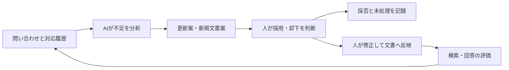

# Treasure AIと、AIを前提に業務・組織を小さくする国内外の事例

調査日：2026年10月6日。日本6社・海外9社、計15社を比較する。日本、米国、カナダ、フランス、スウェーデン、イスラエルの代表事例であり、世界の全企業を網羅した一覧ではない。[出典台帳](treasure_ai_compact_sources_20261006.json)に確認深度と未開示事項を記録した。

## 1. Fluentdの会社はTreasure Dataと考えられる

FluentdをTreasure Dataが開発したことは[CNCFの沿革](https://www.cncf.io/reports/fluentd-project-journey-report/)で確認できる。2026年4月20日に同社は[Treasure AIへのブランド変更](https://www.treasure.ai/blog/treasure-ai-announcement)を発表した。以下のCEO本人の説明が、依頼の「業務をコンパクトにした」事例に合致する。

Fluentd自体は現在CNCFの公開ソフトウェアである。また、Fluentd・Fluent Bitの開発者によるCalyptiaを[Chronosphereが2024年に買収](https://chronosphere.io/news/chronosphere-acquires-calyptia/)している。「Fluentdの会社」という呼び方だけでは一意に定められないが、今回確認した業務再編の当事者はTreasure Dataである。

### 社内で何を変えたか

[2026年6月8日の太田一樹CEOのインタビュー](https://blog.allstarsaas.com/posts/build-or-sell)による。

| 対象 | 変更 | 確認できない点 |
|---|---|---|
| 利用者向け文書 | 2025年3月に文書作成チーム全員を解雇。製品要求仕様書を起点に、製品責任者・GitHub・AIによる生成へ変更 | 人数、公開前の確認基準、誤記率 |
| 営業の情報・道具 | Salesforceと周辺約15製品をほぼ整理し、HubSpotへ集約 | 各製品の代替機能、契約の比較条件 |
| 人事・会計の情報・道具 | 人事・会計システムと周辺約10製品を解約し、データを集約。数億円の費用削減と説明 | 算定期間、移行費用、削減額の内訳 |
| 移行の意思決定 | CEOと財務責任者が主導し、約1年かけて移行 | 部門ごとの移行手順 |
| 内製か購入か | 認可・安全性・管理機能と保守費用を考え、業務ソフトウェアの全面内製は選ばなかった | 全ての代替先の構成 |

一方、開発者の採用は増やす方針である。専任の文書組織をなくした事実から、会社全体の人数が減ったとは断定できない。AIによる作業置換と、既存製品の集約による削減も分けて読む。

### 技術と認可・監査

以下は主に顧客へ提供する製品の公開仕様であり、社内の人事・経理にも同じ設定が実装された証拠ではない。

- **顧客データを検索して回答する。** [公式説明](https://docs.treasure.ai/products/customer-data-platform/ai-agent-foundry/how-do-treasure-data-s-ai-agents-come-up-with-a-response-or-decision)では汎用言語モデルへ検索したデータを渡し、顧客データによる追加学習はしない。宣伝記事の「学習」からモデルへの取り込みを推定しない。
- **実行者の権限を引き継ぐ。** [照会結果の仕様](https://docs.treasure.ai/products/ai-studio/query/query-results)ではAIが利用者自身の権限で動く。照会と結果の取得は別の権限で、結果取得にはCDPのDownload権限が必要になる場合がある。CDPは顧客データを統合する基盤を指す。
- **回答と実行結果を照合する。** 同じ仕様は、AIが書いた表や図が元の照会結果と食い違う可能性を明記する。道具の生の出力と回答を比べ、実行時刻・照会文から処理記録へ遡る。
- **大きな外部操作は人が承認する。** [公式発表](https://www.treasure.ai/blog/treasure-ai-announcement)は必要最小限の権限、改変検知を意図した監査記録、大量の書出しや配信などの既定の人による承認を掲げる。保存期間、承認内容との厳密な一致、取消しの反映時間はこの記事だけでは確認できない。

## 2. 日本の6社：引継ぎと管理作業を減らす

数値は企業の公表値であり、独立した検証値ではない。

| 企業・資料日 | 解決したい課題 | 技術・手順の変更 | 成果と範囲 | 人の責任・未確認事項 |
|---|---|---|---|---|
| メルカリ／2026-09-17 | 開発の分業・引継ぎ、部門間の待ち | AI Podsで一人の開発者がサーバー・携帯・Webを横断。人事とAI推進を一体で組織設計 | 初年度49.5万時間分の効率化と公表。人員削減人数ではない | 最終責任は人。法務など後続工程も変える必要。[当事者対談](https://careers.mercari.com/mercan/articles/63759/) |
| DeNA／2025-11、2026-04 | 社内問い合わせ、根拠不足、文書保守 | Findoutの検索・回答と、Ledgeの対応履歴からの更新案作成 | 回答精度80%から90%超。自社評価であり、全問い合わせの無人解決率ではない | 採否を記録し、人が文書へ反映。次節参照。[導入記事](https://engineering.dena.com/blog/2026/04/ai-helpdesk-knowledge-ledge/) |
| GMOペパボ／2026-05、09更新 | SUZURIの権利侵害画像審査、設備費、障害調査 | 確信度で自動処理と人の審査を分岐。AIが障害記録を調査 | 審査は一人一日約90分から10分の1以下。画像処理の実行単位は平常時80〜90から約40。費用・人員半減ではない | 曖昧な画像と権利の申立ては人。変更案の増加で公開工程が詰まる問題も発生。[責任者対談](https://developers.gmo.jp/technology/83246/) |
| リクルート／2025-10-08 | 広報申請の入力漏れ、転記、日程調整、確認依頼 | 担当者がChatGPTの支援でAppSheetとGASを実装。GASはGoogle Apps Scriptという処理自動化の仕組み | 約2か月で公開し、対象業務の工数56%削減 | AIで通常の自動化を作った事例。業務中の全判断がAIになった証拠ではない。[実装記事](https://techblog.recruit.co.jp/article-5890/) |
| LayerX／2025-12-03 | 採用・労務・営業・開発の情報分断、評価文の準備 | 人事と情報システムを横断する部門を設立。従業員属性・活動記録・AI分析の3層を構想し、活動要約を試行 | 部門設立と試行。統合基盤全体の完成・削減率は未公表 | 管理者が貢献を解釈し対話する。Ripplingは参考例で、導入済みではない。[担当者の記事](https://note.com/mjunya/n/n69e5e8ffe685) |
| サイバーエージェント／2026-07-09 | 設計・実装・試験・文書・監視の負荷 | 約1,200人への利用費支援。AIへ実装・試験を依頼し、人が確認・改善 | 一部組織の開発量約2倍など。全社平均ではない。年間約4億円の当初投資想定を支出が上回った | 2028年の全面自動化は目標。人員削減の証拠ではない。[振返り](https://www.cyberagent.co.jp/news/detail/id=33582) |

### DeNA：自己改善を「提案・採否・反映」に分ける

業務履歴と監査への関心に近い国内事例である。[Ledgeの実装記事](https://engineering.dena.com/blog/2026/04/ai-helpdesk-knowledge-ledge/)では、回答できなかった問い合わせを日次で分析し、既存文書の更新案か新規文書案を作る。人が採用・却下を選び、履歴と未処理件数を見えるようにする。**承認後の本番文書への反映も手動**である。他の担当者の変更の上書きを防ぎ、表現を調整するためだ。リンクの不通・参照権限不足・情報の古さも検出するが、削除や権限拡大をAIが勝手に決める仕組みではない。

[2025年11月の技術記事](https://engineering.dena.com/blog/2025/11/its-ai-journey-rag-tech/)では、Amazon Bedrock Knowledge Bases、OpenSearch、Claude 4 Sonnet、Cohereの検索用数値表現と再順位付けを比較した。公開時の選択は候補100件を再評価して20件に絞り、小・大の階層で文書を分割する方式である。他社への最適値とは扱わない。

検索索引・検索・生成の設定を別々に版管理し、安定した設定と実験対象を区別する。評価結果の保存先も `result` と `result_experimental` に分ける。根拠文書と処理設定の変更を追える構成が重要になる。

## 3. 海外の9社：組織縮小と、能力を伸ばす例

| 企業・地域／資料日 | 解決したい課題 | 技術・手順の変更 | 成果と範囲 | 人の責任・未確認事項 |
|---|---|---|---|---|
| Treasure AI・米国／2026-06-08 | 文書作成、道具の分散 | 文書生成へ転換し、業務製品を集約 | 専任文書チームの廃止、費用削減 | 全社の縮小とは断定できない。第1節参照 |
| Zapier・米国／2026-01-08更新 | 問い合わせの把握、資料、人事の反復作業 | 自社基盤で要約・資料案・社内報告・入社支援を自動化 | Sidekickの要約で平均対応時間半減。社員のAI利用率97%は別の指標 | 顧客対応の無人化や人数半減ではない。[CEOの記事](https://zapier.com/blog/how-zapier-rolled-out-ai/) |
| IBM・米国／2025年の構成を説明 | 国別規則、複数窓口、人事手続きの分断 | AskHRが要求を分類しWorkday・SAP・Concurへ接続。約80手続き自動化 | 人事運用費の4年間で40%減に貢献。定型質問94%を人へ渡さず対応 | 複雑な相談は人。問い合わせ票75%減は2016年以降で生成AI単独効果ではない。[自社導入](https://www.ibm.com/case-studies/ibm-askhr) |
| Box・米国／2026-03ほか | 規程検索、営業準備、重複開発 | 検索の集約、部門のAI担当と中央の連携開発を分担 | 規程を探す時間96%削減という特定業務の値 | 全組織の96%削減ではない。[自社事例](https://community.box.com/general-15/roundtable-highlights-box-s-internal-playbook-to-building-an-ai-first-company-34433) |
| Shopify・カナダ／2026年 | 個人のAI利用で知識が残らない、環境構築、教育 | Riverを社内Slackの共有チャンネルで利用。コード・試験・運用記録を参照。共通基盤Aquifer | 6月の説明では変更案の統合率36%→77%。知識整備が改善に寄与。育成目的の採用は拡大方針 | AI単独では変更を統合しない。人数削減の例ではない。[責任者の説明](https://internships.shopify.com/pages/zero-experience-infinite-leverage) |
| Sanofi・フランス／2026-02-24 | 研究開発投資の根拠集約、会議の確認作業 | Aily Labsと開発したPlaiが10億超のデータ点を集約し、費用・試験期間・成功確率を予測 | 資料確認から将来の判断へ会議の重点が移ったという説明。時短率未開示 | 委員会が決定。人の関与を保つ方針。人数削減の証拠ではない。[導入記事](https://www.sanofi.com/en/magazine/ai-in-healthcare/ai-across-the-research-development-value-chain-portfolio-decision-making) |
| Fiverr・イスラエル／2025-09、2026年年次報告 | 旧来の技術構成と管理階層 | AIを前提に技術・製品を再編し、階層を減らす方針 | 約250人の削減を発表。年次報告で人員約30%縮小の計画と解雇関連費用を確認 | 各職務のAIによる代替の検証は未公表。[CEO文書](https://investors.fiverr.com/node/9736/html)、[年次報告](https://www.sec.gov/Archives/edgar/data/1762301/000117891326000858/zk2634486.htm) |
| Klarna・スウェーデン／2024-02、2025年確認制限あり | 多言語の支払・返金問い合わせ | アプリ内のAI対応と人を選べる窓口 | 初月230万会話、約3分の2の対応、700人相当の作業量 | 700人解雇の人数でも現在の品質でもない。[当初の企業発表](https://www.prnewswire.com/news-releases/klarna-ai-assistant-handles-two-thirds-of-customer-service-chats-in-its-first-month-302072744.html) |
| Duolingo・米国／2025-04-30 | 教材の個別制作と展開時間 | 基礎教材を再利用し、AIと内部の道具で制作・検証 | 148講座を1年未満で制作・公開。主に初級 | 専門家の判断を残す。教育効果の比較実験ではない。[公式発表](https://investors.duolingo.com/news-releases/news-release-details/duolingo-launches-148-new-language-courses) |

### Shopify：共通基盤で保守を集約し、作業記録を残す

[Riverの公式技術記事](https://shopify.engineering/under-the-river)は、共通のソース管理とNixによる再現可能な環境、Aquiferによる会話・実行・記録の共通化を説明する。

| 構成 | 役割 |
|---|---|
| 会話の識別子と追記式の出来事記録 | Postgresへ保存し、実行機械が消えても継続 |
| AIの制御処理 | 履歴・モデル・道具の実行を制御。隔離実行領域の外に配置 |
| 隔離した実行領域 | ファイル変更・試験を実行。破棄・再作成できる |
| 共通の通信・資格情報・監視 | 複数のAI用途で共有し、別基盤の保守を抑える |

経験を文書・技能定義・実行指示の変更として残し、次の処理で使う。対話、変更案の確認、一括処理を共通基盤上の別の設定として提供する。ただし追記式の記録だけで独立監査や改変不能な保存が保証されるとは書かれていない。

[責任者の説明](https://internships.shopify.com/pages/zero-experience-infinite-leverage)では提出者と確認者がコードに責任を持つ。社内共有は社外公開を意味しない。人事・法務・経理へ移す際は、案件の閲覧権限を設計し直す必要がある。

### Box：業務責任と共通の連携開発を分ける

[組織設計記事](https://blog.box.com/ai-first-part-1)では、部門責任者が成果と優先順位を決め、部門のAI担当が利用・改善を管理する。単一業務は部門で作り、複数システムへの参照・書戻しや複数部門の共通機能は中央で作る。既存の法務・情報管理・安全性・購買の審査を更新し、AI専用の承認階層を増やさない方針。人数や正味削減額は未開示。

### Klarna：有名な数字を現在の運用へ持ち込まない

[2025年の上場時開示](https://www.sec.gov/Archives/edgar/data/2003292/000200329225000052/klarnagroupplc424b4.htm)は検索掲載で、2025年6月までの12か月の対応比率69%、2024年の費用削減約3,900万ドル、人による支援との併用を確認した。HTML全文は取得上限とSEC側の拒否で読めず、本文確認済み資料と区別する。当初発表の利益改善4,000万ドルは予測である。両者を同じ実績として合算しない。

## 4. 課題と技術を横断した比較

以下は事例からの本調査の推論・設計案であり、各社の未公開実装を補ったものではない。

| 減らしたい負荷 | 対応する事例 | 技術・業務設計の要点 | 自社で測る指標 |
|---|---|---|---|
| 転記と引継ぎ | Treasure AI、リクルート、IBM | 正本を決め、案件の状態と実行結果を結ぶ | 転記回数、待ち、差戻し、二重処理 |
| 根拠資料の維持 | DeNA、Shopify、Duolingo | 原資料再利用、更新案、版管理、採否記録 | 確認時間、古い情報の誤り、変更後の品質 |
| 道具の保守 | Treasure AI、Box、Shopify | 製品集約と共通接続。内製の保守費も比較 | 契約費、接続数、運用時間、移行費 |
| 定型審査 | GMOペパボ、IBM | 自動対応と例外の引継ぎを分ける | 見逃し、過剰停止、再確認、苦情 |
| 判断材料の準備 | Sanofi、LayerX、Box | 情報の共通構造と根拠の提示 | 準備時間、根拠追跡率、判断後の結果 |

作業を速く作れるだけでは業務全体は小さくならない。メルカリの後続部門の待ち、GMOペパボの公開工程の滞留を踏まえ、受付から実行・検証・監査までを一緒に設計する。出力量やコード行数を成果の代わりにしない。

法務は文案の後の確認・合意・署名・保管、経理は承認・記帳・締め・訂正、人事は定型回答と機微情報を扱う給与変更・評価・異動まで分けて測る。[部門20事例](enterprise_legal_finance_hr_cases_20261006.md)と[データ認可・付与手順](../technology/data_clearance_access_grant_workflows_20261006.md)へ接続する。

## 5. 人の関与、自己改善、監査の設計

人の関与を残す設計は有力だが、全処理で同じ承認を要求する方式ではない。定型回答の自動化、曖昧な審査の引継ぎ、変更案の確認、大きな外部操作の明示承認を使い分ける。

自社の設計案として、以下を案件識別子で結ぶ。

| 記録 | 保存する内容 | 用途 |
|---|---|---|
| 案件と権限 | 利用者・AIの本人性、委任範囲、情報の機密区分、認可判定の版 | 誰が何を見てよかったか |
| 作業 | 原資料と版、検索結果、呼んだ道具、結果、失敗・再試行 | 何を実行したか |
| 判断・承認 | 根拠、変更案、採否、承認範囲、実行前後の状態 | 誰が何を認めたか |
| 改善 | 原因仮説、旧版・新版、評価対象と結果、確認者、適用時刻、戻す手順 | 安全に適用できたか |

記録自身の閲覧・保持・持出しも認可する。AIが述べた理由は説明の資料になるが、認可や外部操作を証明するには実測記録が必要である。各社が全項目を保存しているとは確認できない。

## 6. 自分で問いを提案して掘り下げた経路

3回・9問。前の調査と合わせ21回・69問。

| 回 | ID | 親・起点 | 問い | 調査した回答 |
|---|---|---|---|---|
| 19 | O01 | Fluentdの会社という記憶 | 開発元と業務再編の当事者は一致するか | CNCFの沿革とCEOの説明を照合。Calyptiaと区別 |
| 19 | O02 | O01の作業置換 | 全社の人員削減を意味するか | 文書組織の廃止と開発者採用を区別。Shopifyの採用拡大も確認 |
| 19 | O03 | O02の変更 | 全製品の内製で削減したのか | 既存製品の集約、共通開発、管理された検索基盤を比較 |
| 20 | O04 | O03の基盤 | 保守集約の実装はどこまで公開か | Shopifyの会話・制御・隔離実行、Boxの共通開発、DeNAの検索を確認 |
| 20 | O05 | O04の検索 | 正しさと認可は別の評価か | Treasure AIの照会・結果取得の権限。DeNAの参照不能検出は自動付与ではない |
| 20 | O06 | O04の記憶 | 履歴による自己改善をどこで止めるか | Ledgeの採否履歴・手動反映と、人によるコード統合 |
| 21 | O07 | O06の確認 | 並列処理で確認工程が詰まらないか | 公開・法務の待ちも全体の指標へ含める |
| 21 | O08 | O02・O07 | 人数相当、時短、利用率、目標は別か | IBMの期間、Klarnaの人数相当、限定成果と構想を区別 |
| 21 | O09 | O05・O06 | AIの説明だけで効果と安全を立証できるか | 原資料・処理結果・承認・版・費用を結ぶ設計。未開示を補完しない |

## 7. 確認範囲

一次資料と当事者の説明を優先した。企業の公表値、製品仕様、実装記事、本調査の推論を区別する。人数・売上の変化をAIだけの因果効果とは扱わない。

追加資料はHTMLで確認した。新規PDF・arXivは取得しておらず、既存155本・3,894頁の全頁OCR台帳は変更していない。Klarnaの2025年開示は検索掲載のみ。社内環境での動作試験、第三者監査、費用の再計算は行っていない。
