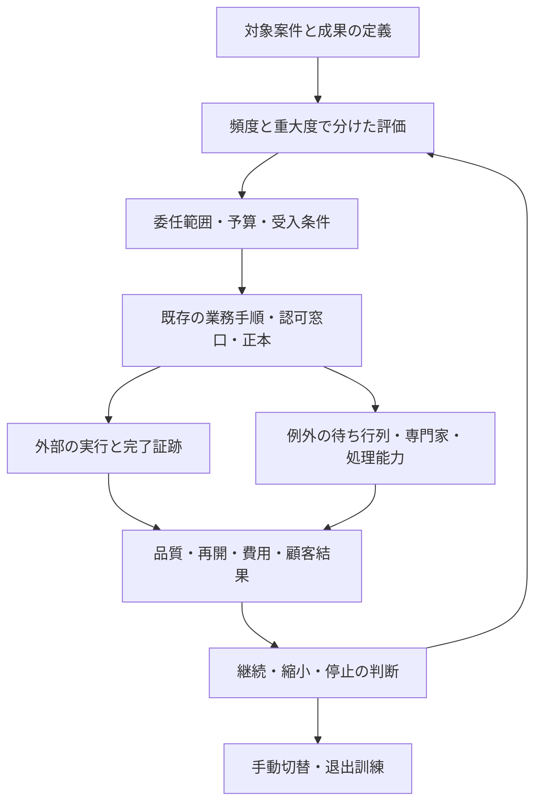

# AIを前提とする企業の拡張調査: 成果・組織・経済性・実行責任

[専門用語の日本語説明](../glossary_ja.md)。製品名・論文の原題・コードは原表記を保持する。

## 調査方法と今回の範囲

[前回の10テーマ](../ai_native_research_audit_20261005.md)から出発し、**問いを作る → 一次資料を調べる → 反証・限界を確認する → 回答から次の問いを作る**というループを3回実施した。15の問いの親子関係、採否、出典の検証深度は[調査ログ](../ai_native_recursive_research_log_20261005.md)に記録した。将来の自動実行を設定したものではなく、今回の調査中に実行したループである。

法務・会計・保険に加え、顧客対応、調達、人事、医療周辺業務、エージェントによる支払いを対象に広げた。さらに企業の生産性、組織・育成、成果の契約、例外処理の能力、評価者の評価、事業継続を扱う。2026年10月5日までの公開資料を対象とする。企業の製品説明、研究の結果、本レポートの推論・設計案を分け、社内運用を実証したとは記述しない。

今回の中心仮説は、**業務の完了条件、委任できる範囲、例外を処理する能力、成果を検証する証跡を一体で設計すると、AI の局所的な効果を企業の成果につなげやすい**というもの。ただし、この因果関係を自社で検証した結果ではない。

## ループ1: 既存調査の前提を広げる

### Q01. AIを前提とする企業の「成功」を何で判定するべきか

**起点:** 前回は自律完了率・時短・採用率を区別した。しかし、いずれも会社全体の成果とは同じではない。

**調査で確認:** 2026年の *Firm Data on AI* は米英独豪の約6,000人の経営層を調査し、69%の企業が AI を利用する一方、約9割が過去3年の雇用・生産性への影響なしと回答した。将来の期待と過去の自己申告を分けている。これは「AI に効果がない」ことの実験的証明ではない。[NBER・要旨](https://www.nber.org/papers/w34836)

**回答・設計案:** 成功は最低でも四層で測る。①課題の品質・時間、②案件の完了・再処理・顧客結果、③部署の処理量・待ち時間・人の負担、④企業の粗利・売上・キャッシュ・事故損失。上流の文書生成が速くなっても、審査待ちが増えれば案件の完了は速くならない。

| 層 | 正の指標 | 同時に測る反証指標 |
|---|---|---|
| 課題 | 抽出精度、作業時間 | 見落とし、誤引用、修正時間 |
| 案件 | 正しく完了した件数、所要日数 | 再開、再問い合わせ、取消し、未処理 |
| 部署 | 同じ人員での処理量 | 例外待ち行列、残業、レビューの集中 |
| 企業 | 貢献利益、継続率、売上への寄与 | 全費用、苦情・損失、他部署への負担移転 |

**次の問い:** Q06で「成果」を契約へ落とす。Q14で採算が反転する条件を計算する。

### Q02. 法務以外では、どこまで AI が業務を担っているか

**調査で確認:** 以下は公表された機能・運用境界の比較であり、全社無人化や日本での導入可否を示す表ではない。

| 拡張領域・事例 | 確認した範囲 | 全社展開への推論と残る問い |
|---|---|---|
| 顧客対応 / Sierra | 業務成果に応じた料金設計を掲げ、顧客対応作業主体のAI を提供 | 契約で何を達成と数えるかが核心。個別の単価・責任条項は非公開。[製品](https://sierra.ai/product) |
| 調達 / Zip | SAP の提携製品掲載は、購入申請作成前の確認作業・承認業務手順と規則に沿った申請の受け付けを説明 | 調達・法務・安全性・予算をつなぐ境界が参照点。全支払いが自律化した証拠ではない。[SAP掲載](https://www.sap.com/uk/products/spend-management/partners/ziphq-inc-zip-ai-agentic-procurement-orchestration.html) |
| 人事 / Workday | 候補者の探索、候補者の選考、面接日程・連絡を自動化対象とし、採用判断は人へ残すと説明 | 日程調整と候補者評価では影響・異議申立ての条件が違う。提供企業の説明は無差別性の独立検証ではない。[作業主体のAI製品](https://www.workday.com/en-us/artificial-intelligence/ai-agents/talent-acquisition.html)、[判断の境界](https://blog.workday.com/en-us/demystifying-ai-hiring-clarifying-how-workdays-recruiting-tools-work.html) |
| 医療周辺 / Hippocratic AI | 2024年の Polaris 1.0 は診断を行わないな患者対応を説明。現行安全性ページは臨床家による評価、監督、人の看護師への専門家への引き継ぎを掲載 | 対話の完了と患者の安全・診断の妥当性は別。日本の医療への適用を確認したものではない。[当初の対象](https://hippocraticai.com/polaris-1/)、[現行安全設計](https://hippocraticai.com/safety/) |

**回答:** 共通する参照点は、業務データ・次工程・利用者との接点・例外経路を持つこと。自動化の程度は業務ごとに異なり、医療のモデル構成を法務へそのまま移しても安全性は移転しない。前回の Harper / Panta / Crosby / Basis と合わせると、道具、業務基盤、専門家を含むサービス、自ら事業を営む企業という四形態を比較できる。[前回の企業比較](../benchmarks/ai_native_companies_20261005.md)

**次の問い:** Q06で成果の帰属、Q10で調達から支払いへの委任を調べる。

### Q03. 組織は「人を作業主体のAI に置き換える」だけでよいか

**調査で確認:** P&G の776人による事前登録済み実験は、製品開発の課題で個人+AI が AI なしのチームに匹敵する性能を示し、専門部門を越えた提案を促したと報告する。単一企業・特定課題の結果であり、組織全体の人員削減を実証していない。[The Cybernetic Teammate・要旨](https://www.nber.org/papers/w33641)

顧客サポートの *Generative AI at Work* の arXiv v2 は5,172人、時間当たり解決件数の平均15%増を報告し、経験の浅い人の改善と熟練者の小さい効果を区別する。NBER の古い掲載要旨は5,179人・14%で、版を混ぜない。[arXiv v2](https://arxiv.org/abs/2304.11771v2)、[NBER掲載](https://www.nber.org/papers/w31161)

**回答・推論:** 職種単位の代替率だけでなく、専門知識の共有と担当範囲の再設計を調べる。専門家は、高難度案件、評価ラベル、例外パターン、育成、ルール変更を担う設計にする。AI が新人を助ける効果と、新人が独力で判断できるようになる効果は別に測る。

**次の問い:** Q07で専門家へ集まる負荷、Q13で監督者の能力維持を調べる。

### Q04. 作業の時短と企業の生産性の間に、何があるか

**調査で確認:** *Productivity J-Curve* は、新しい汎用技術には業務・組織・人的資本等への補完投資が必要で、無形資産の測定が生産性の観測を難しくすると論じる。将来必ず採算が取れるという主張ではない。[研究要旨](https://www.nber.org/papers/w25148)

約750人の経営層を扱う別の2026年研究は、部門差と生産性への正の効果を報告しつつ、認識した改善と測定した改善の差を論じる。Q01の約6,000人調査と対象・指標が異なるため、二つの平均を合算しない。[別調査の要旨](https://www.nber.org/papers/w34984)

**回答・設計案:** AI 費用に加え、データ整理、連携、監督、教育、運用、顧客獲得、移行を投資台帳に記録する。削減時間を①現金費用削減、②処理余力、③売上機会、④品質向上に分け、未使用の余力を現金利益に換算しない。人を減らさず案件が増えた場合、効果は処理能力や売上で測る。

**次の問い:** Q07でボトルネック、Q14で固定費と例外率の感度を見る。

### Q05. 最新能力比較の試験の点数で本番の作業主体のAI を選べるか

**調査で確認:** APEX-Agents は投資銀行・企業法務・経営助言の長時間・複数アプリ作業を480件で評価する。2026年2月23日の v3 要旨の最高 Pass@1 は24.0%。これは当該モデル・周辺実行基盤・予算・課題の結果であり、2026年10月の最新モデルの上限ではない。[論文要旨v3](https://arxiv.org/abs/2601.14242v3)、[課題設計の当事者説明](https://www.mercor.space/blog/introducing-apex-agents/)

τ-bench は課題の終端 DB 状態を目標と比較し、繰り返しの一貫性を `pass^k` で評価する。2024年の結果を現行順位として扱わず、**一回でも成功する確率 `pass@k` と k 回全て成功する確率 `pass^k` を区別する考え方**を採用する。[論文・本文](https://arxiv.org/html/2406.12045v1)

**回答:** 公開能力比較の試験は候補を探す入口。選定には自社の課題構成、接続権限、日本語、実行予算、再試行、完了判定での評価が必要。承認を求めた回数や作業主体のAI の自己申告では、業務成功を判定しない。

**次の問い:** Q08で課題分布の差、Q09で複数の作業主体のAI の効果を検証する。

## ループ2: 回答を業務の仕組みへ落とす

### Q06. 成果報酬なら顧客と提供企業の利害は一致するか

**親:** Q01・Q02。成果を買うには何を「成果」と呼べるかが必要になる。

**追加調査:** Sierra の2026年6月の記事自身が、成果料金設計は運用・契約・会計面で複雑であり、高い自律性と成果の明確な帰属が必要と述べる。公表方針であって、個別契約の保証や損害補償ではない。[当事者の説明](https://sierra.ai/blog/outcomemaxxing)

**回答・契約設計案:** 「作業主体のAI が問い合わせ案件を閉じた」を成果にすると、再問い合わせや誤った解決を見落とす。例えば顧客対応の完了は、対象意図を解決し、約束した処理が成立し、所定期間に同じ理由で再開しないことを確認する。ただし観測期間と再開の帰属は契約で定める。法務は確認作業の納品と適法な締結を、調達は発注と納品・検収を区別する。

| 契約・社内原価計算で先に決める項目 | 内容案 |
|---|---|
| 対象と分母 | 対象案件、除外理由、拒否・人への引継ぎの扱い |
| 完了条件 | DB・相手先・顧客のどの証跡で確定するか |
| 観測期間 | 再開、取消し、返金、訂正をいつまで追うか |
| 責任分担 | 自社データ、提供企業、第三者 API、人の承認の責任と調査義務 |
| 費用と救済 | 失敗・再試行・移管の料金、上限、返金、事故時の連絡 |
| 退出 | 正本・設定・評価・証跡の持ち出しと移行支援 |

**反証条件:** 契約上の成功件数が増えても、再開・苦情・損失を含めた顧客結果が悪化すれば利害一致の仮説を棄却する。条項の法的有効性は今回判定していない。

**次の問い:** Q14の採算、Q15の退出へ。

### Q07. 例外だけを人へ返すと、本当に少人数で運営できるか

**親:** Q03・Q04。AI が速くなるほど、専門家への到着量も増え得る。

**追加調査:** Google SRE の運用過負荷の章は、割り込み・待ち行列・優先順位と実負荷を測る必要を論じる。サーバー向けの過負荷の章は受付制御と再試行の回数・費用の上限を扱う。これを人の審査へ転用する以下の案は、本レポートの推論である。[人的な運用負荷](https://sre.google/workbook/overload/)、[システムの負荷制御](https://sre.google/sre-book/handling-overload/)

**試算（架空条件）:** 1日1,000件、例外10%、1件15分なら審査は25時間/日。3人が各6時間を使えるなら能力は18時間/日で、平均到着量だけでも超過する。自律率90%という数字と少人数運営は両立しない場合がある。例外5%なら12.5時間/日だが、締切の集中、同時障害、難案件の長い処理時間で再び詰まり得る。

**回答・設計案:** 例外率だけでなく、案件種別ごとの到着量、審査時間分布、対応可能な専門家、期限、営業時間を測る。待ち行列が閾値を越えたら新規受付・自律範囲を制限し、期限を伝え、人へ配分する。過負荷を理由に承認の条件を緩めない。作業主体のAI の再試行が新しい例外を大量に作らないよう予算を置く。

**次の問い:** Q12の停止・再試行、Q13の監督品質へ。

### Q08. 自社に合う評価セットは、どう作るか

**親:** Q05。平均点より、頻出する失敗の構成が問題になる。

**追加調査:** 2026年の *Artificial Jagged Intelligence* は、公開能力比較の試験と導入先の課題分布の差をモデル化し、自社で多い課題が苦手なら公開平均より損失が大きくなると説明する。[NBER・理論研究要旨](https://www.nber.org/papers/w34712)

2026年8月の DDR 査読前論文は TheAgentCompany、τ²-bench、AppWorld の実行の経緯に対する分散分析から作業主体のAI と課題の相互作用を強調する。PDFの関連本文まで確認したが、統計推定・コードは再現していない。[DDR・要旨](https://arxiv.org/abs/2608.11323v1)

**回答・設計案:** 自社案件を業務種別、難度、言語、情報欠落、法域、データ量、例外、権限、外部副作用に分ける。実際の頻度で重み付けした期待費用に加え、低頻度・高損失の群を独立評価する。最も難しい群を平均で隠さず、棄却して人へ返した群も測る。過去の同一顧客・案件を学習と評価へ分散させない。

**統計上の限界（独自計算）:** 独立・同じ確率の試行を仮定し、300件で重大失敗が0件でも、片側95%の失敗率上限は約0.994%。0件から上限を0.1%未満にするには約2,995件が必要。これは品質保証ではなく、少数の「全件成功」を過信しないための二項モデルによる例である。案件の相関や分布変化があればこの計算の前提も崩れる。

**次の問い:** Q11で判定者を、Q14で損失を検証する。

### Q09. 複数の作業主体のAI を置くと、品質と費用はどう変わるか

**親:** Q03・Q05。専門部門の協働に似せれば自動的に改善するかを問う。

**追加調査:** MAST の2025年 v3 は、設計、作業主体のAI 間の不整合、課題検証にまたがる14の失敗モードを整理する。複数の作業主体のAI だから安全になるという一般的な保証は得られない。[論文要旨](https://arxiv.org/abs/2503.13657v3)

一方 Anthropic の2025年6月の内部研究評価は、並列に調べられる課題で複数の作業主体のAI が単一作業主体のAI を上回ったと報告する。処理する文章の単位使用は通常の対話比で作業主体のAI が約4倍、複数の作業主体のAI が約15倍という同社データで、**複数の作業主体のAI が単一作業主体のAI の15倍**とは述べていない。共通共有する文脈・依存の多い課題には不向きな場合も説明する。[当事者の実装報告](https://www.anthropic.com/engineering/multi-agent-research-system)

**回答・実験案:** 単一作業主体のAI、固定業務手順 + 単一作業主体のAI、役割を分けた複数の作業主体のAI を、同じ入力・総予算・制限時間・道具で比較する。モデル差と総処理する文章の単位増加を役割分割の効果と混ぜない。重複作業、矛盾、失敗原因の特定時間、終了しない反復調査も費用に含める。

**推論:** 専門家役を増やす前に、入力・出力の契約、正本、誰が最終状態を確定するかを定義する。相互に「妥当」と言い合っても、独立した根拠は増えない。

**次の問い:** Q11の評価者評価へ。

### Q10. 作業主体のAI に購入・支払いを委任するには何が足りないか

**親:** Q02・Q06。道具の実行許可から、財務上の権限へ範囲を広げる。

**追加調査:** Google は2026年4月28日、AP2 の FIDO Alliance への寄贈と v0.2 の人がその場にいない取引への対応を発表した。AP2 の認可文書は、事前承認した事前の包括的な委任証跡を個別取引の個別取引に固定した委任証跡へ結び付け、制約と署名を検証する方式を説明する。[発表](https://blog.google/products-and-platforms/platforms/google-pay/agent-payments-protocol-fido-alliance/)、[確認した固定版の認可文書](https://github.com/google-agentic-commerce/AP2/blob/e1ea56db72a6385bce3e5c1112b3a56ce60acb43/docs/ap2/agent_authorization.md)

**回答・推論:** 自社の委任は取引先、品目、金額・通貨、期間、費目、累積上限、予算、権限者、取消し条件を機械検証できる形にする。自然言語の「必要なら買ってよい」だけでは曖昧さが残る。AP2 の署名があることと、その購入が社内規程・契約・法令に適合することは別に判定する。

前回の承認受け渡す内容の固定に加え、継続委任では取引ごとの残予算と消費履歴が必要になる。作業主体のAI に会社の署名鍵を直接渡さず、権限検証側に置く設計を採る。AP2 採用済み、銀行 API 接続済み、契約上の責任解決済みという意味ではない。

**次の問い:** Q12で二重実行と残予算の競合を調べる。

## ループ3: 反証と運用限界を調べる

### Q11. AI の自己検証・自己修正を、どこまで信用できるか

**親:** Q08・Q09。生成者と評価者の合意を正解と誤認しないために調べる。

**反証調査:** 2023年のモデルによる採点研究は位置・長さ・自己選好等の偏りを扱う。2026年6月改訂の研究も、表現形式と長さの偏り、対策による差を報告する。検索抜粋の古い値からではなく、改訂版 v2 の要旨で確認した。[2023年研究](https://arxiv.org/abs/2306.05685)、[2026年研究v2](https://arxiv.org/abs/2604.23178v2)

自己修正については、2023年研究が外部修正のための情報なしの推論修正の限界を報告する一方、2024年の SCoRe は専用の多段強化学習学習で MATH / HumanEval の改善を報告する。「自己修正は常に無効」も「反省させれば改善」も支持しない。[限界の研究](https://arxiv.org/abs/2310.01798)、[学習による改善](https://arxiv.org/abs/2409.12917v2)

**回答・設計案:** 件数・金額・権限・DB 状態は決定的検査へ、法律上の妥当性等は専門家ラベルへ、文章の読みやすさ等は較正した採点者へ分ける。採点者は人との一致、重大誤許可、表現変更への感度を別々に測る。生成・採点に同じ材料の欠落があれば、モデルを変えても独立性を保証できない。

**反証条件:** 表現だけの変更で採否が変わる、誤答の相互承認が増える、自己修正後に正答が壊れるなら昇格を止める。今回の調査反復調査も、自分の推論を自分で確認するだけで終えず、外部一次資料で限定した。

**残る問い:** 日本語法務・社内規程での採点者の較正と誤許可率は未測定。

### Q12. 正しく承認した取引でも、再試行で事故は起きないか

**親:** Q07・Q10。認可と「一度だけ実行」は別である。

**追加調査:** Stripe は同じ重複防止の識別子の初回結果を返すが、24時間以上経過した識別子は削除でき、削除後の再利用は新しい依頼になると明記する。外部 API の重複防止を無期限だと仮定できない。[公式API資料](https://docs.stripe.com/api/idempotent_requests)

AP2 の固定版は未知の制約を不合格として扱い、取引へ結び付けた委任証跡と受領記録を検証・保存する方式を定義する。受領記録の `success` はこの文書では **操作認可の結果**であり、銀行での最終決済・納品・検収の完了と同じではない。[固定版の検証・receipt規定](https://github.com/google-agentic-commerce/AP2/blob/e1ea56db72a6385bce3e5c1112b3a56ce60acb43/docs/ap2/agent_authorization.md)

**回答・実装検証案:** 自社の操作ID を永続管理し、状態を `prepared → authorized → submitted → confirmed / uncertain / failed` に分ける。時間切れで結果が不明なら、無条件に新識別子で送らず相手先の結果を照会する。残予算の予約・消費は同時実行を含めて原子的に管理する。認可成功、API 成功、決済成立、会計照合を別イベントにする。

**検証する反例:** 同じ依頼の二重配送、成功直後の通信断、外部識別子の保存期限超過、権限失効、金額変更、二つの作業主体のAI の残予算競合、未知の制約。停止した後の待ち行列・処理中取引も対象にする。復旧時に処理する文章の単位を再発行するだけで未確定取引を消さない。

**残る問い:** 自社の銀行・ERP・電子署名 API の保存期限、照会、取消し、競合処理は未確認。

### Q13. 「人が最後に承認する」なら監督は機能するか

**親:** Q03・Q07・Q11。人を置くだけで判断力・時間・情報が揃うわけではない。

**反証調査:** 採用担当者22人への2026年研究は、最終権限が人にあるという認識と、AI が職務定義・評価材料を形作ることとの衝突を報告する。インタビューであり、全採用現場の因果効果や Workday 特定製品の違法性を示すものではない。[研究要旨](https://arxiv.org/abs/2604.26851v1)

Anthropic の2026年6月の利用者調査は、委任の多い人にも学習の自己申告が見られる一方、自己申告では技能低下を除外できないと述べる。対象は Claude 利用者の選択された調査対象で、全労働者を代表しない。[調査と限界](https://www.anthropic.com/research/economic-index-june-2026-report)

**回答・組織設計案:** 承認者へ原典、AI の提案、変更差分、欠落情報、影響範囲、期限を渡す。否認・保留・訂正する権限と時間も確保する。通常案件の抜取検査を残し、例外検知が見逃した案件を測る。専門家の継続育成には、AI 提案を見る前の独立判断や停止時の模擬対応を使う。

NIST AI RMF の統治・状況把握・測定・管理は継続的な管理の枠組みであり、承認利用画面や認証の導入だけで完了する確認項目の一覧ではない。[NIST Core](https://airc.nist.gov/airmf-resources/airmf/5-sec-core/)

**反証条件:** AI の提案に従う率は高いが、仕込んだ重要な誤りを見つけられない、否認すると期限評価で不利になる、停止時に手動運用できないなら、その監督体制を有効と判定しない。

**残る問い:** 社内の監督者数・技能・手動復旧能力と、採用候補者等の異議申立て経路は未確認。

### Q14. どの条件で AI 業務の採算が逆転するか

**親:** Q01・Q04・Q06・Q07・Q08。平均時短を採算に変換する計算を検証する。

**独自の試算:** 以下は実績・見積りではなく、感度を見る架空条件。人のみは1件30分、時間原価6,000円（100円/分）で3,000円。AI は1件の計算・API費200円、月間固定運用費100万円、月1,000件。例外は通常確認作業に追加で30分かかると仮定する。

`AI原価/件 = 200 + (確認作業の分数 + 例外率 × 30) × 100 + 1,000,000 / 月間件数`

| 条件 | 確認作業 | 例外率 | AI原価/件 | 人のみとの差（正が節約） |
|---|---:|---:|---:|---:|
| 軽い負担 | 3分 | 5% | 1,650円 | +1,350円 |
| 基準 | 6分 | 20% | 2,400円 | +600円 |
| 負担増 | 10分 | 40% | 3,400円 | -400円 |

基準ケースでも月500件なら固定費の配賦が2,000円/件となり、総原価は3,400円/件へ上がる。件数増加で固定費が薄まる一方、Q07の人の能力制約を越えれば確認作業費・待ち時間が増えるので、規模による一律の改善は仮定しない。

**損失感度:** 1件10万円の損失が起きる確率を便宜的に0.1%とすると、期待損失は100円/件。1%なら1,000円/件で、基準の600円の節約を上回る。これは事故頻度の予測ではない。比較では人のみの期待損失も同じ方法で差し引き、法的・安全上の許容条件は平均金額だけで置き換えない。

**回答:** 原価は品質を満たした完了案件を分母にし、失敗・再試行・人へ返した案件の費用を分子へ残す。売上増加、継続率、現金支出削減は別々に追う。時間単価による潜在価値を、そのまま実現利益と呼ばない。

**反証条件:** 頻出案件でも品質を揃えた完了原価が人のみより高い、現金削減・売上増・品質改善のいずれも出ない、事故損失や待ち時間を加えると便益が消える場合は、対象範囲縮小・別方式・中止を比較する。

**残る問い:** 実案件分布、原価、損失、売上への寄与、提供企業の最低料金は未取得。

### Q15. 安い・高性能な提供企業への依存は、退出可能性と両立するか

**親:** Q02・Q06・Q10・Q12。個々の API だけでなく業務状態の移行を問う。

**追加調査:** 欧州委員会の Data Act 説明はクラウドサービスの切り替え、機械可読形式での持ち出し、対象データ・説明用の付随情報を扱い、移行手数料の撤廃日を2027年1月12日と説明する。2026年10月5日の時点で既に全手数料がゼロとは扱わない。サービス提供者の知財・営業秘密を除く境界もある。[公式説明・第6章](https://digital-strategy.ec.europa.eu/en/factpages/data-act-explained)

**回答・推論:** 法的な持ち出しがあっても、権限、正本 ID、業務手順の状態、未確定取引、承認受け渡す内容、評価セット、モデル振り分け、構造定義の意味まで移せるとは限らない。個別サービス・自社契約への Data Act 適用は別途確認する。前回の製品終了事例から導いた退出設計を、今回の状態・責任まで広げる。[前回の終了事例](../benchmarks/ai_native_companies_20261005.md)

**退出訓練案:** 一つの案件で原文・構造化データ・ACL・承認・イベント・未確定処理を持ち出しし、別の実行基盤か手動運用で完了できるかを試す。共有の取引先 ID、業務手順構造定義、評価データは自社管理を候補にする。裏側の実行サービス変更後の品質・権限・費用を再評価し、二重稼働期間と外部副作用の排他を計画する。

**反証条件:** 文書は取り出せるが、誰が何を承認したか、未確定処理はどれか、誰が閲覧できるかを再構成できなければ退出可能と判定しない。

**残る問い:** 自社候補の持ち出し範囲、移行時間、最低契約期間、終了時の削除・証跡保持条件は未確認。

## 既存設計へ加えるもの

前回の認可・IFC・状態を保持する継続実行・メモリ分離を維持し、その外側へ業務成果と運用能力を追加する設計案。

| 追加する管理対象 | 最低限の記録案 | 接続先 |
|---|---|---|
| 成果 | 対象となる件数・試行した件数・合格した件数・再開した件数、根拠、観測期間 | 業務 DB と Q06の契約定義 |
| 委任 | 対象、期間、上限、権限者、残予算、失効 | Q10〜12と既存承認対象 |
| 例外能力 | 待ち時間、期限、技能別到着量・処理時間、当番 | Q07・Q13と人への切替 |
| 品質 | 群別成績、重大不備、棄却、採点者較正、版 | Q08・Q11と変更管理 |
| 原価 | 全試行費、人の時間、固定費、損失、完了件数 | Q14と投資台帳 |
| 退出 | 持ち出した資料の一覧、正本ID、未確定処理、復元結果 | Q15と障害運用手順書 |

## 次の調査を選ぶための優先順位

次の公開資料調査と、自社データが必要な検証を分ける。公開資料だけで社内の採算・監督能力を確定しない。

1. **優先度A・社内検証:** 一つの業務について入力から完了までの処理の出来事、原価、例外、再開を集める。Celonis が示す最小の作業記録は案件ID・活動・時刻。これに本設計の版・実行主体・結果・費用を追加する案。[公式資料](https://docs.celonis.com/en/event-logs--file-upload-)
2. **優先度A・社内検証:** 同じ案件で人のみ、AI下書き、固定業務手順、限定自律を比較し、Q07・Q08・Q14の値を埋める。期限超過・取りこぼしも対象にする。
3. **優先度A・契約/接続確認:** 調達・支払い・署名の操作権限と、認可・API成功・業務完了それぞれの証跡を確認する。
4. **優先度B・公開資料追跡:** APEX / τ系の新しい課題・周辺実行基盤と AP2 の仕様変更を追う。順位だけでなく版・予算・公開データの範囲を確認する。
5. **優先度B・追加実証:** 監督者の誤り検知、技能維持、異議申立て、手動復旧、退出訓練を評価する。

製造の物理操作、営業・広告の因果効果、税務申告、規制産業の免許、企業の署名・取締役責任、電力・環境費、競争優位の持続性は今回の15問で十分に調べていない。広く列挙しただけで「調査済み」にせず、次の反復調査候補として[ログ](../ai_native_recursive_research_log_20261005.md)に残す。
