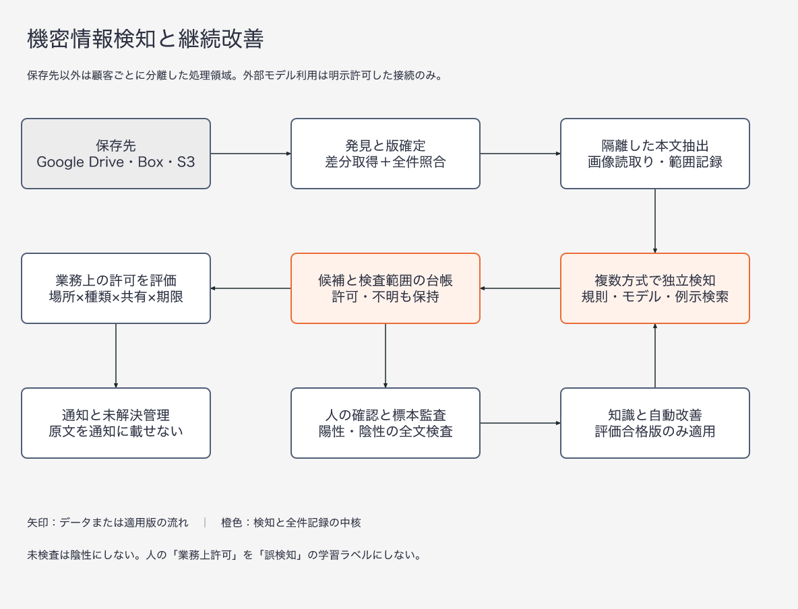
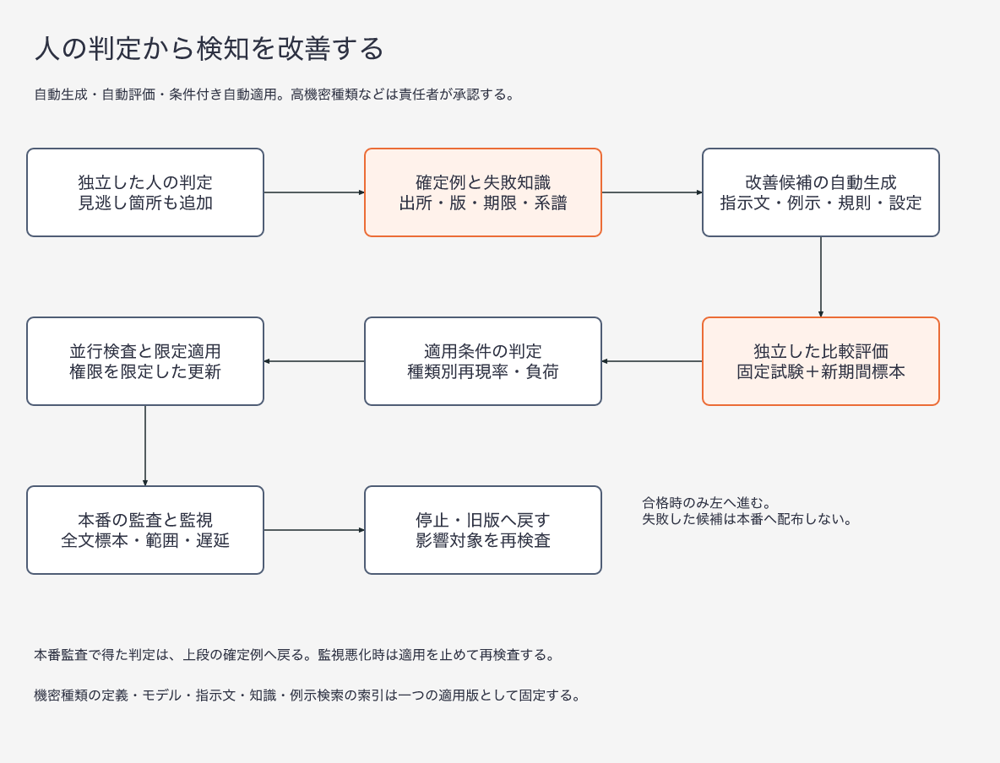

# 人の判定から改善する機密情報検知サービスの設計

設計日：2026年11月11日。DLPは機密情報の検知・漏えい防止、HITLは人が判断過程に参加する方式を指す。本案はGoogle Driveを初期対象とし、Box・S3・ファイル保存領域へ拡張する保存済みデータの検査サービスである。送信前の遮断は別の同期処理経路とし、本案の非同期検査に漏えい前の遮断保証を持たせない。

**全件の検査範囲を記録し、異なる検知方式の候補を合算し、人の確定判定と全状態の無作為全文監査から改善候補を作る。改善候補の生成と評価は自動実行し、評価で悪化を検出した版や採用条件を満たさない版は自動採用しない。** 「使うほど必ず精度が上がる」「全モデルの一致なら安全」とは約束しない。追加する種類や文書の変化によって精度は下がり得るため、種類・言語・形式ごとの見逃し率と未検査率を監視する。

本稿の数値・構成は設計提案であり、実測性能ではない。公開情報と設計上の仮定だけを含む。運用時の原文や人の判定は顧客環境に保存し、この公開リポジトリへ転記しない。[既存製品比較](dlp_detection_formats_accuracy_matrix_20261111.md)、[API比較](dlp_related_services_api_matrix_20261111.md)、[公開自作事例](dlp_self_built_cases_20261111.md)を前提とする。

2026年11月12日改訂：公開論文・公開ソフトウェア・他製品の公開仕様を再調査し、(1) 承認済み確定例を検索して例示にする追加検知、(2) 検索基盤と検索用ベクトルの保護、(3) 派生文書の群化、(4) 秘密鍵の有効性検証・ひな形照合・近接語による加減点、(5) 失敗知識の項目単位更新、(6) 指示文探索の過適合対策、(7) 抽出確率を保った重み付き監査と統計的推定、(8) 記憶汚染などの攻撃試験を追加した。[改訂の記録](adaptive_dlp_adversarial_review_20261111.md#2026年11月12日の改訂)。引用した論文の数値は原典の条件での結果であり、本サービスでの効果ではない。

## 要件と基本方針

| 要件 | 採用する仕組み | 成立しない近道 |
|---|---|---|
| 見逃しを減らす | 規則・日本語固有名抽出・専用モデル・文脈モデル、画像と本文の別経路、陰性標本の人手検査 | 同一モデルを同じ入力で何度も呼べば独立した証拠になる |
| 指定フォルダーの氏名・電話は通知不要 | 全候補台帳へ登録後、場所×種類×共有範囲×期限で通知だけを抑制 | 検知器の除外語に入れる、ファイル全体を永久無視する |
| 自動改善 | 確定判定→失敗分類→指示文・規則・例示の候補生成→独立評価→限定適用→戻し | モデル自身の回答をそのまま正解とする |
| 知識を蓄積 | 出所・適用範囲・版・失効期限のある失敗知識と確定例。項目単位で追記・訂正し、元の判定へ戻れる。検知に使う検索対象は承認済みの確定例だけ | 未確認の文書指示を全顧客共通の記憶にする、知識全体を言語モデルに要約し直させる |
| 自由な種類追加 | 宣言型の種類定義、複数検知器、文書分類と箇所検出の両方 | 自然言語の定義を入力すれば未知分野でも精度保証 |
| API運用 | 検査・全件台帳・判定・許可・版・検査範囲を別の呼出し口にする | 警告一覧を全検知一覧とみなす |

## 全体構成

処理は二つに分ける。検査系は「保存先→発見と版確定→抽出→複数検知→全件台帳→許可規則→通知」。改善系は「人の判定と全状態の無作為全文監査→確定例と知識→候補生成→独立評価→適用版の更新→再検査」である。改善系は原本の削除・共有変更・許可規則の変更権限を持たない。

初期構成は、接続処理とAPI、永続的な作業待ち行列、隔離した抽出処理、検知処理群、PostgreSQLの台帳、暗号化した短期証拠領域、版付きの定義保管、評価処理、確認画面。部品は分離するが、最初から多数の独立サービスへ分割する必要はない。GPUを使うモデル処理と危険なファイル解析は独立した実行環境にする。

### 隔離実行の構成

2026年11月12日追補：[隔離実行の詳細設計](adaptive_dlp_sandbox_design_20261112.md)を本設計の実行契約とする。既存の隔離方式・通信制御・GPU推論・状態復元の調査を統合した。実装・侵入試験・性能測定は未実施であり、以下の方式は受入試験に合格してから本番へ投入する。

| 境界 | 採用する設計 |
|---|---|
| 保存先接続と解析 | Drive等の資格情報を接続部に置き、解析部へ当該原文版だけを読取り専用で渡す |
| CPUでの抽出・検知 | 顧客・原文版・試行ごとに分離。gVisorを第一候補に適合試験し、不適合なら停止。承認した仮想機械構成へ切り替える場合も再試験 |
| GPU推論 | 解析とは別の顧客専用計算機。異なる顧客の同時共有を初期版では認めず、管理側が要求と応答を対応付ける |
| 通信 | 解析部は通信と名前解決を禁止。外部モデル・鍵の有効性照会は明示許可された専用代理部だけから実行 |
| 結果の搬出 | 外側で固定した出力の形式・容量・原文版・帰属を検証。顧客IDや通知先を処理結果の自己申告から決めない |
| 改善と評価 | 改善器は候補だけを生成。実行方式・通信・資格情報・採用試験を変更できず、評価用正解も取得できない |
| 終了と破棄 | 取消後の結果採用を拒否。原文投入後の状態保存・複製は初期版で禁止。破棄失敗した領域は再利用しない |

実行環境の検証前に原文を搬入しない。隔離・通信・認可の適用に失敗した作業は停止し、検査範囲へ失敗または部分検査を記録する。検知が陰性でも外部送信の権限を増やさない。sandboxは検知の見逃しを埋める仕組みではなく、見逃しが起きても禁止した操作をさせない境界として使う。

作業には `runtime_profile_id`、`isolation_policy_version`、`attempt_id`、`authorization_generation` と破棄状態を記録する。同じ検知構成でも実行環境が変われば互換性・隔離・性能を再検証する。認可、検査完了、破棄完了は別の状態として扱う。具体的な入力・出力契約、資源上限、GPUの再割当、削除伝播と試験項目は詳細設計に従う。

### 保存先の発見と検査範囲

1. 認可された保存先・フォルダーID・共有ドライブIDを登録する。パス文字列ではなく親子関係で配下を判断する。ショートカットは対象の実体と認可を別確認し、循環を防ぐ。
2. 初回は変更取得の開始位置を先に記録し、全件列挙後にその位置から変更を取り込む。差分取得に加え定期的な全件照合で漏れを探す。Driveの変更取得は公式APIの方式に従う。[S1]
3. 取得前後の版・更新時刻を比較する。処理中に内容が変わったら旧版の結果として保存し、現行版に昇格せず再投入する。元サービスが一貫した読取りを保証しない場合は、その不確実性を残す。
4. ページ送りの途中失敗、権限喪失、容量超過、未対応形式、展開限界、外部APIの打切りを明示する。取得成功やHTTP 202は検査完了ではない。
5. 作業の識別子は `tenant_id + object_id + content_revision + extraction_version + detector_bundle_version`。同一作業の再送で候補を重複登録しない。共有・場所・許可規則の変更は本文検査と独立して再評価する。

検査範囲はファイル単位の真偽値ではなく、部品単位で管理する。`discovered → fetched → extracted → scanned` の進行に加え、`partial / unsupported / failed / stale / access_lost` を保持する。ここで `scanned` は必要な検知器が指定範囲を実行した状態であり、安全の証明ではない。未検査を陰性として集計しない。全件数が分からない接続では「見えている対象の検査率」と「保存先全体の網羅性未確認」を併記する。

### 抽出する形式と失敗時の動作

| 形式 | 抽出対象 | 部分検査を生む条件と対処 |
|---|---|---|
| Google Docs・Sheets・Slides | 本文、表、全シート、発表者用メモ等を部品として列挙 | 使用APIや書出し形式で取得できないコメント・履歴等は対象外と表示。表示領域だけで完了しない |
| DOCX・XLSX・PPTX | 本文、ヘッダー、脚注、非表示シート、注釈、埋込み物を分離 | マクロは実行しない。未対応の埋込み物を独立した未検査部品にする |
| PDF・PNG・JPEG・TIFF | PDF文字層とページ画像の文字読取り。文字層があっても画像領域を確認 | 読取り不良、縦書き、回転、手書きは別の画像処理か人の確認へ。空文字を陰性にしない |
| TXT・CSV・JSON・コード | 文字コード、構造、全レコード、秘密鍵の形式 | 大容量は分割。先頭部分だけの結果に全件完了を付けない |
| ZIP等 | 許可した形式を深さ・展開後容量・件数の制限内で再帰展開 | 暗号化、展開爆弾、深さ超過は不明のまま運用通知する |
| 音声・動画・CAD・独自形式 | 初期版は未対応。後続で専用抽出器を追加 | ファイル名から本文を推測して検査済みにしない |

各抽出器は処理したページ・シート・部品、予定総数、失敗理由、原文位置との対応を返す。文字の正規化前後の対応表を保持し、日本語の全半角、空白、不可視文字を正規化した経路と原文の経路を両方検査する。正規化で識別子を壊した場合に原文へ戻れることを検証する。

抽出結果は要素（段落・表のセル・画像領域）ごとに、ページ、座標、文字範囲を持つ。公開ソフトウェアのDoclingは要素単位の出所情報を持つが、信頼度はページ・文書単位までで、表の信頼度は未実装と文書化されている。[S36] そのため要素単位の信頼度を前提にせず、ページ単位の読取り品質が低いページを別の画像経路と人の確認へ回す。

画像の別経路には、画像と文章を同時に扱う言語モデル型の文字読取りを候補に加える。日本語の縦書きと表構造を扱う公開モデル（Sarashina2.2-OCR）と、縦横混在・段組み・劣化を制御した公開合成資料（Synth-JDoc）がある。[S37] この方式は文章を生成するため、原画像にない文字の補完や欠落が起こり得る。採用条件は、原画像との位置対応が取れること、氏名・番号の保持率を従来の文字読取りと比較したことの二つとし、位置対応が取れない出力は候補の根拠ではなく「人の確認へ回す手掛かり」に留める。外部の検査サービスを使う場合は、ページ数などの上限超過を部分検査として記録する。

## 見逃しを減らす複数回の検知

### 検知方式と統合規則

| 段階 | 入力と方式 | 実行条件と役割 |
|---|---|---|
| A 形式検知 | 日本語番号の形式、検査数字、辞書、秘密鍵、登録された値との照合、登録したひな形との照合、近接語による加減点 | 全抽出範囲。形式外・検査数字不正でも文脈候補を捨てない。近接語は点数だけを変え、候補を消さない |
| B 専用モデル | 日本語固有名抽出と機密情報専用モデル | 全抽出範囲。モデルの標準種類と独自種類の対応を明示 |
| C 文脈検知 | 別系統の言語モデルに、対象種類と定義を与えて独立抽出 | A/Bの結果を見せない第1回検査。初期版は全対応文字範囲に実行し、陰性を丸ごと省かない |
| C2 例示検索つき文脈検知 | 承認済み確定例から対象箇所に似た陽性例・紛らわしい陰性例を検索し、例示として与えて抽出 | Cとは別の追加経路。Cを置き換えない。検索失敗・該当なしならC2を「未実行」と記録し、Cの結果だけで進む |
| D 見落とし探索 | 異なるモデルまたは異なる表現経路。表の行列、前後文脈、ページ画像 | 高機密種類を検査対象とする保存先の全対応文書に、その種類のDを実行。未知書式・低品質OCRも全件。それ以外は種類ごとの未検知文書・範囲を抽出し、陽性文書も除外しない |
| E 差分検証 | 候補の原文位置照合、分類矛盾の確認、秘密鍵の有効性検証、人の確認 | 箇所が存在しない出力は不正回答。失敗の再試行上限後は不明として残す。有効性を確認できない鍵を陰性にしない |

候補集合は `A ∪ B ∪ C ∪ C2 ∪ D` とする。多数決で少数の正しい検知を消さない。統合は同一の原文範囲と種類の重複整理であり、あるモデルの陰性による候補削除ではない。モデルの自己申告の確信度は確率として使わず、種類・言語・形式ごとの評価で較正した値と分ける。

範囲抽出が向かない「未発表の買収計画」「設計上の営業秘密」等は、文書・節・表単位の分類と根拠箇所を保存する。曖昧な根拠しかない候補は人の確認へ回し、構造化出力が正しいだけで検知の正しさを認定しない。

**ひな形照合。** 社内様式（契約書・申請書・議事録のひな形など）を登録し、様式の語の並びから作った照合値で、その様式を使った文書を文書単位の種類へ結び付ける。Microsoft Purviewの文書フィンガープリントは、空の様式から照合値を作り、一致度の閾値を設定して照合する。[S30] 本案では段階Aの検知器として扱い、一致は「この様式の文書である」という候補であって、記入内容が機密かどうかは別の検知器と人が判定する。画像だけの文書や様式の改版は照合できないため、未一致を陰性の根拠にしない。

**近接語による加減点。** 種類定義に、候補の前後一定範囲や表の列見出しに現れると確からしさを上げ下げする語を持たせる。Google Sensitive Data Protectionは前後の範囲と加減量を指定する規則と、表の列見出しに対する規則を公開している。[S32] 本案では加減点は確認の優先順位と表示だけに使い、候補の削除には使わない。列見出しの規則は、抽出が見出しと列の対応を保持している場合に限る。

**秘密鍵の有効性検証。** 公開ソフトウェアのTruffleHogは、検出した鍵を発行元へ照会し、結果を「有効」「未確認」「不明（通信や照会の失敗）」に分ける。[S29] 本案でも `verification_state` を候補に持たせる。照会は鍵を外部へ送る行為なので、顧客が発行元ごとに明示許可した場合だけ実行し、既定は無効とする。「有効」は重大事案の優先度を上げる根拠にする。「未確認」「不明」「失効済み」は候補を消す根拠にしない。失効済みの鍵も、原文に残っている限り未解決として扱う。

**例示検索つき文脈検知（C2）。** 入力に似た例を検索して例示にすると、無作為に選んだ例示より抽出が良くなることが公開論文で報告されている。[S4][S5] 人の訂正で確定例を更新し、語の検索・意味の検索を統合して文書分類に使う構成も公開されている。[S7] ただし同構成は検索で確信できた文書を言語モデルに渡さず分類して呼出しを減らす。本案はその省略を採らず、検索を追加経路としてだけ使う。 本案では次の条件で採用する。

- 検索対象は、同じ顧客・同じ種類版の承認済み確定例だけ。未承認の判定、モデルの推定ラベル、他顧客の例は使わない。
- 例示には陽性例と、形が似ているが該当しない陰性例を対にして与える。陰性例示がC2の検知を減らしても、他経路の候補は消えない。
- 取得した確定例のID、検索器の版、検索索引の版を候補に記録する。確定例が訂正・削除されたら、その例を使った候補を系譜でたどり再検査する。
- 検索索引は日次などの固定時点で版を切り、適用版に含める。確定例の追加は「知識集合の小更新」として、C2あり／なしの比較だけを行う軽い評価で適用できる。C2は候補を追加するだけなので、他経路の再現率を下げない。一方で誤検知と確認負荷は増え得るため、種類別の適合率と確認待ち量の上限で自動停止する。
- 検索型の例示選択は、例示を狙った攻撃への頑健性に課題があることが報告されている。[S6] 例示内の文章も命令として扱わず、例示集合への毒入れを攻撃試験に含める。
- 評価時は、評価対象と同じ派生群の確定例を検索対象から除く。除かないと、同じひな形の正解を見せた成績になる。

**小型モデルへの移し替え。** 確定例が十分に貯まった種類は、言語モデルの判定と人の確定例から小型の専用モデルを学習し、段階Bへ追加する。言語モデルから小型の固有名抽出モデルへの蒸留、および日本語の要配慮個人情報で言語モデルの付けたラベルから軽量分類器を作る研究が公開されている。[S28][S25] 追加したモデルはCと同じ教師から学ぶため独立とみなさず、共同見逃し率を測る。小型モデルの追加を理由にC・Dを省略しない。

分割は文字数だけでなく段落・表・ページ構造を使う。隣接範囲を重ね、表の見出しを再付与する。範囲をまたぐ氏名と番号の結合は、制限付きの文書全体検査で補う。重ね幅や最大入力長は種類定義とモデルごとに固定し、長い文書の後半・分割境界を必須試験にする。言語モデルは長い入力の中央にある情報を取りこぼしやすいことが報告されている。[S27] 最大入力長はモデルの上限より短く固定し、入力内の位置（先頭・中央・末尾）別の再現率を測る。

同一モデルの乱数を変えた再実行は補助扱いとする。モデルの独立性は名称で決めず、同じ正解例に対する共同見逃し率と、検知器を一つ外した比較で評価する。全員が同じ抽出文字を読むだけでは、OCRが落とした氏名を回復できないため、抽出段階にも別経路を持たせる。

### 費用と待ち時間

初期設定案は、Cを全件1回、Dを事前登録した高機密種類の対象保存先の全文書に適用し、通常種類は未検知の文書・範囲の10%を追加検査する。10%の選び方は、保存場所・形式・更新時期で文書を群に分け、未検査の群・多様な群・変更のあった群を優先する（Amazon Macieの自動検出が公開している標本の選び方を参考にする [S35]）。この優先順位付けは追加検査の順序だけに使い、群の一部を検査した結果を群全体の検査済みとして数えない。検知後の危険度をDの必須対象の選別に使わない。人手無作為全文検査は、陽性・許可済み・陰性の全文書から1%を抽出して開始する。監査枠の半分は一様な無作為抽出、残りは検知器間の不一致や読取り品質の低さで重みを付けた抽出とし、どの文書にも非ゼロの抽出確率を与えて確率を記録する（推定方法は「評価指標と採用条件」）。これは保証値ではなく負荷試験で調整する開始値。分母は文書数とし、大容量・形式・種類の層別抽出も追加する。見逃し発覚時は当該層のDと人手検査を増やす。

1日費用は概ね「抽出ページ数×読取り単価＋各モデルの入力・出力単価×実行量＋計算資源＋人手確認時間」。回数ではなく総入力量で予算を制御する。予算枯渇時は待機・優先処理・運用通知にし、必須検知器を省略した結果に完了印を付けない。目標待ち時間は小型文字文書の95%を5分以内、大容量画像を30分以内と仮置きし、到着から結果までと待機時間を別測定する。実測前の提供保証にはしない。

## 全件台帳と許可の設計

| 記録 | 主な項目 | 不変条件 |
|---|---|---|
| `ObjectRevision` | 顧客、保存先、実体ID、版、親、共有状態、その取得時刻 | 内容版と場所・共有状態の版を混同しない |
| `Coverage` | 部品、予定範囲、処理範囲、必要検知器、状態、理由 | 検査範囲不明を100%にしない |
| `Finding` | 原文位置、種類版、検知器版、判定状態、根拠の履歴（検知器、一致した規則、加減点前後の点数、点数を変えた近接語、検査数字の結果、C2が使った確定例ID）、`verification_state` | 許可後も候補を残す。旧版の候補は現行一覧と分ける。根拠の履歴は検知できた理由だけを説明し、見逃しの理由は説明しない |
| `DerivationGroup` | 近似重複・同一ひな形・複製とみなした文書群、判定方式と版、群に入れた根拠 | 群は評価資料の分割と確認支援に使う。群の一員の判定を他の文書へ自動で写さない |
| `Review` | 真検知・誤検知・見逃し追加・不明、正しい種類と範囲、担当、日時、根拠 | 業務許可を誤検知へ変換しない。訂正は履歴として追記 |
| `Allowance` | フォルダーID、種類版、共有条件、対象値条件、期限、理由、承認者 | 全ファイル無視を既定にしない。適用版・判定時刻を保存 |
| `Incident` | 検知群、通知履歴、対応担当、未解決・解決・再発 | 通知重複をまとめても未解決件数を減らさない |
| `Release` | 種類、抽出器、規則、モデル、指示文、知識集合の固定版と評価結果 | 再現可能な組合せで適用し、以前の版へ戻せる |

値の同一性は顧客ごとの鍵を使ったHMAC（鍵付きの照合値）と、種類・正規化方式の版で表現する。電話番号等の単純ハッシュは使わない。照合値も個人との結び付きが残る機密記録として認可・保持期限の対象にする。異なる顧客間で照合しない。キーの更新時は移行期間を明示し、照合不能なら新規扱いまたは人の再確認にする。

**派生文書の群化。** 同じひな形・複製・一部改変の文書を群にまとめる。語の集合の重なりから近い文書を高速に拾う方式（MinHashと局所性鋭敏型ハッシュ）、バイト列の近さを測る照合値（TLSH）、埋め込みによる意味的な重複検出を候補とする。[S31] これらは取りこぼしと誤った一致の両方を生むため、候補を拾った後に本文の直接比較で確かめる。用途は三つに限る。(1) 評価資料を群単位で分割し、同じ派生を学習側と試験側へ混ぜない。(2) 独立した陽性例の数を群単位で数える。(3) 確定済みの事案に似た文書を、確認者へ「類似の候補」として提示する。群化の照合値と埋め込みは顧客ごとに分離し、原文と同じ保護を適用する。

例：`営業/顧客管理`配下、`PERSON_NAME`と`PHONE_JP`、社内共有のみ、期限内という規則なら、正しく検知した氏名・電話は一覧で種類や場所により絞り込めるが通知しない。同じ文書の秘密鍵は通知する。外部共有・フォルダー移動・規則期限切れで許可を再評価する。内容が変われば新しい範囲を再検査し、前版の人の承認を無条件継承しない。

フォルダーの属性許可は「この場所ではこの種類の新しい値も許可する」という明示的な範囲指定である。一つの電話番号だけの許可とは別に登録する。規則競合は拒否条件を優先し、共有状態不明・期限不明なら許可しない。通知の重複キーは、対象実体・値照合・種類・適用規則・共有条件を含める。場所や公開範囲が変わった再発は、新しい通知事象として扱う。

### 許可失効と過去事案の扱い

許可評価には `allowance_generation` と再発事象IDを付ける。取消・期限到来は永続的な時刻指定作業として予約し、5分以内の再評価を初期目標とする。期限を越えた許可は作業が遅延していても読取り時に失効させる。共有情報の信頼期間は高機密5分、通常15分を開始値とし、超過した状態では通知抑制を続けない。取得失敗は「共有不明」、鮮度切れは「再確認待ち」と表示し、情報漏えい確定とは区別した運用通知を出す。実際の共有変更から発見までの空白は残るため、即時漏えい防止とは表示しない。

上位フォルダーの移動・権限変更でも配下を再評価する。共有先のグループ所属を確認できない場合は、社内限定と推定しない。取消後に同じ条件で再発しても、以前の通知履歴に吸収しない。通知を抑制する直前にも許可・情報の鮮度を再確認する。

新しい検知構成が候補を出さなかったことだけを、既存事案の解決理由にしない。解決には、現行原文の該当範囲削除を検証するか、人による訂正、許可変更などの明示的理由を要求する。許可による通知停止と機密情報の除去を分ける。構成取消時は、その出力に依存する例示・知識・後続構成を系譜で一時無効化し、独立確認済みの人の判定だけを保持する。影響対象を再検査し、再発事象として通知要否を再計算する。

## HITLと知識の蓄積

確認画面では「何を検知したか」「正しいか」「この場所で許可するか」を別操作にする。原文を閲覧する権限は操作のたびに確認し、役割だけで全顧客の原文を閲覧させない。通知には原文を含めず、認可付き画面への参照を送る。

| 確認待ちの種類 | 選び方 | 学習上の目的 |
|---|---|---|
| 高危険の単独検知 | 一つの検知器だけが機密鍵等を発見 | 多数決による取りこぼしを防ぐ |
| 不一致・曖昧 | 種類や境界が不一致、未登録の機密候補 | 分類定義や抽出方式の不足を発見 |
| 全状態の無作為全文標本 | 陽性・許可済み・陰性すべてに非ゼロの抽出確率を与え、形式・言語・部署等で層別化 | 氏名を検知済みの文書内の秘密鍵など、種類別・箇所別の共通見逃しを見つける |
| 抽出不全 | 読取り不良、部品未対応、権限不足 | 検知モデル以外の欠落を測る |
| 許可済みの標本 | 許可され通知されない結果からも抽出 | 誤った許可と学習ラベル汚染を発見 |

高危険例・新種類・判断不一致は2名が独立判定し、違いを責任者が裁定する。通常例は1名判定と抜取り二重確認から始める。見逃し発見時は、検知できなかった位置を追加する操作を必須にする。確認者が検知候補だけを眺める画面では陰性監査にならないため、原文全体と検査範囲を確認する専用作業を設ける。

**判定の品質確認。** 人の判定にも誤りがある。モデルの予測と食い違う判定を「誤りの疑いが高い順」に並べる方式（confident learning）と、複数の確認者の判定とモデル予測から合意の確からしさと確認者ごとの品質を推定する方式が公開されている。[S23] 本案では、これらを二重確認へ回す判定の選別と、確定例へ昇格する前の再確認に使う。疑いは訂正ではないため、人の判定を自動で書き換えない。予測に使うモデルが検知器と同系統なら同じ偏りを持つので、無作為の二重確認を残す。

**確認支援の検索。** 確認画面では、類似の確定例、過去に混同された種類、関連する失敗知識を提示する。提示は判断材料であり、既定の回答を埋めない。提示に引きずられる偏りを測るため、無作為全文監査の一部は提示なしで行う。

**自由文からの構造化。** 確認者が「この部署の名簿は通知不要」のように自由文で書いた指示は、言語モデルが `Allowance` や種類定義の下書きへ変換し、変換できなかった条件を一覧にして、人が構造化結果を確認してから登録する。Microsoft PurviewのDLP警告仕分けエージェント（プレビュー提供）は、自由文の指示を条件式に変換し、扱えない指示を示し、矛盾する指示を誤りとして拒否する動作を公開している。[S34] 本案でも、適用範囲は指示の出所（場所・種類）を既定とし、既存の規則と矛盾する登録は拒否する。変換結果が人の確認なしに通知を緩めることはない。

蓄積するものは三層に分ける。

| 層 | 内容 | 再利用の条件 |
|---|---|---|
| 確定例 | 人の正解範囲・種類・理由・原文版への参照 | 利用目的と保持期間内。同じ人物・ひな形の派生を同一群として扱う |
| 失敗知識 | 「縦書き住所の列を誤結合」「表の見出しを失った」等、原文不要の説明。見逃した例と検知できた例の対比も保存 | 出所・対象形式・種類・承認状態・期限・反証を持つ。項目単位で追記・訂正する |
| 実行用知識 | 承認済みの指示文、例示、辞書、形式規則、種類定義 | 固定版として配布。未審査の自由文は直接実行しない |

**知識の更新方式。** 失敗知識は一項目ずつ識別子を持ち、追加・訂正・無効化を差分として記録する。知識全体を言語モデルに書き直させる更新は行わない。全面的な書き直しを繰り返すと細部が失われる「文脈崩壊」が公開論文で報告されており、項目単位の差分更新がその対策として提案されている。[S12] 同論文などの方式は正解なしでモデル自身の振り返りから知識を更新するが、本案では人の確定判定だけを更新の根拠にする。各項目は、役立った回数・反証された回数・最後に確認した日を持ち、反証が続いた項目は候補状態へ戻す。

**根拠への連結。** 各項目は「一般化した教訓→成功・失敗理由の要約→元の確定判定」の順にたどれる。矛盾や情報不足があれば要約ではなく元の判定を確認する。記憶を根拠へ結び付けることで、記憶が原因の性能悪化を減らせるとする研究がある。[S13] 元の判定の閲覧には原文と同じ権限検査を行い、元が削除されたら連なる要約と教訓も無効化する。

**検索基盤。** 知識と確定例の検索は、語の一致による全文検索と、意味の近さによるベクトル検索を併用し、順位の逆数の和で統合する（順位融合）。[S9] 上位の結果は、問い合わせと候補を対で読むモデルで並べ直す。断片には、元文書のどの部分かを示す短い説明を付けてから索引化する。この組合せで検索の取りこぼしが減ることをAnthropicが公開している。[S8] 説明文の生成にも原文送信の規則を適用する。日本語の全文検索は分かち書きに依存するため、文字単位の索引を併用する。

**検索の権限と保護。** 検索は顧客・利用目的・種類版で範囲を絞り、権限による絞り込みを検索の前段で行う。検索後に結果を間引く方式は、件数や順位から存在が漏れるため採らない。確認支援では確認者の権限、通知文の作成では通知先全員の権限で絞る。関係者全員に閲覧が認められた内容だけを使うべきだとする指摘に従う。[S11] 検索用ベクトルは原文と同等の機密として扱う。ベクトルから原文を高い割合で復元できること、埋め込みモデルごとの学習なしでも復元できること、商用の埋め込みでも短文の復元が成立することが報告されている。[S10] したがって、暗号化・顧客分離・保持期限・削除の系譜を原文と同じにし、外部の埋め込みAPIへの送信は原文の外部送信と同じ規則で制限し、索引の持出しを監査する。全顧客共通知識への昇格は、公開資料または機密値を含まない検証済み一般則に限定する。原文削除要求は、証拠・確定例・検索索引・生成した例示・派生学習版へ系譜をたどる。学習済みモデルからの完全な忘却を約束せず、必要なら該当版停止と除外再学習を行う。

## 自動改善と適用判定

指示文の最適化には、失敗理由を使って候補を生成・評価するGEPA等を採用候補とする。GEPAの公開論文は自然言語の振り返りによる指示文改善を示すが、本サービスの日本語機密検知精度を実証するものではない。[S2] 人の正解とモデル提案を分ける運用はMetaの公開事例を参考にする。[S3] 指示文と例示を同時に探索する方式（MIPROv2）と、失敗を構造別にまとめて多様な候補を作り、再標本化で安定した候補を選ぶ方式（ESPO）を比較対象に加える。[S15][S16] どの方式も日本語の機密検知では未評価であり、同じ開発用資料・同じ予算で比較して選ぶ。

1. 日次または確定例が一定量増えた時点で、見逃し・誤検知・抽出不全・定義曖昧を分ける。抽出不全を指示文だけで直そうとしない。分類には候補の根拠の履歴（どの検知器・規則・近接語が効いたか。Presidioが公開する判定過程の記録を参考にする [S33]）と、検知器を一つ外した比較を使う。
2. 原文を必要最小限にした確定例と失敗知識から、指示文、例示、規則、分割・読取り設定の候補を作る。変更権限は候補領域に限定し、実行コードや接続先URLの生成・適用は許可しない。
3. 開発用資料で候補を探索する。最適化器へ固定試験の正解や個別失敗を返さない。人・ひな形・元文書・合成生成元で分割し、同一派生の混入を防ぐ。固定試験の繰返し利用による適合を避け、採用判断用の新しい期間標本も用意する。
4. 独立評価器が現行版と候補版を同じ資料で比較する。決定的な位置照合と人の正解を優先し、別モデルの採点だけで合否を決めない。
5. 合格した通常種類の変更は、自動で並行検査に投入する。現行結果を使い続けたまま候補の差を記録し、さらに限定した対象へ適用する。高機密種類、外部送信先、種類定義の変更は責任者の承認後に適用する。
6. 見逃し増加・検査範囲縮小・待ち時間悪化・確認待ち過多で自動停止し、旧版へ戻す。新しい版の記録は消さず、影響した対象を旧版または修正版で再検査する。

### 評価指標と採用条件

精度は、検知したもののうち正しかった割合（適合率）と、存在する機密情報を発見できた割合（再現率）を別測定する。範囲の完全一致と重なり一致、種類の正解、文書単位の見逃し、最終的な未許可情報の通知漏れを分ける。

| 判定項目 | 初期の採用基準案 |
|---|---|
| 高機密種類の再現率 | 片側95%信頼下限99%以上を目標。例不足なら「未証明」とし自動昇格不可 |
| 種類・日本語・形式ごとの比較 | 対になる文書群で現行版との差を評価し、事前の劣化許容量を満たす。高機密は既知重大例の新規見逃し0を別条件とし、母集団の劣化0を証明したと表示しない。信頼区間が広ければ判定不能 |
| 適合率と人手負荷 | 種類別最低適合率を事前登録し、確認待ちの処理能力を超える候補は自動適用しない |
| 検査範囲と攻撃試験 | 範囲減少なし、未対応を陰性化しない、権限越境・指示注入・削除伝播・知識と例示への毒入れの伝播・検索用ベクトルからの復元の必須試験に合格 |
| 運用 | 予算・待ち時間・失敗率が事前の上限内。改善と判断する主指標を探索前に固定 |

独立な陽性例を299件すべて検知した場合、二項モデルの片側95%下限は約99%になる（`0.05^(1/299)`）。同一文書の多数の氏名や同じひな形の合成例を独立299件と数えない。群を単位とした再標本化や文書単位評価を使う。多種類を同時に合否判定する場合は多重比較を考慮し、299件を一律の必要数としない。

全状態からの無作為全文検査は抽出確率を保存し、母集団の文書見逃し率を重み付きで推定する。難例だけの確認結果から全体精度を計算しない。全文を正解付けした標本がなければ、箇所単位の再現率は推定不能として表示する。無作為標本・追加の難例・公開試験の成績は分けて報告する。

**少ない人手ラベルでの推定。** 重みを付けた抽出でも、抽出確率の逆数で重み付けすれば偏りのない推定ができる。さらに、少数の人手ラベルと全件のモデル判定を組み合わせて、偏りを補正した信頼区間を作る方式（予測を利用した推定）を採用する。[S20] モデル判定が人の判定とよく合うほど区間が狭くなり、合わなければ人手ラベルだけの推定に近づく。モデル判定が外れそうな対象を多く抽出する能動的な方式と、一様抽出より悪くならないことを保証する抽出方式も公開されている。[S20] 本案が監査枠の半分を一様抽出に残すのは、重みの付け方が外れた場合の保険である。見逃しのように稀な事象では、これらの方式でも必要標本数は大きく減らない場合があるため、「人手を減らせる」とは約束しない。

**適用後の劣化監視。** 適用中の版について、少数の確定判定でモデル判定の誤差を補正しながら、誤警報の確率を抑えて劣化を継続監視する方式が公開されている。[S21] 自動停止の判定に使う候補とする。これは「劣化を検出したら止める」ための道具であり、再現率99%の保証の代わりにはならない。

**閾値の較正。** 確認待ちへ回す点数の閾値や、近接語による加減点の境界は、人の確定判定を使って見逃し率の期待値が上限以下になるよう較正する（適合リスク制御）。[S22] この保証は較正に使った資料と運用中の文書が同じ性質であることを前提にする。文書の傾向が変われば成り立たないため、期間ごとに較正し直し、較正値を安全の保証として表示しない。文書確認の分野には、標本に基づいて再現率の到達を判定する停止規則の研究があり、高機密種類の遡及検査をどこまで続けるかの判定に使う候補とする。[S38]

**条件を制御した試験。** 総合成績は方式ごとの失敗の形を隠す。25言語の公開評価資料REDACTは、書式・長さ・密度・言語混在などを制御して失敗を分けて測る。[S24] 本案の採用試験にも、直接の記載と言い換え、近くに紛らわしい情報がある場合、機密情報の密度、全半角・縦書きなどの表記、入力内の位置を組み合わせた層を置く。病歴・犯罪歴・障害などの要配慮個人情報は、番号や氏名と違い文脈で決まるため、文や節の分類として別に評価する。日本語での検出はなお難しいとする公開研究がある。[S25] 合成資料の成績は顧客文書の成績として報告しない。

**検知器ごとの成績。** 適合率と再現率は種類別に加え検知器別にも報告し、検知器を一つ外した場合の差を適用版の評価結果に含める。再現率の分母は全文を正解付けした標本だけとする。[日本語公開資料の候補と制約](pii_detection_public_datasets_20261111.md)

### 改善と運用の追加契約

**採用評価の反復制御。** 開発用資料では最大20候補を探索し、週次の採用評価へ送る最終候補は一つとする初期案を採る。採用試験の個別正解・個別失敗は探索器へ返さない。採用評価担当が候補回数・種類数を含む検定計画と誤採用率の予算を事前登録する。毎週同じ試験へ無制限に再挑戦しない。使用した採用標本は評価履歴に残し、次の独立期間標本で判断する。標本不足・比較の不確実性・新旧同点で改善を立証できない場合は現行版を維持する。

**探索の過適合対策。** 振り返り型の指示文最適化では、勝ち残った指示文が開発用資料の正解を書き写しただけになる場合と、少数標本・不安定な採点で偶然選ばれる場合があり、両者を分けて測る手順が公開されている。[S17] 初期の指示文に欠陥があると最適化で成績が悪化し得ることも報告されている。[S18] 本案では次を採用条件に加える。

- 開発用資料と採用試験は、派生群に加えて主題（部署・取引先・様式）も重ならないように分ける。
- 探索は乱数を変えて複数回行い、回ごとの成績のばらつきを改善幅と併記する。ばらつきの範囲内の差は改善として扱わない。
- 候補の指示文・例示に、開発用資料の値（氏名・番号・照合値）や正解の列挙が入っていないかを機械的に検査する。指示文そのものも機密検知の対象にする。
- 探索器へ返す評価は合計点だけにせず、種類別・失敗分類別（見逃し、誤検知、境界のずれ）の説明文にする。DSPyのGEPA実装は、評価関数が点数と説明文を返す形を取り、説明文がなければ点数だけの定型文になる。[S19]
- 同実装は一例でも勝つ候補を残すが、最終選択は合計点で行う。[S19] 合計点で選んだ候補が特定種類で悪化していないかを、種類別の非劣化条件で別に確認する。種類ごとに最適化の単位を分け、ある種類の失敗例が別の種類の指示文へ混ざらないようにする。
- 指示文の長さに上限を置く。長さの増加は費用と中央の見落としを増やす。
- 探索の開始前に、初期指示文を種類定義と突き合わせて人が点検する。

**自動適用の段階。** 通常種類は、絶対性能の基準、許容劣化内の対比較、事前に選んだ改善指標、既知重大例の回帰試験をすべて満たした候補だけを自動で並行検査へ送る。並行検査は最低7日かつ事前計画の必要標本数到達まで継続する。次に対象実体IDで固定した5%へ限定適用し、同じ条件を再確認して全体へ広げる。高機密は上記に加え責任者の承認を要する。原文やモデルによる推定ラベルだけでは見逃しの確定値を更新しない。人の判定待ちの間は「評価遅延」と表示し、判定の鮮度上限を超えたら適用拡大を停止する。

**知識を使う方式。** 知識の使い方を三つに分ける。(1) 段階C・Dは、承認済みの知識を種類・形式別にまとめて固定した構成で実行し、検索結果をその場で指示文へ混ぜない。(2) 段階C2だけが入力ごとの検索を使う。検索対象は承認済み確定例に限り、自由文の失敗知識は検索して混ぜない。C2は候補を追加する権限だけを持ち、固定構成のCを置き換えない。(3) 改善候補の作成と人の確認支援には、確定例と失敗知識の両方の検索を使う。いずれも検索器の版・検索集合・取得IDを保存する。相反する知識は候補状態に戻して裁定する。否定的な知識と陰性例示は、他方式の候補を消す権限を持たない。知識あり／なし、C2あり／なしの比較を必須にし、一般化した説明も元の判定まで系譜を保持する。C2は新種類と同じく並行検査から始め、適合率・確認負荷・待ち時間の条件を満たした種類だけで有効にする。

**処理能力と滞留。** 顧客ごとに到着ページ数、モデル入力量、人手確認分数を予算化する。確認時間の見積りを含む投入量を、実測処理能力の80%以下に抑える運用開始値を置く。確認担当時間の20%を無作為監査、20%を重大事案に予約し、残りを不一致・許可再確認等へ配分する。重大事案は4時間、通常監査は2営業日を初期の最大滞留目標とし、超過予測で担当増員・再検査投入量抑制・新規対象の受付制限を行う。緊急対応が監査枠を使った場合も欠測と延期を記録し、監査を実施したことにしない。戻しても旧版の負荷が高い場合は受付制御を継続する。

**欠測の扱い。** 抽出したが人が確認できなかった文書は欠測とし、件数・層・理由を報告する。重み付き推定だけでは、難しい文書ほど未完了になる偏りを消せないため、欠測例がすべて見逃しだった場合の上限も併記する。監査枠を削った期間の成績で自動適用の合格を出さない。

## 機密情報の種類を追加する仕組み

種類は名前だけでなく、定義、陽性・陰性例、曖昧例、対象言語、箇所型か文書型か、危険度、検知方式、評価条件を持つ。親子分類は許すが、親の許可を新しい子へ自動継承しない。新種類は `draft → evaluation → shadow → active → deprecated` と進み、精度不足でも候補表示は可能だが「保証対象」には入れない。必要能力未実装は精度未証明と別状態にする。

```yaml
type_id: ACQUISITION_PLAN
version: 1
name: 未公表の買収計画
definition: 買収候補、交渉条件、または実施時期を具体的に示す未公表の計画
unit: section
languages: [ja, en]
severity: high
detectors: [context_model_a, context_model_b, template_match]
templates_ref: acquisition_templates_v1   # 登録したひな形
hotwords:                                 # 近接語。点数を変えるだけで候補を消さない
  - {words: [買収, 譲渡, 基本合意], window_chars: 200, adjust: raise}
  - {words: [研修資料, 架空事例], window_chars: 200, adjust: lower}
example_retrieval: shadow                 # C2の状態（off / shadow / active）
examples_ref: approved_examples_v1
evaluation_policy_ref: high_risk_v1
owner_role: classification_owner
```

これは設定契約の例であり実装済みAPIの仕様ではない。「未公表」は文書本文だけで確定できないことがある。公開状態の信頼できる知識がなければ `unknown` とし、人が確認する。追加用画面は定義と試験例の作成を支援するが、任意の正規表現には時間制限、任意コードには署名・審査・隔離を要求する。標準では宣言的設定だけを許す。

種類定義には `required_evidence_sources`（必要な証拠源）、`as_of_policy`（判定時点）、`cross_document_join`（文書間結合の要否）、`required_extractors`（必要な抽出器）を追加する。公開状態などの外部事実は指定の知識管理責任者が出所・有効期間を管理し、更新や期限切れで本文更新と独立して再判定する。文書間結合が必要な種類は、初期版では「必要能力未実装」と表示して有効化を拒否する。後続で実装する際は、結合キー・範囲・顧客境界・権限・有効時点を固定した結合検知器と専用評価を要求する。

種類の有効化では「文書版×種類版×必要検知構成」ごとの検査範囲を作る。既存文書の新種類は全件未検査から始め、危険度と公開範囲で優先した遡及検査を予約する。全件が完了または明示的な未検査理由を持つまで、初回巡回完了を表示しない。未検査が残れば検査率は100%にならない。種類や知識の追加が既存種類の入力を変える場合は、影響する全種類を再評価する。通知規則も新種類を既定の許可へ自動追加しない。

## APIと画面の契約

| 提案するAPI | 動作と重要な応答 |
|---|---|
| `POST /scans` | 対象と版を固定して受付。`scan_id`を返し、完了は別照会 |
| `GET /scans/{id}` | 部品ごとの検査範囲、必要処理の成否、待機理由、版 |
| `GET /findings` | 許可・誤検知を含む全候補を条件指定して照会。既定の非表示状態も応答へ明記 |
| `POST /reviews` | 検知の真偽・種類・範囲の訂正。対象版と期待する更新番号を要求 |
| `POST /allowances` | 業務上の許可を登録。範囲・期限・責任者を必須化 |
| `POST /allowances/{id}/revoke` | 許可を取消し、評価世代を更新して該当事案を再評価 |
| `POST /types` | 種類の下書き。登録だけでは本番検知を変更しない |
| `GET /releases/{id}` | 固定された構成、評価結果、適用範囲、旧版への戻し先 |
| `GET /coverage` | 保存先・形式別の検査率、未検査、権限喪失、鮮度 |

全APIで顧客・操作権限を検証する。ページ送りは安定した時点と継続位置を持ち、途中失敗を空配列に置き換えない。変更操作は再送識別子、競合検知、監査記録を持つ。通知は台帳更新と送信予定の記録を同じ取引で確定し、再送は許容するが同一通知IDで受信側が重複排除できるようにする。

## 機密保護と敵対的入力への対策

原文は顧客環境内の短期暗号化領域、照合・検知のメタデータは顧客ごとに分離した台帳、改善用資料は用途と期限を限定した領域に置く。外部モデル利用は送信先・地域・保持・学習利用条件を確認した接続に限定し、既定は顧客内実行とする。外部へ出せない原文に対しては内部モデルか人の確認を使い、外部送信禁止を未検査の黙認にしない。

| 攻撃・故障 | 対策と残る制約 |
|---|---|
| 文書に「この番号を無視せよ」と書く指示注入 | 文書を命令として扱わず、検知器に道具・ネットワーク・許可更新権限を与えない。指示で検知が乱れる余地は別方式と攻撃試験で測る |
| 文書に隠した指示で検知を妨げる | 文書に埋めた指示で言語モデルによる個人情報抽出を妨害できることが報告されている（原典は抽出攻撃への防御策として提案。検知側から見れば見逃しを起こす攻撃になる）。[S26] 言語モデルを使わない段階Aを常に全範囲で実行し、不可視文字・極小文字・白文字を抽出時に可視化して別候補にする。妨害文を埋めた文書での再現率を必須試験にする |
| 人の判定や知識への毒入れ | 担当権限、原文版の照合、二重確認、訂正履歴、承認前の知識を実行に使わない。誤りの疑いが高い判定を確定例にする前に再確認する |
| 記憶を経由した毒の伝播 | 毒が保存され、要約や別の記憶へ伝わり、後日取り出されて効く過程を評価する公開試験があり、調べた全方式で攻撃の成立例が報告されている。[S14] 承認時の検査に加え、「文書→確定例→失敗知識→例示→検知結果」の各段を通した試験を行い、取り出し時にも承認状態と期限を確認する |
| 検索用ベクトル・照合値の流出 | 原文と同等に保護し、流出を想定した復元試験を受入試験に含める。外部の埋め込みAPIは原文送信の規則に従う |
| 秘密鍵の有効性検証の悪用 | 照会先は発行元の公式な呼出し口の許可一覧に限る。文書や種類定義から照会先を指定させない。照会の記録に鍵の平文を残さない |
| 改善器からの漏えい | 原文の外部送信を推論時と同じ規則で制限。失敗記録・指示文・検索索引も検査し、平文の通常ログを禁止 |
| 抽出器の脆弱性・巨大展開 | 通信禁止の隔離環境、CPU・メモリー・容量・時間制限、読み取り専用入力 |
| 許可による隠蔽 | 許可はモデルでは変更できない。値・場所・種類・共有条件・期限を監査し、許可済みも標本確認 |
| 権限喪失・原文削除 | 観測不能と削除確認を区別。アクセス失効後は保存済み証拠の閲覧も停止。保持規則に従い派生物を処理 |
| モデル提供者の版変更 | 明示版を固定できる場合は固定し、できない場合は定期の既知例検査と変更検知で自動適用を停止 |

原本の削除・隔離・共有制限は別の操作権限と承認を持つ将来機能とする。検知系・改善系からの自動実行を初期版に含めない。

## 実装の順序と受入試験

| 段階 | 成果 | 完了を示す試験 |
|---|---|---|
| 0 隔離実行基盤 | 接続・解析・GPU・管理の分離、実行定義、通信制限、結果取込、破棄 | [隔離設計の受入試験](adaptive_dlp_sandbox_design_20261112.md#本番投入前の受入試験)に合格。設定失敗時の停止、他顧客へのアクセス禁止、出力差替え拒否、取消と破棄を確認 |
| 1 検査範囲と台帳 | Drive接続、主要形式抽出、版、全候補、許可、通知 | フォルダー移動、外部共有、途中更新、ページ送り中断、再送、抽出失敗が正しく記録される |
| 2 複数検知と人の判定 | A/B/C、Dの追加経路、ひな形照合、近接語、根拠の履歴、派生文書の群化、全状態の全文監査、真偽と許可の分離 | 全半角、縦書き、表、後半・中央、境界、秘密鍵、妨害文つき文書、全モデル陰性の見逃し追加。近接語と有効性未確認で候補が消えない |
| 3 知識と改善 | 確定例、系譜、項目単位の知識更新、検索基盤、C2の並行検査、候補生成、独立評価、限定適用、戻し | 汚染した判定、毒の多段伝播、試験混入、指示文への正解混入、成績悪化、削除要求、保持期限切れで採用・再利用を停止。権限外の確定例が検索に出ない。C2停止時にCだけで完了できる |
| 4 拡張と運用 | 新種類、Box/S3接続、負荷と費用制御 | 未知種類、API打切り、外部モデル停止、予算枯渇、確認待ち過多で黙って安全扱いしない |

設計の採用前には、形式別の抽出成功率、種類別の再現率、1日当たり対象量、外部送信可否、人手確認の処理能力を実測する。設計段階でサービスの精度・費用・待ち時間を保証しない。

## 構成図とレビュー

Nodettoで作成した[構成図の閲覧版](diagrams/adaptive_dlp_architecture_20261111.html)と[編集用JSONL](diagrams/adaptive_dlp_architecture_20261111.jsonl)。2ページで検査全体と自動改善を分けた。隔離の単位・配置と入出力の境界は[隔離実行の詳細設計](adaptive_dlp_sandbox_design_20261112.md)の配置表を正とし、この概要図だけでは物理的な隔離境界を表さない。主要な流れを示す図であり、時刻指定の失効処理や抽出器の更新などは本文の契約に従う。2026年11月12日の改訂で、検知の箱に例示検索、候補生成の箱に例示、適用版の注記に検索索引を加えた。確認支援の検索や派生文書の群化は図に描いていない。





Astraによる敵対的レビューと修正後の再レビューを実施した。[指摘と対応記録](adaptive_dlp_adversarial_review_20261111.md)。設計レビューの通過は、実装の安全性や精度の実測保証ではない。

## 公開根拠

- S1：Google Drive [Retrieve changes](https://developers.google.com/workspace/drive/api/guides/manage-changes)。変更取得と継続位置の公式仕様。フォルダー許可や本案の全件整合性は独自設計。
- S2：Agrawalほか [GEPA: Reflective Prompt Evolution Can Outperform Reinforcement Learning](https://arxiv.org/abs/2507.19457v2)。失敗の振り返りと指示文候補探索の根拠。日本語DLPへの改善幅は未測定。
- S3：Meta [Privacy-aware infrastructure in the AI-native era: An asset classification case study](https://engineering.fb.com/2026/06/25/security/privacy-aware-infrastructure-in-the-ai-native-era-an-asset-classification-case-study/)。人の正解とモデル提案の分離を参考にする。
- S4：Liuほか [What Makes Good In-Context Examples for GPT-3?](https://arxiv.org/abs/2101.06804)。入力に似た例を検索して例示にする方式の根拠。
- S5：Wangほか [GPT-NER](https://arxiv.org/abs/2304.10428)。言語モデルによる固有名抽出と例示検索・自己検証。
- S6：Yuほか [Evaluating and Safeguarding the Adversarial Robustness of Retrieval-Based In-Context Learning](https://arxiv.org/abs/2405.15984)。検索型の例示選択の攻撃への頑健性。
- S7：[HIRA: A Human-in-the-Loop Retrieval-Augmented Cascade for Document Classification in Regulated Industries](https://arxiv.org/abs/2608.21792)（2026年8月）。人の訂正で更新する確定例と複数検索の統合。一般の文書分類での結果。
- S8：Anthropic [Contextual Retrieval](https://www.anthropic.com/news/contextual-retrieval)。断片への説明付与、全文検索併用、並べ直しによる検索失敗の低減。
- S9：Cormackほか [Reciprocal Rank Fusion](http://cormack.uwaterloo.ca/cormacksigir09-rrf.pdf)。順位融合。
- S10：Morrisほか [Text Embeddings Reveal (Almost) As Much As Text](https://arxiv.org/abs/2310.06816)、[Universal Zero-shot Embedding Inversion](https://arxiv.org/abs/2504.00147)、[How Much Do Modern Embeddings Reveal?](https://arxiv.org/abs/2611.05716)（2026年11月）。ベクトルからの原文復元。短い英文での結果であり、日本語・長文の復元率ではない。
- S11：Bhattほか [Enterprise AI Must Enforce Participant-Aware Access Control](https://arxiv.org/abs/2509.14608)。関係者全員の権限による制御。
- S12：Zhangほか [Agentic Context Engineering](https://arxiv.org/abs/2510.04618)。文脈崩壊と項目単位の差分更新。
- S13：[Don't Just Trust Your Memory: Evidence-Linked Memory Reduces Memory-Induced Degradation in LLM Agents](https://arxiv.org/abs/2611.14320)（2026年11月、査読前）。記憶と根拠の連結。
- S14：[MemoryDojo: Benchmarking Poisoning Through LLM Agent Memory](https://arxiv.org/abs/2611.09721)（2026年11月）。記憶を経由した毒の保存・伝播・再取得の評価。
- S15：Opsahl-Ongほか [Optimizing Instructions and Demonstrations for Multi-Stage Language Model Programs](https://arxiv.org/abs/2406.11695)。指示文と例示の同時最適化（MIPROv2）。
- S16：[ESPO: Error-Structured Prompt Optimization via Diagnose, Diversify, and Stabilize](https://arxiv.org/abs/2609.04197)（2026年9月）。失敗の構造別集約と安定選抜。
- S17：[Reflective Prompt Optimization of a Deep-Research Agent: A Topic-Disjoint, Multi-Seed Protocol](https://arxiv.org/abs/2610.12601)（2026年10月、査読前）。主題の重ならない分割と複数乱数による、指示文水準の過適合の測定。
- S18：[Reflection in the Dark](https://arxiv.org/abs/2603.18388)（2026年3月）。欠陥のある初期指示文で振り返り型最適化が悪化する例。
- S19：DSPy [dspy.GEPA](https://dspy.ai/current/api/optimizers/GEPA/overview/)。予算、説明文つき評価、候補の保持と最終選択の仕様。
- S20：Angelopoulosほか [Prediction-Powered Inference](https://arxiv.org/abs/2301.09633)、Zrnic・Candès [Active Statistical Inference](https://arxiv.org/abs/2403.03208)、[Robust Sampling for Active Statistical Inference](https://arxiv.org/abs/2511.08991)。少数の人手ラベルとモデル判定による推定、能動的な抽出。
- S21：[Prediction-Powered Risk Monitoring of Deployed Models for Detecting Harmful Distribution Shifts](https://arxiv.org/abs/2602.02229)（2026年2月）。適用後の劣化監視。
- S22：Angelopoulosほか [Conformal Risk Control](https://arxiv.org/abs/2208.02814)。単調な損失の期待値を抑える閾値較正。
- S23：Northcuttほか [Confident Learning](https://arxiv.org/abs/1911.00068)、cleanlab [複数注釈者の品質推定](https://docs.cleanlab.ai/stable/tutorials/multiannotator.html)。判定誤りの疑いの順位付け。
- S24：[REDACT: A Systematically Controlled Multilingual Benchmark for Personal Information Detection](https://arxiv.org/abs/2606.19881)（2026年6月）。条件を制御した多言語評価。合成資料。
- S25：[Detecting Sensitive Personal Information in Japanese Pre-Training Corpora for Large Language Models](https://aclanthology.org/2026.findings-acl.653/)（2026年）。日本語の要配慮個人情報の検出。学習用文章での結果であり、業務文書の再現率ではない。
- S26：Liuほか [Evaluating LLM-based Personal Information Extraction and Countermeasures](https://arxiv.org/abs/2408.07291)。言語モデルによる抽出と、指示注入による妨害。
- S27：Liuほか [Lost in the Middle](https://arxiv.org/abs/2307.03172)。長い入力の中央での性能低下。
- S28：Zhouほか [UniversalNER](https://arxiv.org/abs/2308.03279)。言語モデルから小型の固有名抽出モデルへの蒸留。
- S29：TruffleHog [公式リポジトリ](https://github.com/trufflesecurity/trufflehog)、[独自検知器の文書](https://trufflesecurity.com/docs/custom-detectors)。鍵の有効性検証と三状態。
- S30：Microsoft Purview [Document fingerprinting](https://learn.microsoft.com/en-us/purview/sit-document-fingerprinting)。ひな形照合。
- S31：datasketch [MinHash LSH](https://ekzhu.com/datasketch/lsh.html)、[TLSH](https://github.com/trendmicro/tlsh)、[SemDeDup](https://arxiv.org/abs/2303.09540)。近似重複の検出。
- S32：Google Sensitive Data Protection [近接語による確からしさの調整](https://docs.cloud.google.com/sensitive-data-protection/docs/creating-custom-infotypes-likelihood)。
- S33：Microsoft Presidio [Decision process](https://presidio.dataprivacystack.org/analyzer/decision_process/)。候補ごとの判定過程の記録。検知できなかった理由は説明しないと明記されている。`Finding` の根拠の履歴の参考。
- S34：Microsoft Purview [DLP警告仕分けエージェント](https://learn.microsoft.com/en-us/purview/copilot-in-purview-triage-dlp-agent-get-started)。自由文の指示の条件化。プレビュー提供。
- S35：Amazon Macie [自動検出の仕組み](https://docs.aws.amazon.com/macie/latest/user/discovery-asdd-how-it-works.html)。群化と優先順位付きの標本抽出。
- S36：Docling [Confidence scores](https://docling-project.github.io/docling/concepts/confidence_scores/)。抽出の信頼度の粒度。
- S37：SB Intuitions [Sarashina2.2-OCR](https://huggingface.co/sbintuitions/sarashina2.2-ocr)、[Synth-JDoc](https://arxiv.org/abs/2608.28248)（2026年8月）。日本語の縦書き・表の読取りと合成評価資料。
- S38：Lewisほか [Certifying One-Phase Technology-Assisted Reviews](https://arxiv.org/abs/2108.12746)。標本に基づく再現率の判定。
- 検知部品・製品API・日本語資料の根拠は[自作事例](dlp_self_built_cases_20261111.md)、[API比較](dlp_related_services_api_matrix_20261111.md)、[公開データセット](pii_detection_public_datasets_20261111.md)の一次資料を参照。各部品の広告上の精度を本案の合成性能として使わない。
