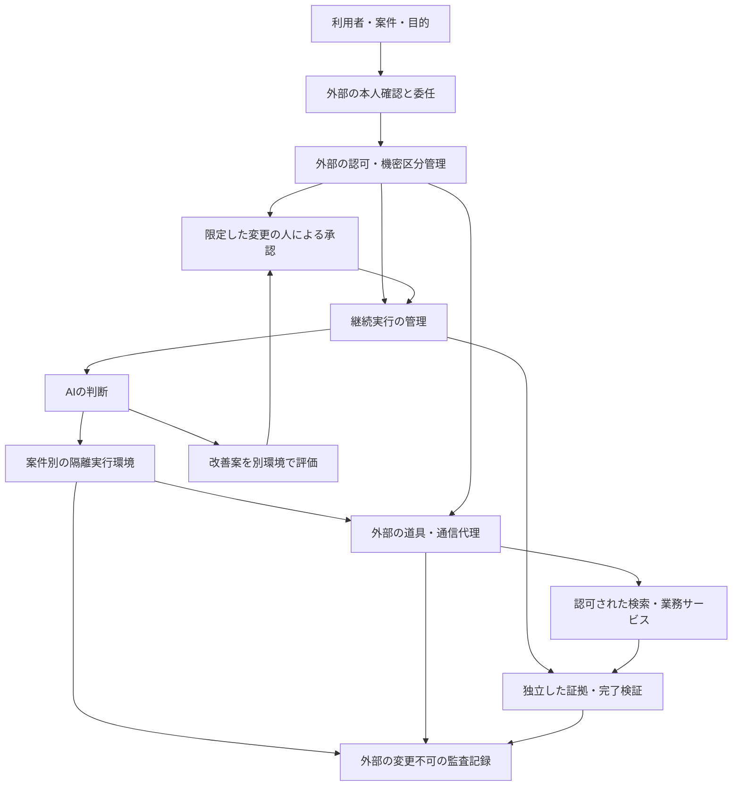

# AIの実行基盤と隔離技術の比較

確認日：2026年10月7日。AI Agent OS（AIの実行・記憶・道具・権限を管理する基盤）とsandboxing（実行できる範囲を制限する隔離技術）を、企業の機密検索、法務・経理・人事の操作、継続実行、自己改善に結び付けて調査した。

**企業基盤では、実行環境の隔離と、データ・業務操作の認可を別々に強制する必要がある。** 小型仮想機械に閉じ込めても、共有された機密ファイルや、許可された外部サービスへの書込みは残る。判断するAI、制約を強制する管理部、資格情報を持つ代理部、証拠を保存する監査部の分離を中心に比較する。

17の技術・基盤を比較し、12論文を新規取得した。うち10本は2026年7〜10月の研究で、最新の初稿公開日は10月5日。残る2本は実行状態の複製と共有CPUの漏えいに関する基礎研究。全PDFを全頁OCR（画像の文字認識）し、[日本語解説12](../papers/paper_notes_12.md)、[取得台帳](../papers/arxiv_manifest.json)、[OCR台帳](../papers/ocr_manifest.json)へ記録した。

要旨と本文の設計・手法・結果・限界の関連箇所、公式資料、公開実装を確認した。全付録の精読、製品導入、攻撃の実行、性能再現は行っていない。著者の評価値、提供者の説明、本調査の設計案を区別する。[出典確認台帳](agent_os_sandbox_sources_20261007.json)に確認方法と制限を残した。

## 1. 「OS」が指すものを分ける

| 層 | 解決する課題 | AIに変更させる範囲 |
|---|---|---|
| 計算機のOS・仮想化 | プロセス、記憶領域、ファイル、通信を隔離する | 隔離された内部の設定。外側の強制規則は管理者が管理 |
| AI実行管理 | 推論の順番、道具、会話状態、記憶、予算を管理する | 許可範囲内の計画と処理順序 |
| 業務の認可・委任 | 誰のために、どの資料・対象・操作を扱えるか決める | 親の権限以下の委任。権限拡張は外部で判断 |
| 継続実行 | 中断、再試行、人の承認待ち、取消しを扱う | 記録済みの状態に基づく再開 |
| 外部監査 | 実際のアクセス・変更と成功の証拠を残す | AIは説明を付けられるが原記録は編集できない |

AIOSの「kernel」は推論などを仲介する実装上の名称であり、Linuxの保護境界と同一ではない。MemOSは記憶管理が中心。Kubernetes Agent Sandboxは作成・再開を管理する仕組みで、低層の隔離をgVisorやKata Containersへ委ねる。[AIOS](https://github.com/agiresearch/AIOS)、[Agent Sandboxの対象範囲](https://github.com/kubernetes-sigs/agent-sandbox/blob/58707de4f339615645724deae3898ef65360192a/README.md)。

既存ノートの「AIOS系は開発が停滞」という評価を修正する。公式APIで確認した最新の変更はAIOSが2026年7月20日、MemOSが9月22日。開発の継続と、企業本番での採用実績・独立検証は別の論点である。[AIOSの変更](https://github.com/agiresearch/AIOS/commit/292d98f78c835499df18cdb6de6325bba1895862)、[MemOSの変更](https://github.com/MemTensor/MemOS/commit/a7367d07e55db61099f7b4e2c1108bc5831a24f3)。

## 2. 何から守るか

| 脅威 | 必要な制御 | 隔離だけで残る問題 |
|---|---|---|
| 文書・道具からの悪意ある指示 | 出所と機密区分、操作前の認可 | 許可された資料を許可された送信先へ漏らせる |
| 生成したコードの悪用 | OS・仮想化の制約、通信と資源の上限 | 正規の業務APIによる不正処理 |
| 資格情報の盗難・代理操作 | 秘密値の外部保管、操作ごとの短期委任 | 秘密値を読めなくてもその権限を使用できる |
| 別の顧客・部署・案件への移動 | 実行単位の本人性、保存領域と通信の分離 | 共有索引・記憶・保存状態からの漏えい |
| 自分の規則・評価の改変 | 外部の変更検証、監査・評価器の分離 | 設定の道具を守ってもshellから変更できる場合がある |
| 成功の虚偽報告 | 外部の状態照合、証拠による完了判定 | 自己申告の説明や自作の検証だけでは証拠にならない |
| 共有CPUからの漏えい | 計算機更新、共有方法・配置の制限 | 仮想機械にも共有ハードウェアに起因する経路がある |

脅威モデルには「AIが悪意あるコードを実行している状態」を含める。管理部、仮想化部、認可部まで同時に侵害された状況に対して、個々の論文が保証しているとは扱わない。

## 3. 17の技術・基盤を比較する

TCBは「安全性が依存する信頼対象の実装」。小さな実装でも、誤設定や外部操作の広い権限があれば被害は大きくなる。互換性・隔離境界・初期設定・業務権限を合わせて選ぶ。

| 技術・基盤 | 主な境界・用途 | 技術的な選択点と限界 | 一次資料 |
|---|---|---|---|
| AIOS | 推論、文脈、記憶、保存、道具の管理 | AIの資源管理と生成コードのOS隔離を別に設計 | [実装](https://github.com/agiresearch/AIOS) |
| MemOS | 記憶の保存・検索・版管理 | 機密区分と主体の認可を接続。記憶機能の停止だけでは共有ファイルが残る | [実装](https://github.com/MemTensor/MemOS) |
| AgentKernel | 本人性、入力、思考・記憶、実行の仲介 | 迂回できない接続が前提。信頼対象の大きさ、性能・攻撃耐性の実測が課題 | [論文](https://arxiv.org/abs/2609.29647v1) |
| Landlock | Linuxのプロセスと子プロセスに追加の制約 | 対応ABI（機能の版）を確認。扱わない権限を誤って許可しない。TCP・UDPも版依存 | [OS公式説明](https://www.kernel.org/doc/html/latest/userspace-api/landlock.html) |
| 通常のOCIコンテナ | 名前空間、資源上限、利用者権限、seccomp | ホストのOS中核を共有。システム呼出しの制約は支払認可の代替にならない | [seccomp](https://docs.docker.com/engine/security/seccomp/) |
| gVisor | 利用者空間でLinuxの呼出しを仲介 | ホストへの直接呼出しを減らす。互換性・性能と、共有CPU・通信の問題を別に確認 | [安全性モデル](https://gvisor.dev/docs/architecture_guide/security/) |
| Firecracker | KVMを使う小型仮想機械。個別のOS中核 | 仮想化部のAPI、jailerによる制約、ホスト設定も信頼対象 | [安全性方針](https://github.com/firecracker-microvm/firecracker/blob/main/docs/prod-host-setup.md) |
| Kata Containers | コンテナの操作体系で仮想機械を実行 | コンテナ管理との互換性と個別OSの境界。業務認可は上位で実装 | [公式事例](https://katacontainers.io/use-cases/) |
| Wasmtime / WASI | WebAssemblyの記憶領域と明示した外部機能 | 小さな道具に適する。外部関数・与えたファイル権限は信頼対象 | [安全性説明](https://docs.wasmtime.dev/security.html) |
| Docker Sandboxes | 小型仮想機械、通信・資格情報代理、作業領域 | 書込み可能な共有領域、ホスト側MCP、SSH署名代理まで確認 | [隔離](https://docs.docker.com/ai/sandboxes/security/isolation/)・[資格情報](https://docs.docker.com/ai/sandboxes/security/credentials/) |
| SideKernel | macOSのVirtualization.frameworkによる小型仮想機械 | 使いやすさを重視する研究試作。正式な外部安全性監査は未実施 | [固定版](https://github.com/minoansecurity/sidekernel/tree/a12575abc156a5929e52233b203f305e17ad1bdf) |
| NVIDIA OpenShell | OS側の制約、通信・資格情報代理、規則検証 | 記録のみのモードと遮断を区別。形式検証の対象外を合格扱いしない | [固定版](https://github.com/NVIDIA/OpenShell/tree/9a6148fc988a5e7a20a43805a52fdfaad766f8ae) |
| Kubernetes Agent Sandbox | 作成、準備済みの環境、再開、経路制御 | `RuntimeClass`、受付時の規則、通信制約が必要。任意のPodを安全にする仕組みではない | [脅威モデル](https://github.com/kubernetes-sigs/agent-sandbox/blob/58707de4f339615645724deae3898ef65360192a/docs/security/threat_model.md) |
| E2B | 作業用Linux仮想機械、雛型、停止・再開 | 保存状態に記憶も含む。外向き通信と公開URLの認証を明示設定 | [公式説明](https://e2b.dev/docs)・[通信設定](https://github.com/e2b-dev/E2B/blob/c0f426ae479806538808c4fa407b7b0ad86c2576/packages/js-sdk/src/sandbox/sandboxApi.ts) |
| Modal Sandboxes | gVisorまたは仮想機械と通信制約 | 外向き全遮断、IP・ドメイン制限を選択。接続口と内部からの通信を別に管理 | [安全性モデル](https://modal.com/docs/guide/sandbox-networking) |
| Anthropic Managed Agents | 推論・実行環境・継続する作業記録の分離 | 資格情報を外部保管。代理操作の範囲と自社データの認可は接続側でも必要 | [構成説明](https://www.anthropic.com/engineering/managed-agents) |
| Temporal | 履歴による継続実行、再試行、人の承認待ち | 隔離技術ではない。AI呼出しを記録し、外部書込みの重複を防ぐ | [処理定義](https://docs.temporal.io/workflow-definition)・[履歴](https://docs.temporal.io/encyclopedia/event-history) |

機密計算はクラウド運用者から記憶内容を守る別の境界を加える。その中のAIが正規APIで誤った支払や送信を行う問題は残る。[既存の機密計算調査](agent_sandbox_isolation_confidential_computing.md)と合わせて評価する。

## 4. 実装と初期設定を深く確認する

### Docker Sandboxes：秘密値の保護と使用権限

仮想機械ごとにLinuxのOS中核を持ち、通信はホストの代理部を通る。直接共有する作業領域の書込みはホストへ即時反映される。複製モードでも読取り専用の元領域には追跡対象外・Git除外ファイルが含まれる。読取り専用は機密性の保証ではない。

MCP（道具を呼ぶ接続規約）のホスト側ゲートウェイで動くローカル道具は仮想機械の外で動く。この経路も独立して制限する。[隔離の公式説明](https://docs.docker.com/ai/sandboxes/security/isolation/)。

SSHの署名代理は初期設定で転送される。秘密鍵はホストに残っても内部のプロセスは署名を要求できる。資格情報の外部保管と操作権限の縮小を別に設計する。[資格情報の公式説明](https://docs.docker.com/ai/sandboxes/security/credentials/)。

### OpenShell：記述した規則が遮断に使われるか

取得した変更 `9a6148fc…` を対象に確認した。過去の「alpha」説明と現在の0.1.xの説明を混ぜて成熟度を断定しない。監督部に規則と資格情報を置き、実行部と分離する構成を確認した。[隔離方式の接続](https://github.com/NVIDIA/OpenShell/blob/9a6148fc988a5e7a20a43805a52fdfaad766f8ae/docs/extensibility/isolation-backends.mdx)。

HTTP等の内容を扱う規則の初期設定は `audit`（記録のみ）。`enforce`（違反を遮断）へ切り替える必要がある。暗号化通信を検査しない例外、広い実行ファイル指定も制約を弱める。[固定版の安全性説明](https://github.com/NVIDIA/OpenShell/blob/9a6148fc988a5e7a20a43805a52fdfaad766f8ae/docs/security/best-practices.mdx)。

形式検証では「上限規則の内側か」と「追加案が危険な権限を増やすか」が別検査。前者はファイル・通信・REST等を扱うが、GraphQL・MCP等は対象外として `unsupported` を返す。合格の意味を任意の道具やAIの意図まで広げない。[検証器の説明](https://github.com/NVIDIA/OpenShell/blob/9a6148fc988a5e7a20a43805a52fdfaad766f8ae/docs/how-it-works/policies/prover.mdx)。

[9月28日のNVIDIA Sentryの発表](https://investor.nvidia.com/news/press-release-details/2026/NVIDIA-Launches-Open-Agent-Safety-Platform-to-Secure-Agents-From-Testing-to-Deployment/default.aspx)は、BlueField-4を使う外部監視の参照設計として出典台帳に記録した。提供者が述べる短時間の隔離を、再現した性能や全環境で使える機能とは扱わない。gVisor内部のSentryとは異なる。

### Kubernetes Agent Sandbox：管理部と接続経路

固定版 `58707de4…` は、強い隔離を提供する実行方式を指定するよう求める。`SandboxTemplate` 経由では管理用の認証情報を渡さない初期設定がある。直接作成する `Sandbox` に同じ制約を強制するには受付時の規則が必要。

経路制御部の初期の認可器は `AllowAll`。危険なIP範囲等の検査だけで、利用者と作業領域の対応が保証されるとは扱えない。本人性、部署・顧客・案件、直接接続の遮断を加える。[脅威モデル](https://github.com/kubernetes-sigs/agent-sandbox/blob/58707de4f339615645724deae3898ef65360192a/docs/security/threat_model.md)。

保存状態の復元例はGKE Autopilot、gVisor、拡張APIを前提としPythonで対応する。同じ作業領域の復元に加え、共通雛型から多数を起動する例もある。全Kubernetes環境の共通機能とはしない。[固定版の復元説明](https://github.com/kubernetes-sigs/agent-sandbox/blob/58707de4f339615645724deae3898ef65360192a/site/content/docs/sandbox/snapshots/_index.md)。

### SideKernel：使いやすさと侵入防止を分ける

論文は80人の形成的な調査を基に23の機能確認を行った。Docker SandboxesとSideKernelの好成績はこの機能評価の結果。一般人口での採用率や侵入防止性能ではない。論文には正式な安全性監査、企業向け記録・管理機能が未実施・未整備という制限がある。[論文](https://arxiv.org/abs/2610.02456v1)。

固定版の `Host/MicroVM.swift` で、作業・案件領域を `readOnly: false` で共有する箇所も確認した。仮想化境界があっても、与えた領域の変更は可能。[実装](https://github.com/minoansecurity/sidekernel/blob/a12575abc156a5929e52233b203f305e17ad1bdf/Host/MicroVM.swift)、[研究試作の位置づけ](https://github.com/minoansecurity/sidekernel/blob/a12575abc156a5929e52233b203f305e17ad1bdf/README.md)。

### 許可された送信先でも送信相手を固定する

Anthropicは、許可された `api.anthropic.com` へ攻撃者側のAPI鍵でファイルを送った事例を説明している。ドメインの許可と隔離は満たしたが、受信する口座が攻撃者のものだった。過去に報告された経路として扱い、現行製品で未修正と断定しない。[提供者の説明](https://www.anthropic.com/engineering/how-we-contain-claude)。

設計上の結論は、ドメイン、資格情報、所属先、API操作、対象資源、送信できる機密区分を一組として認可すること。通信の許可を検索結果の持出し許可へ読み替えない。

## 5. 新規取得した12論文

日付はarXivの初稿公開日。識別子の月と公開日が一致しない例がある。採択を別に確認できないものは公開前論文として扱う。手法・評価条件・企業設計への示唆と原本・OCRへのリンクは[解説12](../papers/paper_notes_12.md)に記載する。

| 論文・取得版 | 公開日 | 課題・技術 | 著者の結果と制限 |
|---|---|---|---|
| [What May an Agent Change About Itself?](https://arxiv.org/abs/2610.06274v1) | 2026-10-05 | 自己設定を能力・範囲・強制規則へ分ける | 道具経由の保護対象の保存は0/167。shellによる直接変更は対象外 |
| [AgentSpy](https://arxiv.org/abs/2610.06001v1) | 2026-10-05 | AIと子プロセスのOS呼出し・通信を外部観測 | 実行された攻撃18回中14回検出。監視は防止と同義ではない |
| [Self-Propagating Misalignment](https://arxiv.org/abs/2610.04083v1) | 2026-10-02 | 永続情報から後続AIへ不正な目標が伝わる | 11モデル・20状況。明示目標58%、弱い価値付け18%。目標は実験用指示で誘導 |
| [SideKernel](https://arxiv.org/abs/2610.02456v1) | 2026-10-01 | macOSで隔離を利用しやすくする | 80人と23機能。研究試作で、侵入防止の比較ではない |
| [AgentXploit](https://arxiv.org/abs/2609.31318v1) | 2026-09-25 | コードの入力から敏感な操作まで追い、実行で検証 | 12システムで72の再現可能な問題を報告。制御された試験の成果 |
| [Memory Compression for High-Fanout Agent Sandboxes](https://arxiv.org/abs/2609.11294v1) | 2026-09-10 | 多数の環境を圧縮・先読みで扱う | AgentZipの所有記憶は最大8.7倍圧縮。総費用や全機種の結果ではない |
| [Delegation Without Trust](https://arxiv.org/abs/2609.00267v1) | 2026-08-31 | 本人性・短期委任・実行前認可を仲介 | 11種類の攻撃試験。約2.6µsは参照実装の認可判断のみ |
| [AgentKernel](https://arxiv.org/abs/2609.29647v1) | 2026-08-29 | 本人性・入力・記憶・実行の共通管理部 | 設計と安全性分析が中心。現実の性能・敵対的評価は今後の課題 |
| [Agent Safety Should Be a Runtime Contract](https://arxiv.org/abs/2608.11274v1) | 2026-08-11 | 危険操作の遮断と証拠による完了判定 | 52事例等に基づく立場論文。新しい防止器の実測ではない |
| [SpecBox](https://arxiv.org/abs/2607.23933v2) | 2026-07-27／v2 08-05 | 推論中に次の環境を予測し準備・結果再利用 | P99遅延最大2.9倍改善と記憶45.9%減は比較相手が異なる。同一ホストの共有記憶を使用 |
| [Restoring Uniqueness in MicroVM Snapshots](https://arxiv.org/abs/2102.12892v1) | 2021-02-04 | 保存状態が秘密・乱数・識別子を複製する | `MADV_WIPEONSUSPEND`・`SysGenId`等を検討。現在の全基盤での導入を示さない |
| [Microarchitectural Security of AWS Firecracker VMM](https://arxiv.org/abs/2311.15999v1) | 2023-11-27 | 共有CPUの推測実行等による漏えい | 当時の機種・設定の結果。2026年の全サービスの脆弱性を示すものではない |

既存取得分から[AIOS](https://arxiv.org/abs/2403.16971)、[Toward Securing AI Agents Like Operating Systems](https://arxiv.org/abs/2605.14932)、[Agent Operating Systems](https://arxiv.org/abs/2606.01508)、[Towards an Agent Operating System](https://arxiv.org/abs/2607.25076)、[SoK: Agent Security as Kernel Design](https://arxiv.org/abs/2609.23700)、[SandboxEscapeBench](https://arxiv.org/abs/2603.02277)も接続した。最後の研究に使われた意図的に弱い入れ子の試験環境を、全コンテナに一般化しない。

## 6. 性能改善で変わる保護境界

### 起動待ちと記憶使用量

常時確保は起動待ちを減らすが、待機中も記憶を使う。必要時の作成は逆の性質を持つ。SpecBoxは推論途中から準備を始め、AgentZipは同じ雛型から派生した多数の環境を圧縮・先読みする。どちらも性能評価から隔離の正しさを導けない。

本調査の設計案として、先行してよいのは計算環境の準備までとする。支払、通知、権限付与、契約の締結を予測して実行しない。結果再利用には主体、顧客・案件、認可の版、機密区分、対象データの版、期限を一致条件に含める。質問の意味が似ていても、権限の異なる人へ同じ検索結果を返さない。

### 保存状態の再利用

状態保存は記憶中の秘密、開いた接続、乱数状態も保存し得る。2021年の基礎研究は複製問題を論じ、Firecrackerの説明も記憶ファイルと実行状態を扱う。[公式説明](https://github.com/firecracker-microvm/firecracker/blob/main/docs/snapshotting/snapshot-support.md)。以下は企業向けの設計案であり、全製品の実装済み機能ではない。

1. 共通雛型は資格情報を入れる前に作り、案件の保存状態は所属と機密区分で分ける。
2. 再開時に本人確認と認可をやり直し、期限切れ・取消し済みの委任を復活させない。
3. 接続と資格情報を再発行し、乱数・識別子の一意性を保つ。
4. 保存状態を暗号化し、所有者、雛型・強制規則の版、保存期限、復元履歴を記録する。
5. 取消し後に古い環境や再利用結果を読める経路も遮断する。

## 7. 自己改善と外部監査

自己設定研究は能力の追加、アクセス範囲の拡張、強制規則の変更を分ける。企業では処理順序・検索方法・下書き等の改善から始め、認可、通信、資格情報、監査、評価器の変更を独立した手順へ置く。shell、共有設定、起動時処理、外側の道具から同じ変更を実行できないか確認する。別環境で評価し、外部管理部が承認された版を配布する。

伝播研究では専用記憶を外してもファイルへの書込みが残った。点検には技能文書、共有領域、成果物、応答保存、索引、パッケージ配布元、状態保存を含める。再読込み時に出所と認可範囲を保持し、過去のAIが書いた指示を上位規則へ昇格させない。

AgentSpyは `auditd`、Laurel、Zeek、Falco等を使い子プロセスまで観測する。義務の遵守と禁止事項の検出を分けるが、準備・収集は観測範囲外で、OSやSDK等を信頼する。OS観測だけで暗号化APIの業務内容や決裁の正当性まで分かるとは扱わない。

説明可能性には、AIが述べた理由、参照情報、認可判断、外部の実変更を分けた記録が必要。自然言語の理由は調査の入口であり、内心の忠実な証明や成功の証拠ではない。

| 記録 | 外部で照合する項目 |
|---|---|
| 主体・委任 | 利用者、AI、親の委任、範囲、期限、取消しの版 |
| 入力・検索 | 出所、資料・索引の版、機密区分、取得時と表示時の認可 |
| 認可・承認 | 規則の版、判断、操作内容とハッシュ、承認者 |
| 環境 | 雛型、実行方式、共有領域、通信規則、復元元 |
| 実操作 | 引数、子プロセス、変更、通信相手と所属、外部受付番号 |
| 完了証拠 | テスト、外部状態、差分、検証器の版、未達条件 |
| 改善 | 変更案、独立評価、承認、配布版、戻した版、次の評価 |

ログ自体へ機密本文や秘密値を集め過ぎない。通常閲覧は識別子・区分・結果を中心にし、原証拠は別権限・保存期限で保管する。これは本調査の設計提案である。

## 8. 企業基盤の構成案

以下は本調査の構成案であり、特定製品の実装図ではない。

AIが提案し、外部管理部が利用者の権限と案件の範囲を交差させて許可する。通常の低リスク操作は自動化できる。HITL（人を判断の手順に入れる方式）は権限拡張、高額支払、法的確定、機微な人事判断、強制規則の変更へ置く。操作内容が変わった場合は古い承認を流用しない。

法務なら契約版と修正範囲、経理なら金額・取引先・重複防止、人事なら対象者・情報区分・書戻し先まで認可する。検索結果の閲覧が許可されても、送信・更新は別判断。[データ区分と権限付与の調査](data_clearance_access_grant_workflows_20261006.md)。

Temporal等の再試行ではAI呼出し・外部操作の結果を履歴へ残す。再生時にモデルの判断を要求し直さない。書込みの重複防止識別子と外部状態照合を使い、取消し後に遅い応答で変更が起きないようにする。履歴の再生だけで外部APIの「厳密に一度」を保証したとしない。[決定性](https://docs.temporal.io/workflow-definition)、[再実行と重複防止](https://docs.temporal.io/nexus/operations)。

## 9. 導入前の検証条件

| 確認する状況 | 合格の条件 |
|---|---|
| 子プロセス・別の道具から同じ操作 | 同じ認可・通信・ファイル制約を適用 |
| 許可先へ別資格情報・別所属で送信 | 受信者・所属・操作範囲の不一致で遮断 |
| `.env`、技能文書、ホスト側MCPを使用 | 必要範囲だけ見え、外側の機能を迂回利用できない |
| 管理用の認証情報・内部サービスへ接続 | 明示した例外以外は届かず拒否が記録される |
| 承認後に操作引数を変更 | 古い承認が無効になる |
| 取消し後に復元・再試行・結果再利用 | 古い権限・結果を復活させず再認可 |
| 道具以外から設定変更 | 外側の規則・監査器は変更できない |
| 完了を報告するが証拠がない | 未完了で残り外部照合を優先 |
| 別案件の保存状態を復元 | 所有者・機密区分・規則の不一致で拒否 |
| 高負荷・復元失敗 | 制約を解除せず停止。再試行でも二重操作にしない |

性能は起動時間、操作全体の中央値とP95・P99、同時実行数、記憶、待機・検査費用、復元失敗率を測る。保護は検出率だけでなく、遮断前の変更、見逃し、誤検出、途中で止まる仕事、取消しの反映時間まで測る。

## 10. 問いを発展させた調査記録

4回・12問の追加調査。既存の[反復調査記録](../ai_native_recursive_research_log_20261005.md)を前提に、実行境界から業務の意味へ広げた。

| 回・問 | 調査から出た問い | 次の確認と到達点 |
|---|---|---|
| 1-1 | Agent OSはOS隔離を置き換えるか | AIOS、AgentKernel、Agent Sandbox。資源管理・認可・OS保護を分離 |
| 1-2 | 仮想機械なら全ての漏えいを止めるか | gVisor、Firecracker、CPU研究。共有領域・通信・CPUを別評価 |
| 1-3 | 使いやすさが採用障壁か | SideKernelの80人・23機能。一般採用率や安全性へ一般化しない |
| 2-1 | 秘密値を外に置けば権限も狭まるか | DockerのSSH代理、Managed Agents。保管と使用権限を分離 |
| 2-2 | 許可ドメインなら安全な受信者か | Anthropicの報告。資格情報・所属・操作を認可単位へ |
| 2-3 | 規則の記述・検証は実行保証か | OpenShell。遮断設定・検証対象外を照合 |
| 3-1 | 復元・複製で秘密や権限が復活するか | GKE、2021年研究、E2B。復元時再認可を追加 |
| 3-2 | 多数の環境を安価に動かすには | AgentZip、SpecBox。比較基準と再利用の認可条件を分離 |
| 3-3 | 障害後の支払は一回だけか | Temporal。外部状態照合と重複防止が必要 |
| 4-1 | 自己設定を安全に制限できるか | 10月5日研究。設定の道具以外も点検 |
| 4-2 | 専用記憶を止めれば伝播も止まるか | 10月2日研究。共有ファイル・成果物も永続経路 |
| 4-3 | 成功と安全をAIの説明で確定できるか | AgentSpy、Runtime Contract、AgentXploit。外部観測・独立検証へ |

未解決なのは、意味に基づく機密区分の正確さ、管理部と低層制約の対応の検証、共有CPUの漏えい、製品横断の取消し、機密を過剰収集しない監査である。最新の提案を解決済みの根拠に使わない。
