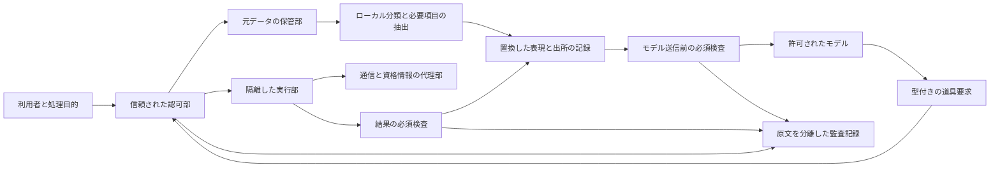

# 個人情報を扱うAIハーネスの保護機構と開発要件

確認日：2026年10月8日。ハーネスは、AIへの入力を組み立て、道具を実行し、権限・記憶・保存・再試行を管理する周辺プログラムである。Codex、Claude Code、pi.devと代表的な公開ハーネスを、内容検査、実行の認可、OS隔離、通信、資格情報、履歴、組織管理まで調べる。

**個人情報を安全に扱うには、どの道具が何を実行できるかと、どの情報がどこへ送られるかを別々に強制する。** シェルの隔離、承認画面、ファイル除外、伏字化のどれか一つでは、モデル・道具・観測記録・子エージェントを通るすべての経路を保護できない。

## 1. 調査資料への入口

| 調査 | 主に確認する機構 | 資料 |
|---|---|---|
| Codex | OSの規則変換、命令の承認、通信代理、資格情報代理、管理者規則、拡張・履歴 | [詳細](harness_codex_security_20261008.md)、[固定資料](harness_codex_sources_20261008.json) |
| Claude Code | 道具の許可、実行前後処理、sandbox-runtime、秘密値置換、通信の内容検査、組織設定 | [詳細](harness_claude_security_20261008.md)、[固定資料](harness_claude_sources_20261008.json) |
| pi.dev | プロジェクト信頼、拡張イベント、標準MCP、QuickJS、道具・モデル・履歴の境界 | [詳細](harness_pi_security_20261008.md)、[固定資料](harness_pi_sources_20261008.json) |
| その他の公開ハーネス | OpenCode、Gemini CLI、OpenHands、Aider、Goose、Cline、Roo Codeの強制箇所 | [7製品とOpenHands SDK](harness_oss_security_20261008.md)、[固定資料](harness_oss_sources_20261008.json) |
| 開発用SDK | OpenAI Agents Python、LangChain、LangGraph、Deep Agentsの検査・承認・保存・実行環境 | [詳細](harness_sdk_security_20261008.md)、[固定資料](harness_sdk_sources_20261008.json) |
| 情報フロー・認可・評価 | CaMeL、Multi-CaMeL、LLMbda、AgentDojo等、OWASP、Cedar・OPA・OpenFGA | [全文と固定実装の分析](harness_information_flow_and_evaluation_20261008.md)、[取得資料](harness_information_flow_and_evaluation_sources_20261008.json) |
| ガードレールと個人情報検出 | NeMo、LlamaFirewall、LLM Guard、Guardrails AI、Presidio | [詳細](harness_guardrail_mechanisms_20261008.md)、[固定資料](harness_guardrail_sources_20261008.json)、[局所確認結果](harness_guardrail_probe_results_20261008.json) |

現行の開発コードと安定配布版は同一とは限らない。Codexは安定版0.161.0を固定し、他の対象は取得した変更識別子と配布版との関係を各稿で説明した。Claude Codeの本体等、非公開部分の内部実装は公式仕様と公開した隔離実行部から確認する範囲に限る。

## 2. 調べるべき全分野

[20分野のCSV](harness_security_requirements_20261008.csv)も保存した。製品名を増やすだけでは漏れるため、次の20分野に分けて強制点を確認する。全製品に全機能が存在するという意味ではない。

| 分野 | 調査する問い | 自作ハーネスに必要な条件 |
|---|---|---|
| 1 入力の取込み | 指示、ファイル添付、画像、検索、初期指示がどこから入るか | 読取り前の認可と、モデル送信前の最小化を両方行う |
| 2 PIIと企業機密の分類 | 形式・文脈・対応表・資源ラベルを使うか | 非PIIの秘密も扱い、判定不足を非機密にしない |
| 3 指示とデータの区別 | 外部文書の命令を信頼した指示へ昇格させないか | 出所を維持し、検出器だけでなく実行部でも制約する |
| 4 道具の型と認可 | 道具名、引数、操作対象、宛先を誰が許可するか | 利用者・目的・対象資源ごとに既定拒否で評価する |
| 5 人の承認と自動レビュー | 許可の単位、期限、再実行、変更後の再審査はどうなるか | 一回の承認を別の引数や将来の操作へ転用しない |
| 6 ファイルの読取り | ignore、専用道具、シェル、MCPの境界は同じか | 不要な原本を実行部へ載せず、OSでも拒否する |
| 7 ファイルの書込み | 作業領域、設定、Git、保管部を変更できるか | 保護方針と元データをAIが改変できない領域へ置く |
| 8 OSと計算資源の隔離 | プロセス、名前空間、コンテナ、仮想機械のどれか | 実装を選び、CPU・記憶・子プロセス・終了も制限する |
| 9 通信先 | DNS、転送、私有IP、UDP、Unixソケットまで扱うか | 宛先だけでなく操作・認証・転送先も管理する |
| 10 モデルの通信 | 主モデル、補助モデル、分類器、画像生成はどこへ送るか | 外部モデルに許す表現を送信直前に検査する |
| 11 資格情報の供給 | 原値はモデル・道具・代理部のどこに見えるか | 原値の保管と短期の限定操作権を分離する |
| 12 道具の結果 | 本文以外に詳細情報・エラー・画像が返るか | 結果の全形式を検査し、原文を返す例外を作らない |
| 13 逐次出力と並列処理 | 検査前に表示・送信・実行が始まらないか | 機密の外部送信は検査完了後に行う |
| 14 ログと観測 | 伏字化前の値や承認要求も保存されるか | 原文を観測系へ入れず、必要記録を別の権限で保存する |
| 15 記憶と要約 | 圧縮、再開、共有、書出しで情報や権限が失われないか | 出所・案件・機密区分を要約後も保持する |
| 16 子エージェント | 親の権限、履歴、秘密、共有領域をどう引き継ぐか | 親より広い能力を自動付与せず、情報の引継ぎも制約する |
| 17 MCPと拡張 | 外部コードは隔離内か、道具の説明を信頼してよいか | 導入・更新・実行・応答の各段階で認可する |
| 18 組織による管理 | 個人設定・プロジェクト設定で上限を覆せないか | 管理者の上限と実効設定を信頼した側で固定する |
| 19 障害と復元 | 検査失敗、隔離不能、取消し、再試行で何が起こるか | 不明・例外を許可へ変えず、再試行を新しい操作として評価する |
| 20 評価と更新 | 固定版、修正の反映、判定漏れ、境界の試験があるか | 内容検出の精度と強制制約の試験を別に行う |

## 3. 製品の違いから得られた重要な事実

| 対象 | 技術的に参考になる機構 | そのまま機密保護の保証にできない点 |
|---|---|---|
| Codex | OSの実行制限、名前付き権限、通信・資格情報代理、管理者要求 | コマンドの代理部はモデル・MCP等を一括して扱わない。秘密らしい環境変数の自動除外は現行既定で無効 |
| Claude Code | 実行前の認可、結果置換、OS隔離、認証値を外部に置く方式 | 結果置換前の観測記録、無効な置換結果、検査の失敗時を別に確認する |
| pi.dev | 標準MCP、プロジェクト信頼、QuickJS内で結果を集約し必要部分だけ返す方式 | JavaScriptの能力制限と、Bash・ファイルのOS隔離は別。例外・詳細情報・補助分類モデルも送信経路 |
| OpenCode | 操作・資源の規則と保存済み許可、拡張可能な道具 | 公開仕様は承認をOSの隔離と区別。V1とV2の機構が異なる |
| Gemini CLI | 起動時と道具実行時のOS隔離、環境変数の除去 | Linuxの基底はホストrootの読取り専用bindであり、すべて不可視ではない |
| OpenHands | 秘密の実行時取得、逐次出力の秘密置換、危険性と承認の別構成 | 道具には原値を渡す。登録した秘密の置換は、未知PIIの一般検出と異なる |
| Aider | 送るファイルの選択、変更の復元 | ignore・Gitの復元はシェルの読取り禁止や送信取消しではない |
| Goose | 道具の権限、別モデルによる審査、拡張のコンテナ化 | 審査用の分類先も秘密の送信先。拡張だけの隔離と本体の隔離は異なる |
| Cline | SDK道具認可、実行前処理、企業設定 | 子プロセス化だけではOS資源を制限しない。CLI等に適用しない企業設定もある |
| Roo Code | 専用道具の除外と命令承認 | 独自スクリプトを含む任意シェル全体の読取り禁止ではない |

根拠と固定コードの行参照は上記の各詳細稿に収録した。この表は設定・版の違いを省略した単純な安全順位ではない。

## 4. 検査が失敗したときの比較

失敗時に拒否することをfail-closed、保護を適用できず処理を続けることをfail-openと呼ぶ。製品全体に一つの分類を付けず、具体的な経路ごとに比較する。

| 経路 | 確認した動作 | 開発への含意 |
|---|---|---|
| Codexの同期PreToolUse | 適切な拒否は阻止。時間切れ・不正JSON・終了2で理由なし等は通常処理へ進む経路 | 障害時の必須検査には単独で使わない |
| Claude Code CLIの実行前処理 | 明示の阻止と、起動失敗・時間切れ等の通常処理への復帰を区別 | SDKの処理との差を確認する |
| Claude Codeの結果置換 | built-inの置換結果の形式不正では元の結果を採用する経路 | 置換器の存在だけで原文遮断を保証しない |
| 独立sandbox-runtimeのJWT置換 | 固定mainのJWT・claim処理不適合では実際の環境変数を残す経路 | Claude同梱版と区別し、置換と資格情報代理を個別確認する |
| Agents SDKの最終出力検査 | 拒否判定と検査関数の例外では保存が異なり、後者で完成したターンを保存する | 停止と原文の非保存を別の条件として試験する |
| piのtool_call | 例外は当該道具の実行を阻止 | 全会話・全モデル要求の停止と同義ではない |
| piの結果・文脈・要求前の一部拡張 | 例外を記録して継続する経路 | 置換器の例外を送信阻止と想定しない |
| piの公式sandbox例 | 初期化失敗等で通常Bashへ戻る経路 | 運用用には非隔離への復帰を禁止する |
| NeMoの並列ストリーム検査 | 一部の失敗・例外で出力を続ける経路 | 順番に検査する方式、検査前出力、置換可能性も別に確認する |
| LlamaFirewallの実験的PIICheck | 評価例外をERRORへ変換し、score=0・ALLOWにする経路 | 検査不能を安全判定へ変えない |
| LLM Guardのfail_fast | 検査列を途中で終了し不合格の結果を返す | アプリの実行・送信は呼出し側で止める |

LlamaFirewallとLLM Guardの該当関数は、固定原本から未変更の関数を抽出し、通信や識別器をローカルな代替にした局所確認を行った。[確認スクリプト](../../scripts/probe_harness_guardrail_semantics.py)、[結果](harness_guardrail_probe_results_20261008.json)。外部モデル呼出しは0件である。完全なライブラリの起動試験やOS隔離試験とは区別する。

## 5. 個人情報用ハーネスの構成案

以下は公開機構から導く開発案であり、特定製品が全体を実装しているという主張ではない。

元データを読む分類器は信頼したローカル処理として置く。外部モデルには伏字と必要な属性だけを渡し、原文の参照権を与えない。対応表は案件ごとに保管し、復元は信頼した認可部が許された本人・宛先に対して行う。文字列の置換だけでは残った属性からの識別を防げないため、データを減らす処理も行う。

道具の要求は、操作名、案件、資源、目的、宛先、期限を構造化する。モデルが付ける「安全」という説明と別に、認可部が実際の値を確認する。メールならTo・CC・BCC・添付・転送履歴を含め、社外宛先や共有範囲を評価する。シェルへ任意文字列を渡せる場合は、型付きの業務道具より大きい権限になる。

OS隔離は、必要な作業領域だけを実行部へ渡して構成する。元データの保管部、認可規則、復元表、認証用の原値は別に置く。プロセス内で秘密を隠す方式だけで足りるか、同じOS中核を共有してよいか、仮想機械が必要かは、扱うコードと共有利用者の信頼条件で選ぶ。[隔離基盤の既存調査](agent_os_sandbox_deep_dive_20261007.md)。

外部モデルを使わずローカルモデルへ原文を渡す案でも、道具、分類器、MCP、記憶、観測、依存関係の取得が外部へ通信し得る。モデル配置だけで全面ローカルの構成とは扱わない。

## 6. 開発時の受入条件

以下は実装して合格済みの試験ではなく、今後ハーネスを実装する際の受入条件である。

1. 個人情報の[陽性・陰性・文脈次第43例](pii_classification_examples_20261008.json)を使い、識別子の検出と法律上の該当性を別々に評価する。
2. 同じ禁止ファイルを専用read、Bash、別名、シンボリックリンク、MCP、添付から取得しても、保護対象へアクセスできない。
3. 検査器の時間切れ・例外・不正応答、隔離実行部の欠落で、非隔離実行や元文章の外部送信へ自動復帰しない。
4. モデル、分類器、検索、画像、道具の送信先を別々に観測し、未許可の経路を拒否する。
5. 検査が完了する前に原文をモデル・ストリームの受け手へ出さない。
6. 秘密が道具の本文、詳細情報、標準エラー、例外、承認要求、複数の出力片に分かれても、原文を許可されない記録へ保存しない。
7. 子エージェントへの会話複製・要約・再開で、案件、出所、機密区分、認可期限が消えない。
8. 復元要求は置換記号の文字列だけで認可せず、対象利用者と宛先を確認する。
9. AIやプロジェクトのコードは、管理者の上限規則・必須検査器・観測の保存方針を変更できない。
10. 取消し後も子プロセス・常駐処理が残らず、CPU・記憶・時間・保存容量の上限が強制される。別プロセスのMCP・ブラウザにも適用範囲を確認する。
11. 権限の取消し、再試行、承認後の引数変更、外部道具の更新で、以前の承認を再利用しない。

## 7. レビューと証拠の強さ

Codex、Claude Code、pi、その他OSSは担当を分けて調査し、担当を入れ替えてコード・仕様のレビューを行った。誤った全面保証を避けるため、機構の有無、強制場所、既定、失敗時、版・環境の差を照合した。各レビューは修正要求と確認結果を残す。

- [pi担当によるCodexレビュー](harness_review_pi_to_codex_20261008.md)
- [Claude担当によるpiレビュー](harness_review_claude_to_pi_20261008.md)
- [OSS担当によるClaudeレビュー](harness_review_oss_to_claude_20261008.md)
- [親によるOSSレビュー](harness_review_root_to_oss_20261008.md)
- [OSS担当によるガードレールレビュー](harness_review_oss_to_guardrails_20261008.md)
- [親によるSDKレビュー](harness_review_root_to_sdk_20261008.md)
- [親による情報フロー・評価レビュー](harness_review_root_to_information_flow_20261008.md)
- [OSS担当による統合稿レビュー](harness_review_oss_to_master_20261008.md)

[保存資料・参照の整合確認](harness_evidence_verification_20261008.json)と[調査完了の監査記録](harness_research_completion_audit_20261008.json)も保存した。ハッシュ一致は原本の保存状態を確認するもので、内容の主張の正しさは上記の独立レビューで照合する。

固定コードの読取りで確認できるのは、その版にある分岐と接続である。配布済み実行ファイルの再現性、全OSの実機挙動、非公開クラウド内部の強制機構、未知の攻撃への完全耐性、個人情報の検出精度を同時に証明するものではない。製品ごとの未確認点を削って安全認定のように見せない。

最新の情報フロー研究も、条件と検証状態を区別する。Multi-CaMeLの評価は空の機密性規則で行われ、0%の攻撃成功率は個人情報の全送信禁止の証明ではない。階層的な親子呼出しの範囲、暗黙依存の追跡漏れ、正常課題成功率の低下も記載した。公開実装はSequrity Control APIへ依存し、LLMbdaのLean証明・実行器は本調査で原本を取得できていない。[研究・評価の詳細](harness_information_flow_and_evaluation_20261008.md)。

## 8. 用語と暗号技術との関係

| 用語 | この調査での意味 |
|---|---|
| ガードレール / rail / scanner | 内容や操作を検査し、変更・拒否・再確認を返す処理。実行側が結果を強制する必要がある |
| sandboxing | 実行するコードからファイル・通信・OS資源へのアクセスを制限すること |
| MCP | モデルの周辺プログラムが外部の道具・資源へ接続する共通手順。接続できることと認可されたことは別 |
| handoff / agent-as-tool | 会話処理を他エージェントへ移す方式 / 他エージェントを明示入力・出力の道具として呼ぶ方式 |
| context / metadata | 実行時に渡す周辺状態 / 本文に付随する属性。モデルへ自動送信しなくても道具・記録経路は確認する |
| trace / telemetry | 処理の追跡記録 / 利用・運用状況の観測記録。原文を含むかは製品・設定ごとに異なる |
| streaming | 完成前の文章や処理結果を断片ごとに送る方式 |
| hook | 入力、道具実行、結果等の指定した時点で呼び出す追加処理 |
| tokenization | 原値を参照用の記号へ置き換える方式。対応表と復元権限を別に管理する |
| JWT / claim | JSONで属性を表す情報形式 / 利用者や期限等の属性。署名・完全性保護と暗号化は別であり、署名だけでは本文は隠れない |
| FUSE / SYS_ADMIN | 利用者側の処理でファイルシステムを提供する機構 / Linuxで多数の管理操作を許す能力 |
| 情報フロー制御 / taint | 値の出所と許された使用先を追跡・制限する方式 / 値に付く出所・信頼度等の属性 |

JWTの形式については [RFC 7519 §3・§6](https://www.rfc-editor.org/rfc/rfc7519)も保存・照合した。

保存暗号化は、復号して処理する時点で平文を扱う。伏字化は、残った文脈や復元表からの識別可能性を別に評価する。情報フロー制御は、平文を使いながら値の使用先を制限する方式を含む。これらは「誰にも平文を見せず計算する」方式と同じではない。

ゼロ知識証明は、秘密の原値を開示せず特定の条件を満たすことを証明する技術である。道具の操作が認可条件を満たしたことや推論計算の証明に利用できるが、証明する条件自体の適切さ、機密分類器の検出漏れ、道具の別経路、記録の漏洩を自動的に解決しない。[関連研究・公開事例](zero_knowledge_sensitive_data_research_20261007.md)。平文を読まず機密性を分類したい場合は、秘密計算・暗号化推論・既知値との秘匿照合を別に比較する。[平文を開示しない分類の調査](confidentiality_classification_without_plaintext_20261007.md)。
