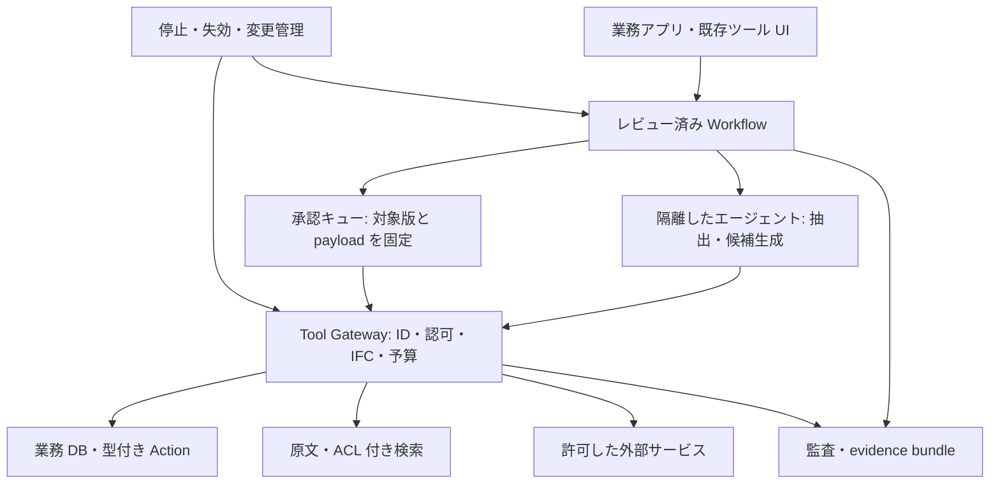

# AI-native 企業の共通基盤: 実行・データ・機密保護

[専門用語の日本語説明](../glossary_ja.md)。製品名・論文の原題・コードは原表記を保持する。

## 調査目的と証拠の範囲

Apple Notes の2026年10月5日作成「新規メモ」に貼られたコンソール写真3枚を読み、同じ10テーマをこのリポジトリで再調査した。本稿は写真の①実行基盤、②データ・検索・モデル、③セキュリティを扱う。④〜⑩は[法務・業務設計](../legal_domain/ai_native_operations_20261005.md)と[企業事例](../benchmarks/ai_native_companies_20261005.md)、全項目の対応は[調査範囲・検証台帳](../ai_native_research_audit_20261005.md)を参照。

写真が示す目的は「法務の一部で AI autonomy / Human on the Loop を実現し、全社に展開できる技術基盤を設計する」。写真中の結論・製品名は調査の入力であり、検証済み事実とは扱わない。ここでいう**確認**は公開一次資料の記述を確認したこと、**設計案**は本調査の提案である。実装、契約、社内データでの性能は未検証。10月2日の既存ノートの全記述を再検証したものでもない。

## ① エージェントの実行基盤

### 認可: Zanzibar、OpenFGA、Cedar の役割を分ける

| 対象 | 一次資料から確認した役割 | この基盤での設計案 |
|---|---|---|
| Zanzibar | Google の大規模で整合性を考慮した関係ベース認可システムの研究。製品そのものの導入手順ではない | データ共有・継承・取り消しの参照モデルにする。[論文紹介](https://research.google/pubs/zanzibar-googles-consistent-global-authorization-system/) |
| OpenFGA | 関係をモデル化し、ユーザーとオブジェクト間のアクセスを判定する認可エンジン | 文書、案件、部門、担当者の閲覧判定に使う。[公式資料](https://openfga.dev/docs/fga) |
| Cedar | principal、action、resource、context を用いたポリシー評価言語・エンジン | 「承認者本人か」「この金額・状態・宛先で操作できるか」を評価する。[言語仕様](https://docs.cedarpolicy.com/) |

二つの判定を gateway の一つの強制点に集約する案は妥当だが、OpenFGA と Cedar の自動連携が完成済みという意味ではない。利用者の閲覧権限、エージェントの委任範囲、操作ポリシーを全て満たした場合だけ通す。対象版と認可モデル版を記録し、承認後の権限取り消し・文書更新を実行前に再検査する。

### 継続実行、隔離、情報フローは別の機能

| 部品 | 確認した機能 | 境界・採用時の検証 |
|---|---|---|
| Temporal | Event History による replay と障害後の再開、Activities と Signals による外部との接続 | LLM 推論と API 操作は Activity に置く。業務状態の復元と外部副作用の一度だけ実行は別問題。再試行に備え下流の冪等キーと結果照会を設計する。[Execution](https://docs.temporal.io/workflow-execution)、[Definition](https://docs.temporal.io/workflow-definition) |
| gVisor | ユーザー空間の application kernel と OCI runtime `runsc` によるホストとの隔離 | syscall 互換性・I/O 負荷を確認する。ネットワークで許可された漏えいまでは止めない。[公式資料](https://gvisor.dev/docs/) |
| Firecracker | KVM を利用する軽量 microVM | 強い分離の候補。VM イメージ、ホスト更新、ネットワーク、永続ディスクを別途管理する。[公式資料](https://firecracker-microvm.github.io/) |
| CaMeL | 信頼する要求から制御・データフローを抽出し、出所に基づく capability とポリシーをツール実行時に検査する研究 | Temporal を置くだけで CaMeL の保証は得られない。値の由来と宛先の検査まで必要。[論文本文](https://arxiv.org/html/2503.18813v2) |

**設計案:** 業務 Workflow は人がレビューしたコードで定義し、LLM は抽出・候補生成を担う。ツール gateway が閲覧認可、操作認可、出所ラベル、egress、承認証跡、予算を検査する。エージェントに任意の DB 更新・外部通信を与えない。

CaMeL の AgentDojo 評価は、保護なし84%に対し安全性の保証を伴うタスク達成77%と報告する。これは指定の脅威モデル・実装・評価条件の結果であり、法務の正しさや全ての side channel の保証ではない。[論文](https://arxiv.org/abs/2503.18813)

### 自律実行と人の承認

AWS AgentCore Policy は gateway のツール呼び出しに対してポリシーを強制する。**ツールの許可**と「この契約のこの版をこの相手に提示する」という**業務承認**は同一ではない。[AWS 公式資料](https://docs.aws.amazon.com/bedrock-agentcore/latest/devguide/policy.html)

主要ベンダーの広い比較は[既存の制御面調査](enterprise_agent_control_plane.md)を参照。今回は以下の現行一次資料を追加確認した。ベンダーの製品 UI で承認ボタンがあるだけでは、承認内容と実行内容の一致は証明されない。

| ベンダー | 今回の再確認 | 業務承認への接続で残る点 |
|---|---|---|
| AWS | AgentCore workload identity は環境・認証方式をまたぐ identity の基点。Policy は gateway 操作に強制。[Identity](https://docs.aws.amazon.com/bedrock-agentcore/latest/devguide/understanding-agent-identities.html) | identity と許可だけで、承認者が見た契約版の一致は証明しない |
| Microsoft | Entra agent identity の human sponsor、ライフサイクル、Conditional Access による agent authentication の遮断を説明。[管理 docs](https://learn.microsoft.com/en-us/entra/agent-id/manage-agent-identities-admin) | 失効後の外部 token・queue・実行中操作の停止は別に確認 |
| Google | Agent Identity の自身の権限と利用者代理の権限を区別。[IAM docs](https://docs.cloud.google.com/iam/docs/agent-identity-overview) | 両方の権限と案件 scope を検査する。自身の権限を利用者の承認とみなさない |
| Anthropic | Managed Agents の `always_ask` は事前承認、`auto` は自動許可を含み human checkpoint ではない。custom tools はアプリ側の責任。[Permission policies](https://platform.claude.com/docs/en/managed-agents/permission-policies) | 独自 API は自社 gate を必要とする。tool allow を業務承認へ流用しない |

承認と実行の binding に関する2026年9月の研究は、coding-agent harness で承認した action と実行された action が一致するという前提の失敗を整理する。今回確認したのは abstract で、本文・個別 exploit の再現は未実施だが、payload と対象版を固定する設計の検証候補となる。[Approval Laundering](https://arxiv.org/abs/2609.38983)

**承認オブジェクトの設計案:** `case_id / action_type / actor / approver / resource_id / resource_version / payload_hash / destination / amount / policy_version / expiry / nonce` を保存する。実行直前に hash・対象版・宛先・権限・期限を照合する。変更があれば再承認。承認待ち中にモデルが内容を編集しても既存の承認を流用できないようにする。無人の再試行も同じ検査を通す。

## ② データ・検索・モデル

### データ表現: オントロジー、GraphRAG、SQL

GraphRAG はテキストからグラフ構造を抽出し、検索・要約に利用する仕組み。オントロジーは「案件」「契約」「請求」「部門」等の意味・関係・操作を定義する層であり、グラフ DB や GraphRAG を導入することと同じではない。[GraphRAG](https://microsoft.github.io/graphrag/)、[本 repo のオントロジー調査](ontology_palantir_kinetic_layer.md)

| 問い | 設計上の処理 | 検証すべきこと |
|---|---|---|
| 契約金額、期日、処理状態を一覧したい | 業務 DB の SQL / 型付き read API | JOIN の意味、通貨、税、タイムゾーン、権限、実行時点 |
| 条文の根拠、過去案件を探したい | ACL 付き hybrid retrieval + 原文引用 | 法域、適用日、引用箇所、削除済み原文の排除 |
| 取引先から契約・請求・紛争まで追いたい | 安定 ID の関係モデル / グラフ探索 | 同名企業の誤統合、関係の由来、有効期間 |
| 文書群の横断的傾向を知りたい | GraphRAG 等の集約 | コスト、要約の根拠、利用者ごとに集約対象を制限できるか |

**判断:** 初期は SQL の正本 + 意味定義 + ACL 付き検索。多段関係の問いが評価セットで頻出してからグラフを追加する。検索結果の適切さを事業知識に基づき評価し、全社データをまとめた要約を個別 ACL で後から隠す方式は採らない（設計案）。

### Slack、メール、Drive: 複製・都度参照・必要情報抽出

Slack Events API は OAuth scope と認可された利用者・bot に見える範囲のイベントを配信する。Drive の changes API はアクセス可能なファイルの変更取得を提供する。Gmail の同期は history を使い、履歴が利用できない場合は full sync が必要となる。[Slack](https://docs.slack.dev/apis/events-api/)、[Drive](https://developers.google.com/workspace/drive/api/guides/manage-changes)、[Gmail](https://developers.google.com/workspace/gmail/api/guides/sync)

| 方式 | 利点 | 必要な対策・選定条件 |
|---|---|---|
| 内容を複製して検索 | 低遅延、横断検索、参照版の固定 | 原文 ID、版、ACL、削除・保持同期、暗号化。ACL 失効の反映期限を測る |
| 都度 API 参照 | 現行の情報に寄せやすい | quota、障害、認証、遅延、アクセス範囲、同時更新。判断時の内容を証跡として固定 |
| 必要項目だけ抽出 | 利用範囲を絞り構造化できる | 抽出誤り、原文との照合、派生データの削除、用途外利用防止 |

**設計案:** 原文は source of truth とし、検索 cache と業務イベントを分離する。派生物にも元の ID・版・ACL・機密ラベルを持たせる。ingestion 時と retrieval 時の認可を両方行い、権限同期に障害がある間は機密検索を停止する。決定に使った evidence bundle を ID と版で保存する。複製の許可範囲・API 契約条件は社内で未確認。

### 長期メモリ: Letta / Mem0 / Zep

| 対象 | 今回確認した機能 | 業務向けの注意 |
|---|---|---|
| Letta | DB に state を保持し、context 内の memory blocks をエージェントが tools で編集できる | 編集可能な記憶を契約・規程の正本にしない。[Docs](https://docs.letta.com/v1-sdk/concepts/stateful-agents) |
| Mem0 | メッセージから LLM で memory を抽出。`infer=False` で raw 保存。現行の add docs は追加型と説明 | 抽出された記憶の誤り・重複・矛盾・削除の処理を検証する。過去版の update 挙動を無条件に引き継がない。[Docs](https://docs.mem0.ai/core-concepts/memory-operations/add) |
| Zep / Graphiti | Graphiti はエピソード由来の temporal graph、bi-temporal、事実の失効と hybrid retrieval。Zep は managed context layer | 時間の扱いが有用でも、抽出結果の真偽・案件 ACL を自動保証しない。[Docs](https://help.getzep.com/graphiti/getting-started/overview) |

**設計案:** 業務記録、エピソード、手順、評価付きフィードバックを分離する。業務 DB が正本。経験からの新ルールは候補として保存し、承認した版だけ配布する。判断に用いた memory ID・版・取得時刻を固定し、後日の更新で監査結果を変えない。

### モデル最適化: RAG / SFT / LoRA / 蒸留 / 継続事前学習

| 方法 | 一次資料と役割 | 適用案・不確実性 |
|---|---|---|
| RAG | 外部 evidence を検索して推論に渡す | 変更・削除・ACL が必要な機密知識の初期方式。引用の存在だけで正答と判定しない |
| SFT | ラベル付きの入力・期待出力による task adaptation | 条項分類、抽出形式、社内 playbook の適用手順。学習データ・評価データを案件単位で分離 |
| LoRA | 事前学習 weight を固定し low-rank の更新を学習する。[論文](https://arxiv.org/abs/2106.09685) | SFT 等を効率よく行う技法であり別の知識 DB ではない。機密ラベルや削除要求が重みに反映しにくい |
| 蒸留 | 大きいモデル等の知識を小さいモデルへ移す学習法。[論文](https://arxiv.org/abs/1503.02531) | 狭い抽出タスクの費用・遅延削減候補。教師の誤りを転写しないよう専門家ラベルで検証 |
| 継続事前学習 | ドメイン・task の未ラベル corpus への適応に効果を報告。[研究](https://arxiv.org/abs/2004.10964) | 学習量、コスト、忘却、機密・ライセンス管理が増える。日本語法務への効果をこの研究から直接主張しない |
| 検索モデルの適応 | embedding / reranker を評価・改善する設計 | 誤った根拠の retrieval が主因なら生成モデルより優先。Recall@k、法域・版・ACL の逸脱を測る |

企業での専用・fine-tuned モデルの公開例は Harper の内部学習データの説明と Harvey の domain model に関する資料がある。ただし学習手法、データ量、日本語法務での精度の再現に必要な情報は不足する。[Harper](https://www.harperinsure.com/privacypolicy)、[Harvey 導入の技術事例](https://www.microsoft.com/en/customers/story/19750-harvey-azure-open-ai-service)

**選定手順:** 同じ評価セットで一般モデル + RAG を baseline にし、検索改善、SFT/LoRA、小型化を一つずつ比較する。平均品質に加え、高リスク誤答、引用の支持、棄却、削除対象の再出力、総処理費用を記録する。最適化手法を導入目的にしない。

### 音声・会話の保存

Meet の録画・transcript は主催者の Drive に保存され、Meet REST API の transcript entries は会議終了から30日後に削除される。API 側の期限と Drive / Vault の保持を混同しない。[Meet artifacts](https://developers.google.com/workspace/meet/api/guides/artifacts)

多言語 ASR の基礎研究は[Whisper 論文](https://arxiv.org/abs/2212.04356)、日本語向け OSS は[ReazonSpeech](https://research.reazon.jp/projects/ReazonSpeech/index.html)。後者はモデルと corpus のライセンス条件が異なる。いずれも会議の話者同定や法務固有名詞の正確さをこの公開資料だけで保証できない。

**設計案:** 会議 API、オンライン録音、対面録音を別経路として扱い、収集目的、告知・同意の要否、保存期限、利用者 ACL、訂正経路を管理する。音声、文字起こし、話者推定、決定事項を分離し、人が確定した議事・業務イベントだけを正本にする。評価は CER/WER のほか、金額、日付、当事者、否定表現、話者、無音区間の誤生成を測る。

## ③ セキュリティ・機密保護

### 情報流出防止とモデル配置

CaMeL は入力検知だけに頼らずデータフローを検査する。権限があることは外部送信してよいことを意味しない。**設計案:** IFC ラベルを原文・要約・embedding・tool 結果へ伝播させ、送信先を gateway で検査する。送信先・権限引数を untrusted 文書の文章だけで決めず、取引先 master と照合する。[CaMeL](https://arxiv.org/html/2503.18813v2)

| 配置 | 確認資料 | 評価・契約の確認軸 |
|---|---|---|
| Managed cloud | Bedrock はデータ保護の責任分担とモデル提供者へのデータの扱いを説明。[Docs](https://docs.aws.amazon.com/bedrock/latest/userguide/data-protection.html) | inference、logging、cache、バックアップ、support、embedding 等を別々に確認。国内リージョンの有無だけで国内処理と断定しない |
| Local LLM | 自社内で model serving を運用する設計 | 日本語法務品質、GPU、運用人員、patch、外部 telemetry、ライセンス、電力を含め総費用を比較 |
| TEE | Confidential VM は利用中のデータを保護する機能。[Google Docs](https://docs.cloud.google.com/confidential-computing/confidential-vm/docs/confidential-vm-overview) | attestation、対応 accelerator、鍵解放、I/O とログの扱い。許可されたモデル出力の漏えいは別に防ぐ |

既存の[隔離・機密計算調査](agent_sandbox_isolation_confidential_computing.md)を踏まえ、機密区分ごとの route を policy として定義する案。モデル、ASR、embedding、judge、外部 tools の全てを対象にする。

### PII、embedding、ACL 検索

Presidio は custom recognizer 等を用いる PII 検出・匿名化 framework で、全機密情報の検出を保証しないと明記する。日本語の社名、人名、住所、口座、案件固有語を別途評価する。[公式 repository](https://github.com/data-privacy-stack/presidio)

Vec2Text は特定の32 token 入力・embedding モデル・攻撃条件で92%の完全復元を報告する。全 embedding の復元率として一般化できないが、「ベクトルなので非機密」という扱いは支持されない。[研究](https://arxiv.org/abs/2310.06816)

**設計案:** 仮名 ID と復元対応表を分離し、対応表に独立した権限を要求する。検索結果の prompt 化前に ACL を検査し、metadata、graph edge、要約、cache にも同じ境界を設ける。削除対象の embedding・graph・memory を追える lineage を保存する。DLP / PII 検知を認可・IFC の代替にしない。

### ID、監査、停止、インシデント

OWASP は agentic AI の脅威と対策を整理し、CSA の MAESTRO は層間の相互作用を含む threat modeling を提供する。いずれも認証や runtime enforcement を導入する製品ではない。[OWASP](https://genai.owasp.org/resource/agentic-ai-threats-and-mitigations/)、[MAESTRO](https://labs.cloudsecurityalliance.org/maestro/)

**設計案:** 利用者・エージェント・業務 owner・基盤 owner を識別し、短命で audience を絞った資格情報を gateway 外で管理する。decision ID で evidence、モデル版、policy、承認、実行結果、例外、rollback をつなぐ。機密 prompt 自体を無制限にログへ複製せず、暗号化と閲覧制御を持つ evidence store を分ける。

| リスクの一次資料 | 本調査への含意 |
|---|---|
| EchoLeak（CVE-2025-32711）の攻撃研究は crafted email による Copilot からの情報流出を分析。[論文](https://arxiv.org/abs/2509.10540) | SaaS 内で参照できるメールも untrusted。研究上の exploit と実際の顧客被害を区別する |
| MCP の security best practices は confused deputy、token passthrough 等を扱う。[仕様](https://modelcontextprotocol.io/docs/2025-11-25/tutorials/security/security_best_practices) | MCP 接続があるだけで適切な委任認可が実現するわけではない。server ごとに scope・audience・出所を検査 |
| 法務 RAG 製品の2024年評価で hallucination が残る。[研究](https://arxiv.org/abs/2405.20362) | AI の誤操作だけでなく根拠の誤用を gate に含める。歴史的評価を現行製品の率として引用しない |

サーバー側の隔離だけで社員端末・第三者 SaaS・OAuth 管理・ブラウザをカバーできない。端末の管理、アプリ inventory、許可 connector、送信先を含む運用が必要という設計判断である。ID 失効、gateway deny、ネットワーク遮断、Workflow の停止を個別に検証し、停止後の queued / in-flight 操作も点検する。

## 共通基盤の構成案

これは製品が一式で実装済みという図ではない。SDK が提供すべきものはこの runtime との型付き契約であり、SDK の helper 関数だけに検査を置くと別クライアントから迂回できる。認可・外部送信・承認の検査を server 側で強制する。

## 実装前の検証項目

1. 承認済み内容の差し替え、期限切れ、権限失効、別案件への流用を gateway が拒否すること。
2. ACL 変更・削除の source → 検索 → memory → graph → cache までの反映遅延を測定すること。
3. Workflow crash、tool timeout、二重配送、外部成功後の通信失敗から再開しても副作用を重複させないこと。
4. PII、inject された宛先、偽引用、他案件情報、無音 ASR を含む日本語評価セットを作ること。
5. ID・ネットワーク・gateway・Workflow の各停止経路と、人への切替・復旧・版の pin を検証すること。
6. モデル本体以外の ASR・embedding・judge・support にも国内処理、保持、学習利用、契約条件を確認すること。

これらは調査から導いた受入条件であり、今回実施した実装テストではない。
