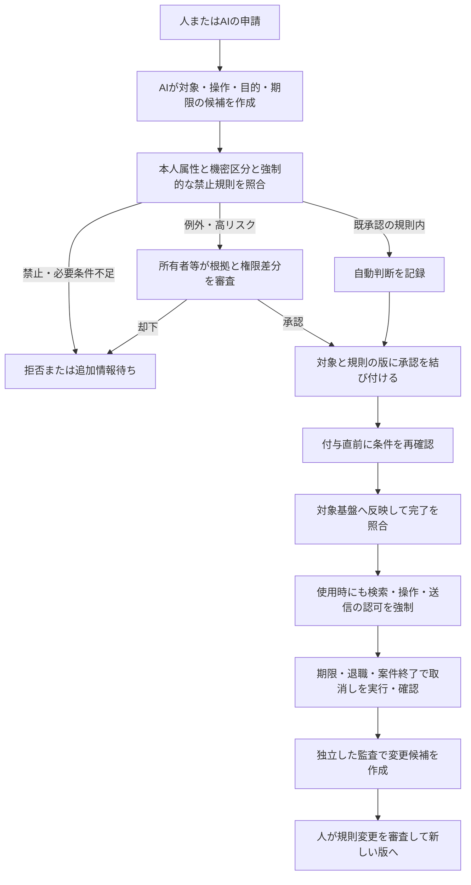

# データの機密区分とアクセス権の申請・付与・取消しをAIで支援する調査

調査日：2026年10月6日。対象は海外の導入事例、製品の技術文書、研究論文。公開資料の確認であり、顧客環境での試験・実験再現は行っていない。

## 1. 人の承認を基本にするべきか

**規則の新設・緩和と高リスクの例外には人の承認を残し、承認済みの規則内で反復する申請は自動化する**、という設計を本調査では推奨する。HITL（Human-in-the-loop）は、人が判断・承認に参加する仕組みを指す。全ての読み取りや申請を毎回人に回すことが必須、という意味ではない。

実際に、Immutaは規則内の自動付与と例外の人による審査を提供し、Instacartは条件付き規則とAIによる申請分析を組み合わせ、個別承認を減らしている。ただし、個人の好みの予測、同僚との類似度、承認履歴との一致は、機密保護や法的な利用資格を証明しない。[Immutaの付与構成](https://www.immuta.com/platform/provision)、[Instacartの導入事例](https://www.c1.ai/customers/instacart)。

人の承認も、それだけで十分とはいえない。模擬操作を使った研究では、利用者が書いた規則から人へ回された越権操作が承認される例が多かった。AI自身が書いた説明を承認しても、実行内容と違えば保護にならない。[利用者の承認の実験](https://arxiv.org/abs/2608.27443)、[承認と実行の一致の研究](https://arxiv.org/abs/2606.02668)。

| 判断すること | 本調査が推奨する人の関与 | 自動化する条件・範囲 |
|---|---|---|
| 初回の機密区分、利用資格の規則、承認者の設定 | データ所有者・安全管理担当者が制定・確認 | AIは分類候補と根拠箇所を提示。既承認の分類器による反復分類は自動化可能 |
| 日常の参照権の申請 | 既存の規則を承認した人が責任を持つ | 本人属性・目的・資産・地域・期間を機械判定し、規則内だけ自動付与 |
| 個人情報の非表示解除、国外移転、機密区分の引下げ | 原則として所有者、必要に応じ法務・安全管理担当者 | 対象列・対象者・送信先・期限を限定。本人の承認だけで他人の情報を解放しない |
| 特権・管理者・書込み・再委任 | 例外承認と必要な職務の分離 | 対象を許可一覧で限定し、短命の権限として付与。読取り許可から推測で拡張しない |
| 期限切れ・退職・案件終了による取消し | 定型の取消しは待たせない。異常・業務影響を人に通知 | 対象側の取消し完了まで確認。延長は新たな判断として扱う |
| 規則の自己改善 | 変更案、拒否例、権限増加の差分を人が審査 | 本番の承認規則をAIが自分で緩めない。変更後は版を更新して再評価 |

これは設計上の推奨であり、全製品の既定動作や法令上の一律要件を述べたものではない。

## 2. クリアランスを四つに分ける

ここではクリアランスを「データの機密区分」と「主体がそのデータを使える資格・条件」の両方として扱う。単一の高低の数字だけでは、案件・国・目的が異なるデータを区別できない。

| 管理対象 | 例 | 別に管理する理由 |
|---|---|---|
| データの機密区分と制約 | 公開／社内／機密、個人情報、案件番号、保存地域、契約上の利用目的 | 資料の分類は、特定の人への権限付与ではない |
| 利用主体の資格 | 雇用状態、部署、研修完了、案件参加、居住・勤務地域 | 資格があっても、全ての対象へのアクセスを付与しない |
| 個別の許諾 | 主体×対象×操作×目的×期限、非表示解除する列 | 同じ表でも読取り・更新・外部送信・再委任は異なる許可 |
| 情報の流れ | 原文→索引→検索結果→要約→監査記録→外部送信 | 一度読めた情報が、別の受取人や保存先へ自由に出せるわけではない |

機密ラベルと実際の保護を結び付ける必要がある。Microsoft Purviewでは、内容に応じた自動分類と、ラベルに設定された暗号化などの保護を扱う。ラベルが付いている事実だけで、検索索引や独自のAI基盤の認可まで完了したとは扱わない。[自動ラベルの公式文書](https://learn.microsoft.com/en-us/purview/apply-sensitivity-label-automatically)。

## 3. 事例と技術構成の比較

「導入」は顧客の運用が紹介されている場合、「製品」は提供元の機能説明、「研究」は指定条件の評価である。製品一般の機能を顧客の導入済み機能へ読み替えない。

| 事例・提供元 | 解決する課題 | AIが担当する部分 | 権限付与・人の関与 | 確認できた範囲 |
|---|---|---|---|---|
| Instacart＋C1.ai＋Gadjit | 常設特権、管理者の形だけの承認、複数基盤の権限分散 | 申請者・権限・既存利用者の文脈の比較 | 条件付き規則、自動承認対象の限定、期限付き付与。規則を人が審査 | 顧客事例＋公開コードの静的確認 |
| Immuta Review Assist | データ所有者が申請の妥当性を毎回調べる負担 | 過去の判断と主体属性から推奨・理由・期間を提示 | 人が変更可能。承認後にデータ基盤側へ自動反映 | 公式技術文書 |
| Immuta Agentic Data Access | AIの問い合わせごとにデータが必要になり、人の待ち行列が詰まる | 必要データの探索と不足権限の申請 | 代理元の人の権限、規則内の自動承認、機密申請の人への回付、短命付与 | 製品構成の説明。顧客固有の内部実装は未確認 |
| C1.ai Thomas | 申請・棚卸しの大量処理と、申請文からの不正指示 | 信頼しない入力の構造化と、制限された道具による判断 | 入力処理と承認操作を分離。AI自身の本人性・道具・記録を管理 | 提供元の技術記事 |
| C1.ai 実行時の制御 | 既に権限を持つAIが、読み取ったデータを外へ送る | 操作ごとの危険度評価 | 道具の範囲制限、拒否・人の承認待ち・応答の非表示処理 | 2026年7月29日の製品発表。迂回耐性の試験なし |
| SailPoint | 難解な権限名、申請候補の探索、再認定の負担 | 同僚・関係図による推薦、説明生成、自然言語で申請作成 | 説明を採用する前に人が審査。申請作成と付与判断を区別 | 機能一覧＋管理者向け文書 |
| Saviynt | 多数の役割から適切なものを選べず、承認者も判断材料がない | 同僚の権限を学習し、候補・確信度・理由を提示 | 申請者・承認者の判断支援。この記事だけで無人付与を立証しない | 2024年9月30日の製品解説 |
| Veza Access Requests | 役割名だけでは実際に開く資産が分からない | 最小権限の役割候補と付与影響の事前確認 | 規則に基づく反映、期限付き付与、自動失効 | 製品ページ。推薦方式の詳細と顧客別AI運用は未確認 |
| Microsoft Purview | 大量文書の機密区分を手で付ける負担 | 機密情報の検出・学習可能な分類器 | 利用者への推薦と自動付与、管理者の試行評価 | 公式技術文書。生成AIによる承認の事例ではない |

### 3.1 Instacart：AIによる自動承認の実例と公開コードの境界

C1.aiの顧客記事は、条件付き規則で約95%の特権を必要時だけの付与へ移行した後、Gadjitで残る申請を分析したと説明する。Terraformで規則を管理し、所有者が四半期ごとに規則を確認する。記事の結果欄は100%を掲げるが、本文の95%は規則による移行段階を指す。**100%という記載をAI単独の寄与や独立検証された安全性へ変換しない。**[顧客記事](https://www.c1.ai/customers/instacart)。

公開Gadjitの固定版 `614b211dd41728603d1edf159483d8421a2a8158` では、次を確認した。顧客の本番設定がこの版と同じという意味ではない。

- 申請者と既存メンバーの属性をLLM（大規模言語モデル）で比較し、既存メンバーの類似度上位3件の平均と、権限の説明との関係点から点数を計算する。
- 採点拡張の負の結果は拒否、0は手動審査へ回す。最終点が1未満なら手動審査を求めるコメントを残す。
- 最終点が1以上でも、権限の名前またはIDが `entitlements_to_auto_approve` に含まれる場合だけ承認操作を実行する。一覧の既定値は空。
- 承認処理は、申請を設定した主体へ割り当て直し、現在の承認段階を取り直して承認APIを呼ぶ。

[採点処理](https://github.com/instacart/gadjit/blob/614b211dd41728603d1edf159483d8421a2a8158/gadjit/plugins/scoring/requester_profile_attribute_proximity/plugin.py)、[分岐と許可一覧](https://github.com/instacart/gadjit/blob/614b211dd41728603d1edf159483d8421a2a8158/gadjit/handler.py)、[承認操作](https://github.com/instacart/gadjit/blob/614b211dd41728603d1edf159483d8421a2a8158/gadjit/plugins/iga/conductorone_cron/plugin.py)。

本調査の解釈：同僚も持っている権限は、同僚の過剰付与を複製する可能性がある。関係点のプロンプトは「判断不能」を1とするが、最終点は他の採点も含むため、これだけで自動承認されるとはいえない。それでも不確実性の点数を禁止条件と分ける必要がある。高リスクの対象には変更可能な名前より不変のIDを使い、資格・地域・職務の分離の禁止条件を独立して強制することを推奨する。動作試験・攻撃試験は未実施。

### 3.2 Immuta：参照の許可と非表示解除を別の申請にする

公式文書は、表などの参照申請と、特定列の非表示を解除する申請を分ける。承認不要の設定では、利用条件への同意と必要事項の回答後に自動付与する。承認が必要な場合は保留し、承認後にデータ基盤側の規則で反映する。[申請の公式文書](https://documentation.immuta.com/SaaS/request/access-data-products/how-to-guides/requesting-access-to-a-data-product)。

Review Assistは人が下した最終判断の傾向を使う推薦で、承認者は判断と理由を変更できる。**非表示解除の例外には利用できない。** 申請フォームの自由記述も評価する拡張は限定的な試験提供である。履歴との違いを危険度へ反映する仕組みであり、規則の適法性の証明とは異なる。[Review Assistの公式文書](https://documentation.immuta.com/saas/request/review-access-requests/reference-guides/understanding-review-assist)。

AIによる問い合わせ時の申請、代理元の人の権限の継承、一時的な付与は製品構成として説明される。[Agentic Data Access](https://www.immuta.com/platform/agentic-data-access)。単にAI専用の強い共用アカウントを作る構成とは区別して評価する。

### 3.3 C1.ai：申請文を読むAIと承認できるAIの権限を分離

Thomasの技術記事では、利用者の申請理由や外部の説明を信頼しない入力とし、構造化するAIに承認の道具を持たせない。承認・拒否・割当てを行うAIには限定した道具と本人性を与え、操作・判断・結果を記録する。要約を作るだけで安全になったと証明する記事ではなく、構造的な権限分離の説明である。[2025年6月5日の構成記事](https://www.c1.ai/labs/research/splitting-ai-agents-to-contain-prompt-injection)。

2026年7月29日の実行時制御の発表は、道具呼出しを共通の判定点へ通し、観測のみの段階から強制へ移る方式を説明する。判定不能時は待機し、規則に応じ拒否・人の確認・戻り値の非表示を行う。**この後発の製品機能が前記Instacartの導入で使われたとは確認していない。**[発表](https://www.c1.ai/blog/introducing-agent-runtime-governance)。

### 3.4 SailPoint・Saviynt・Veza：候補、説明、実際の影響を判断材料にする

SailPointのAccess Request Agentは自然言語から申請を作成し、状態確認や取消しを行う。協調的な推薦・関係図による棚卸し支援と、生成AIによる説明作成は異なる機能である。[AI機能の一覧](https://www.sailpoint.com/why-us/trust/ai)。生成した権限説明は審査後に採用する。管理文書では付与の部分失敗も状態として扱うため、「承認済み」と「対象へ反映完了」を別に管理する実装の参考になる。[管理文書](https://documentation.sailpoint.com/saas/help/requests/approvals_admin.html)。

Saviyntは同僚の権限を機械学習でモデル化し、申請者と承認者へ候補・確信度・理由を提示する。[製品解説](https://saviynt.com/blog/intelligent-recommendations-while-requesting-and-approving-access)。Vezaは役割の候補について付与前の影響確認、期限付き付与、自動失効を説明する。[製品ページ](https://veza.com/product/access-requests/)。本調査では、推薦の確信度を強制的な許可の根拠にせず、実際に開く対象と操作を表示する設計へつなげる。

### 3.5 Microsoft Purview：分類の自動化にも方式ごとに異なる人の関与

利用者のアプリでの推薦・自動ラベルと、サービス側で大量に付けるラベルは異なる。サービス側は利用者の個別操作を伴わず、事前のシミュレーションで範囲を確認する。手動ラベルと優先順位の扱いにも設定差がある。自社で使うときは分類漏れ、誤分類、機密区分を下げる条件を試行で検証する。[公式文書](https://learn.microsoft.com/en-us/purview/apply-sensitivity-label-automatically)。

### 3.6 広い企業導入の証拠と、AI固有の証拠の違い

Roche DiagnosticsとAccentureは、部門がデータを所有する構成に共通のアクセス制御を適用する発表を行っている。ただし公開の紹介本文だけでは、現在のAIによる申請判断の本番導入を確認できない。[2023年3月1日の発表紹介](https://www.immuta.com/resources/roche-data-mesh-federated-governance-access-control)。

Immutaの現行サイトはGeneral Motorsの1,000万超の自動付与、5日から2分への短縮、Rocheの50部門の統合などを掲げる。これは提供元の公表値で、測定条件・分母・AIの寄与はこのページだけでは分からない。無人の権限付与の安全性や、全社のAI化の実証には使わない。[提供元の導入紹介](https://www.immuta.com/)。

## 4. 追加した論文7本と既存研究の位置付け

追加論文は全てPDFを取得し、本文の関連箇所を確認して全頁OCRを行った。概要、重要点、評価条件、限界、企業設計への解釈は[日本語解説11](../papers/paper_notes_11.md)へまとめた。元PDF・OCR版・認識本文へのリンクは[論文台帳](../papers/README.md)にある。

| 論文 | 解決する課題・技術 | 企業設計へ使うときの境界 |
|---|---|---|
| [Policy-Aware Generative AI for Safe, Auditable Data Access Governance](https://arxiv.org/abs/2510.23474) | 生データではなく規則と属性を入力し、LLM判断を強制的な規則判定で制限 | 模擬14事例。禁止規則をLLMの外で強制する参考 |
| [Can LLMs Make (Personalized) Access Control Decisions?](https://arxiv.org/abs/2511.20284) | 短い個人の希望文から許可判断を予測 | スマートフォンの個人権限の研究。好みとの一致と企業の安全性を混同しない |
| [Generation of Human Comprehensible Access Control Policies from Audit Logs](https://arxiv.org/abs/2603.14341) | LANTERN：決定的な規則抽出とLLMによる説明を組み合わせる | 合成ログ。過去に許可されたことから新規許可の正当性は導けない |
| [What You Approve Is What Executes: Consent Integrity for Black-Box LLM Agents](https://arxiv.org/abs/2606.02668) | 実際の操作から信頼できる承認表示を作り、承認を実行へ結び付ける | 試作には見逃しと過剰な確認が残る。全操作の仲介は未実装 |
| [How Agents Ask for Permission](https://arxiv.org/abs/2607.13718) | 21提案・商用5システムの申請表現、内部規則、強制方式を比較 | 調査時点の整理。現在の全製品の安全性評価ではない |
| [Do User-Authored Permission Policies Improve Protection Against AI Agent Overreach?](https://arxiv.org/abs/2608.27443) | 人の個別承認、AIの確認、利用者の事前規則を模擬業務で比較 | 113人の実験。承認の数と越権を止める能力は異なる |
| [Guarded Commits: Transactional Human Approvals for LLM Workflows](https://arxiv.org/abs/2610.00037) | 審査した対象・根拠・規則の版・実行経路を記録し、確定時に照合 | 公開記録の再構成と合成計画。実企業の本番で事故を防いだ実証ではない |

既取得のRAGentは文章から認可規則を作る研究、Towards Automating Data Access Permissionsは個人の文脈・好みによる判断支援、HONEYBEEとMetaPermitは検索側の認可・索引構成の研究として接続する。[既存の日本語解説10](../papers/paper_notes_10.md)。**規則の作成、権限の付与、検索時の強制は別の工程**である。

## 5. 企業AI基盤へ落とす業務手順とデータ構造

以下は資料から導いた設計案で、特定製品の実装済み機能ではない。AIに会話だけで許可を作らせず、申請・判断・実際の付与・取消しを別の状態として扱う。

### 最小限の管理データ

| 記録 | 必要な主な項目 | 失敗を防ぐための意味 |
|---|---|---|
| 資産 | 不変のID、所有者、機密区分、案件・地域・目的、列・行の制約、由来、版 | 表示名の変更や派生資料で認可が抜けない |
| 主体 | 人とAIの別、代理元、責任者、現在の部署・雇用状態、委任の範囲 | AIと人の共用資格情報を避け、誰のための操作か確定 |
| 申請 | 対象、操作、目的、要求する範囲と期間、申請者、実利用者 | 代理申請を本人の許可と混同しない |
| 判断 | 結果、適用規則のIDと版、属性の取得時刻、根拠、AIの推奨と人の判断の別 | 流暢な説明から実際の判定規則を推測せずに済む |
| 承認 | 承認者・権限、対象の指紋値、根拠の版、期限、再利用条件 | 審査後の対象差替え、目的変更、古い承認の使い回しを防ぐ |
| 実付与 | 基盤側の許諾ID、反映結果、部分失敗、開始・終了、取消しの確認時刻 | 承認成功だけで付与・取消し成功と記録しない |
| 作業・監査記録 | 操作ID、代理元、参照対象、判定、外部結果、再試行、保管範囲 | AIの自己説明と、実際のアクセス・送信・失敗を比較 |

本調査では、有効な利用範囲を「組織の強制規則、データ側の制約、代理元の人の権限、AIへの委任、現在の目的・期限」の共通部分として設計する。これは説明用の定義であり、単一の機密レベルの大小比較ではない。

### 自己改善で変更してよいものと、審査が必要なもの

AIは申請の書式、説明、適切な所有者への回付、重複申請のまとめ、候補の順位を改善できる。許可範囲が広がる分類変更、規則緩和、承認者変更、保管期間延長は、別の変更申請とする。

ログから規則候補を作るLANTERNは、この分離の参考になる。成功したアクセスだけを学ぶと誤った過剰付与を正規化しかねないため、拒否例、監査で撤回された許可、目的外利用の事例も評価へ含める。承認・操作記録自身が個人情報や機密を持つので、保管・閲覧・持出しに同じ認可管理が必要である。

### 導入前に測るもの

- 禁止対象の誤承認率。全件の正答率とは分け、地域・部署・データ種類ごとに測る。
- 人が推奨を覆す率、必要な確認時間、形だけの承認、根拠を理解できるか。
- 審査中の退職・異動・データ分類変更、承認後の対象差替えを止められるか。
- 付与・取消しの完了時間と部分失敗。索引、一時保存、要約、継続中のAI作業へ取消しが伝わるか。
- 申請理由・権限説明への不正指示、AIの偽説明、外部送信や再委任への範囲拡張。
- AIや認可基盤が応答しない場合、待機・拒否・例外手順が意図どおり動くか。

## 6. 自分で問いを提案して掘り下げた経路

| 回 | 起点となる問い | 調べて得た回答 | 次の問い |
|---|---|---|---|
| 16 | A01：分類とアクセス付与を同じ許可として扱えるか | Purviewの分類、Immutaの参照と非表示解除を比較。別の管理対象として整理 | A04：一度付けた権限の取消しと派生物はどう扱うか |
| 16 | A02：全件を人へ回すのが基本か | Immutaの自動付与設定とInstacartの条件付き規則を確認 | A05：AIによる承認は実際に使われているか |
| 16 | A03：申請候補をAIが選ぶだけでも改善になるか | SailPoint・Saviynt・Vezaで候補、説明、付与影響の確認を比較 | A06：同僚の権限を学ぶと過剰付与を複製しないか |
| 17 | A04：取消しの判断と実行をどうつなぐか | 期限付き付与と部分失敗の状態を確認。完了照合と検索側の取消しを設計条件へ | A07：承認後に条件が変わった場合はどうするか |
| 17 | A05：AIによる承認は実際に使われているか | Instacartの顧客記事から公開Gadjitの固定版まで確認。許可一覧と採点の分岐を照合 | A08：人の承認を残せば越権は防げるか |
| 17 | A06：同僚の権限やログを学ぶ方式は安全な規則を作れるか | 個人の許可研究とLANTERNを本文確認。履歴の再現と適切な新規許可を分ける | A09：規則の自己改善を誰が承認するか |
| 18 | A07：承認後の対象変更と条件変化を止められるか | Consent IntegrityとGuarded Commitsで表示・対象・版・実行の結合を確認 | 本番では不変IDと付与直前の再照合を試験する |
| 18 | A08：人の承認を残せば越権は防げるか | 113人の模擬操作研究で承認の失敗を確認。Thomasの入力と承認操作の分離を比較 | 人が検証できる権限差分と信頼できる表示を試験する |
| 18 | A09：規則の自己改善を誰が承認するか | ログからの規則候補と本番反映を分離。版管理と拒否例を変更審査へ | 社内検証で誤承認・取消し・事故後の撤回まで測る |

まだ公開情報から確定できない点は、各顧客の採点しきい値・禁止条件・誤承認の分母・取消しの伝播時間、機密資料を分類する際のモデルへの送信条件、監査記録の保持契約である。次の段階は、この表の試験条件を自社の代表申請と拒否例へ適用することになる。
