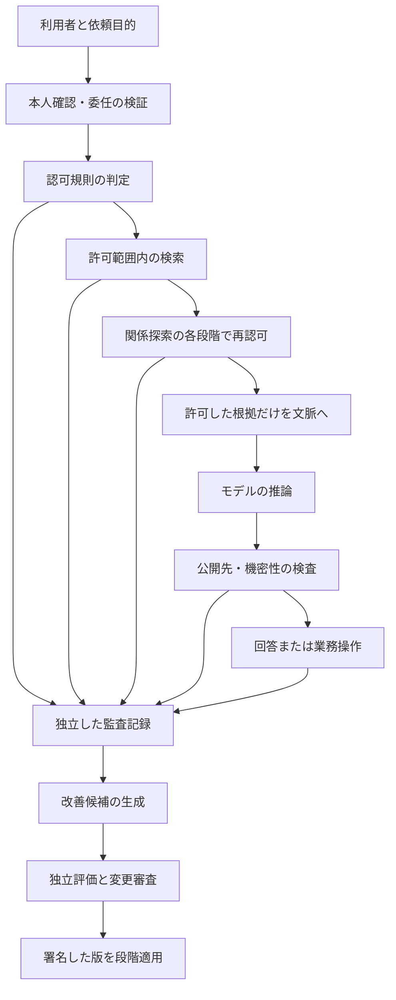

# 企業AIデータ基盤：検索認可・漏えい防止・知識構造・自己改善の監査

調査日：2026年10月6日。既存調査を踏まえ、問いを立て、回答から次の問いを作る反復調査を行う。製品の公式資料、論文、標準を優先する。設計案は調査者の推論であり、未実装・未検証である。

## 今回追加した論文

- [HONEYBEE](https://arxiv.org/abs/2505.01538)：検索認可と索引の構造。
- [Retrieval Pivot Attacks](https://arxiv.org/abs/2602.08668)：文章検索から関係探索へ移る境界。
- [Securing Retrieval-Augmented Generation](https://arxiv.org/abs/2604.08304)：検索経路の攻撃と防御。
- [MetaPermit](https://arxiv.org/abs/2609.31039)：意味の推定と認可の分離。
- [Towards Automating Data Access Permissions](https://arxiv.org/abs/2511.17959)：AIによるデータアクセスの権限。
- [Language Models Don't Always Say What They Think](https://arxiv.org/abs/2305.04388)：説明と判断への実際の影響の違い。
- [Reasoning Models Don't Always Say What They Think](https://arxiv.org/abs/2505.05410)：推論モデルでも残る説明の不忠実性。
- [RAGent](https://arxiv.org/abs/2409.07489)：文章の要件から認可規則を作る支援。
- [AgentTrace](https://arxiv.org/abs/2602.10133)：作業の経緯を構造化して観測する記録方式。

## 設計に直結する判断

検索認可は、モデルへ情報を渡す前に実行する。許可した文書から派生する文章片、数値表現、関係、要約、記憶にも同じ制約を引き継ぐ。回答時の機密検知は補助にする。自己改善では、改善する主体から認可規則・採点規則・監査記録の変更権限を外す。

ここでいう認可は「誰が、何を、何の目的で、どの操作に使えるか」の判定である。本人確認が成功しても全資料へのアクセスを許可したことにはならない。暗号化は保存・通信・計算基盤からの盗み見を防ぐ技術であり、正規権限を持つAIの誤送信を単独で防ぐ技術ではない。

以下は公開資料から導いた構成案である。特定製品を導入すれば自動的に全条件を満たすという意味ではない。



## 第1回：検索認可から、認可の引き継ぎへ

### 問い1：利用者がログインすれば、検索も安全か

安全とは限らない。Azure AI Searchは検索基盤への接続権限と、検索された文書への権限を分ける。通常の文字列による検索条件と、利用者の認証情報に基づく文書単位の判定も区別している。今回確認した資料では、後者の複数機能は試験提供中である。[公式資料](https://learn.microsoft.com/en-us/azure/search/search-document-level-access-overview)

GoogleのGemini Enterpriseは、対応する資料のアクセス制御情報と本人確認基盤を検索へ結び付ける。対応する資料源、IDの対応、取得した権限情報の更新方法を確認する必要がある。[公式資料](https://docs.cloud.google.com/gemini/enterprise/docs/identity)

Databricks AI Searchの公式資料には、行・列単位の権限を直接は提供せず、検索条件のAPIを使ってアプリ側の制御を実装できると記載されている。元の表に制御があることだけで、検索索引も同じ制御を強制すると判断しない。[公式資料](https://docs.databricks.com/aws/en/vector-search/vector-search)

**次の問い：** 許可条件を全検索経路で必ず実行し、利用者がその条件を書き換えられないようにできるか。

**設計案：** 利用者の文章やモデル出力から組織ID・権限を採用しない。サーバー側で確認した本人情報から条件を作る。検索経路は一つの制御窓口へ集約し、権限が不明な資料を拒否する。管理者用の検索資格情報をモデルへ渡さない。

### 問い2：権限を取り消した直後、検索は何を返すか

Azureの文書認可は索引へ同期した権限情報を使う。元の権限変更と検索結果の変更には同期の条件がある。即時の取り消しを要件とする業務では、この差を吸収する仕組みが必要である。[同期モデルの説明](https://learn.microsoft.com/en-us/azure/search/search-document-level-access-overview)

Zanzibarは、Googleの複数サービスに共通する関係ベースの認可を実装し、資料変更と権限変更の因果順序を扱う実運用の研究である。これは言語モデル向け検索の実証ではないが、認可状態と内容の整合性を設計する重要な先行例になる。[論文掲載と運用報告](https://research.google/pubs/zanzibar-googles-consistent-global-authorization-system/)

**次の問い：** 古い検索結果や回答の再利用によって、取り消した権限が復活しないか。

**設計案：** 検索索引の権限版・同期時刻を記録し、失効の許容遅延を定める。緊急の取り消しは更新待ちではなく入口で拒否する。回答を一時保存して再利用する場合も、根拠資料を現在の権限で再確認する。同じ質問でも、利用者・目的・資料版・認可版が異なる場合は同じ保存回答を使わない。

### 問い3：認可を維持したまま、大量の意味検索を高速化できるか

HONEYBEEは、役割に基づく閲覧範囲を利用し、数値化した文章の索引を重なりのある区画へ分ける。利用者ごとの複製と共通索引の後段除外の間で、記憶量・遅延・検索の取りこぼしを最適化する。論文の改善率は指定された負荷での比較であり、全企業での速度保証ではない。[論文](https://arxiv.org/abs/2505.01538)

PostgreSQLの行単位制御は、通常の問い合わせへ規則を適用する実装例になる。ただし所有者、特権管理者、`BYPASSRLS`には例外がある。公式資料には他の表を参照する規則での同時更新の問題も示されている。[公式資料](https://www.postgresql.org/docs/current/ddl-rowsecurity.html)

**次の問い：** 高速化した索引の区画と、現在の正式な閲覧範囲がずれた場合どうするか。

**設計案：** 区画を性能改善の補助として扱い、現在の認可を最後の条件にする。AIの検索用接続は特権例外を持たない役割とする。検索速度だけでなく、拒否された情報の混入率と許可情報の取りこぼしも測る。

### 問い4：文書を許可したら、関係図の探索も許可できるか

Retrieval Pivot Attacksは、許可された検索結果から共有の人物・組織を経由し、他の顧客領域へ探索が伸びる問題を検証する。合成の企業資料とEnronメール資料で、文章検索だけでは現れない漏えいを報告する。攻撃文がなくても共有実体で経路が生まれる。関係探索の境界で認可を行うと、測定された漏えいを抑えられた。[論文](https://arxiv.org/abs/2602.08668)

**次の問い：** 関係、集計、まとめた要約にも閲覧制約を付けられるか。

**設計案：** 頂点、関係、関係の属性を独立した保護対象にする。各探索段階で認可する。複数資料から作った要約は、原則として全ての根拠を閲覧できる利用者だけに渡す。公開可能な集計への変換は、別の明示的な規則と審査を設ける。共有実体を顧客間の情報を結ぶ許可として扱わない。

## 第2回：漏えい防止から、企業の知識構造へ

### 問い5：「出てはいけないデータ」を検知すれば十分か

Amazon Bedrock Guardrailsには個人情報の検出、遮断、置換がある。Google Sensitive Data Protectionは、暗号による仮名化と復元を扱う。これらは有用だが、一般的な機密検知と、特定利用者へ特定資料を公開してよいかの認可は異なる。[AWSの検出・置換](https://docs.aws.amazon.com/bedrock/latest/userguide/guardrails-sensitive-filters.html)、[Googleの仮名化](https://docs.cloud.google.com/sensitive-data-protection/docs/pseudonymization)

**次の問い：** 生の秘密をモデルが読まない構成と、読んだ秘密が外へ流れない構成を分けられるか。

| 技術 | 防ぐ対象 | 残る問題 |
|---|---|---|
| 検索前の認可・顧客領域の分離 | 権限外の根拠をモデルへ渡すこと | 古い権限、別の検索経路、共有記憶 |
| 機密部分の削除・仮名化 | 個人名や識別値の露出 | 組み合わせによる推測、鍵を持つ主体による復元 |
| 情報の機密性・信頼性の追跡 | 機密を許可されない送信先へ渡すこと | ラベルの欠落、非対応の道具、公開判断の誤り |
| 通信先の制限・認証情報の代理注入 | 不正な外部送信、資格情報の読み取り | 正規サービス上の不正操作、画像やURL経由の送信 |
| 出力の機密検査 | 漏れた識別情報の最終検知 | 言い換え、推測、分割送信、検知漏れ |
| 機密計算・暗号計算 | 基盤運営者などの盗み見 | 正規のAI自身による許可されない判断 |

FIDES、CaMeL、APPAは、モデルの拒否に加えて情報や制御の流れへ制約を置く研究である。形式的な保証は仮定を明示して評価する。実験で攻撃成功ゼロだったことは未知の操作を含む無事故の保証ではない。[FIDES](https://arxiv.org/abs/2505.23643)、[CaMeL](https://arxiv.org/abs/2503.18813)、[APPA](https://arxiv.org/abs/2607.24625)

### 問い6：企業のデータを、どんな構造で持つべきか

「類似した文章を探す索引」「業務上の正本」「人物・契約・設備の関係」「指標や用語の意味」「権限と来歴」は用途が異なる。全部を一つの文章索引へ押し込めない。

| 層 | 保存する内容 | 代表研究・例 |
|---|---|---|
| 業務の正本 | 契約、取引、承認、正式な状態 | 関係データベースと取引管理 |
| 文書と検索用索引 | 文書版、文章片、数値表現、原文の位置 | HONEYBEE、検索追加型生成 |
| 関係図 | 実体、関係、属性、関係の出典 | HippoRAG、SCAIR |
| 業務意味の定義 | 指標、単位、集計粒度、許す結合 | GROUND、業務意味の説明を追加する比較研究 |
| 検証規則 | 必須項目、整合条件、業務の制約 | SHACL、NL2SHACL-Bench、PolicyKG |
| 時点と来歴 | いつの事実か、いつ知ったか、どこから得たか | Zep、PROV-O |
| 認可 | 組織、役割、関係、目的、許す操作、規則版 | Zanzibar、Palantirの対象・属性単位の権限 |

[HippoRAG](https://arxiv.org/abs/2405.14831)、[SCAIR](https://arxiv.org/abs/2607.22571)、[GROUND](https://arxiv.org/abs/2608.26157)、[意味定義の比較研究](https://arxiv.org/abs/2604.25149)、[Zep](https://arxiv.org/abs/2501.13956)、[PROV-O](https://www.w3.org/TR/prov-o/)

**次の問い：** 良い構造や正しい用語を用意すれば、認可は省けるか。

省けない。GROUNDは、正確な指標定義だけの条件でも顧客間の漏えいが残ることを比較する。構造の正しさ、回答の事実性、閲覧権限は別の評価軸である。Palantirは対象と属性の閲覧権限を公式資料で説明するが、これだけで自社の派生資料まで自動的に正しく設定されるとは判断しない。[GROUND](https://arxiv.org/abs/2608.26157)、[Palantirの対象と属性の権限](https://www.palantir.com/docs/foundry/object-permissioning/managing-object-security)

### 問い7：AIが業務規則・権限規則を作ることはできるか

RAGentは要件の文章からアクセス制御規則を生成する支援を研究する。MetaPermitは意味に関する属性の推定と、規則による認可を分ける。NL2SHACL-Benchは、文法的に正しい制約でも意味が一致しない場合を示す。PolicyKGも一つの機関の規程を中心にした検証であり、完全な自動変換ではない。[RAGent](https://arxiv.org/abs/2409.07489)、[MetaPermit](https://arxiv.org/abs/2609.31039)、[NL2SHACL-Bench](https://arxiv.org/abs/2608.07530)、[PolicyKG](https://arxiv.org/abs/2608.09028)

**次の問い：** 誤った属性の推定でも、形式的な認可判定が許可してしまわないか。

**設計案：** AIが推定した機密区分や利用目的を暫定値として保存する。判断根拠と不確実性を残し、判定できない場合は拒否または審査へ回す。規則の採用には正規例と拒否すべき反例を用意する。AIの規則生成権限と本番規則の配備権限を分ける。

### 問い8：最低限どんな情報を文章片へ付けるか

以下は本調査の設計案であり、共通標準の必須項目ではない。

```json
{
  "chunk_id": "契約42-第7版-第3片",
  "source_object_id": "契約42",
  "source_version": 7,
  "tenant_id": "企業A",
  "security_label": "法務限定",
  "policy_ref": "契約閲覧規則-第12版",
  "acl_revision": 12,
  "acl_synced_at": "2026-10-06T00:00:00+09:00",
  "valid_time": "契約が有効だった期間",
  "recorded_time": "基盤がこの事実を把握した時刻",
  "derived_from": ["原本42-第7版"],
  "transformation_version": "文章分割-第3版",
  "content_digest": "内容のハッシュ値",
  "deletion_state": "有効"
}
```

**次の問い：** 削除は原本だけで完了するか。

**設計案：** 原本→文章片→数値表現→関係→要約→保存回答→記憶→改善用資料の依存をたどる。削除依頼の受付時に新規検索と再利用を止め、各保存先の削除・失効の完了を記録する。重みに入った知識の忘却と、検索資料の削除を同じ作業と呼ばない。[忘却用語の整理](https://arxiv.org/abs/2606.27379)

## 第3回：作業記録から、自己改善と説明の検証へ

### 問い9：作業記録と監査記録は同じか

役割が異なる。作業記録は経路、遅延、道具の呼び出し、失敗を追う。監査記録は、誰の委任で、どの権限を使い、何を参照し、何を変更したかを立証できるようにする。OpenTelemetryはAIの呼び出し、業務手順、道具の実行などの記録方法を定義するが、今回確認したAI向け規約は開発中である。本文や引数の記録には機密性の注意があり、内容の取得は初期設定で行わない方針が示されている。[AI向け規約](https://github.com/open-telemetry/semantic-conventions-genai/blob/main/docs/gen-ai/gen-ai-agent-spans.md)、[内容取得の方針](https://github.com/open-telemetry/semantic-conventions-genai/blob/main/docs/gen-ai/gen-ai-spans.md)

AgentCoreは処理経路の観測と、CloudTrailによる操作記録を別の機能として説明する。PalantirのAction logは成功した操作を分析可能な対象として保存する例であり、失敗・拒否・検索の全経路をそれだけでカバーしたと扱わない。[AgentCore観測](https://docs.aws.amazon.com/bedrock-agentcore/latest/devguide/observability-telemetry.html)、[Gateway操作記録](https://docs.aws.amazon.com/bedrock-agentcore/latest/devguide/understanding-gateway-cloudtrail-log-entries.html)、[Palantir操作記録](https://www.palantir.com/docs/foundry/action-types/action-log)、[AgentTrace論文](https://arxiv.org/abs/2602.10133)

AgentTraceの本文図には機密除去などを将来の項目とする箇所がある。観測基盤を、そのまま機密保護と改変耐性を備えた監査基盤と扱わない。

**次の問い：** AIが記録を書き換えたり、重要な呼び出しを記録から外したりできないか。

**設計案：** 認可窓口・検索窓口・実行窓口が記録を書き、AI自身には削除や改変権限を与えない。低遅延の観測用記録は間引けても、重要な承認・認可・状態変更の監査記録は間引かない。記録の欠落数と外部の実行結果を照合する。

### 問い10：改ざんを検知できる記録なら、内容も正しいか

連結ハッシュ、署名、追記専用の保管は、記録の後の変更を検知する助けになる。aiAuthZは独立した認可窓口と連結ハッシュの監査を提案する。RFC 9162は証明書向けの追記記録に関する仕組みで、AI監査への応用は本調査の設計上の類推である。[aiAuthZ](https://arxiv.org/abs/2607.05518)、[RFC 9162](https://datatracker.ietf.org/doc/html/rfc9162)

**次の問い：** 不正な内容を最初から記録した場合や、末尾を削った場合は何が検知するか。

**設計案：** 改変検知は記録内容の真実性を保証しない。件数・順序番号・外部へ保管した署名済みの終端値を使い、末尾切り捨ても検知する。成功はAIの文章ではなく業務側の取引ID・状態・受領記録で確認する。低い候補数の秘密を単純ハッシュで公開すると推測照合され得るため、機密本文と照合用情報もアクセス制限する。

| 記録の種類 | 残す内容 | 記録する主体 |
|---|---|---|
| 依頼・委任 | 利用者、責任者、目的、対象、有効期間 | 本人確認・委任窓口 |
| 検索 | 検索条件、許可した資料IDと版、索引版 | 検索窓口 |
| 認可 | 許可・拒否、規則版、使用した属性、判断ID | 独立した認可窓口 |
| 推論 | モデル版、設定、入力の参照先、出力の参照先 | 推論窓口 |
| 操作 | 引数の保護された記録、承認との対応、取引ID | 実行窓口 |
| 改善 | 親版、変更差分、学習した経験の来歴 | 候補管理基盤 |
| 評価・適用 | 試験版、結果、独立審査、配備・復旧先 | 評価・配備基盤 |

記録そのものが機密資料になる。通常の運用担当者には識別子と状態を見せ、詳細本文は必要な監査権限で取得する。PROV-Oの資料・活動・責任主体という区別は、上記を結び付ける来歴構造に使える。[PROV-O](https://www.w3.org/TR/prov-o/)

### 問い11：自己改善が成功したと、誰が判定するか

Self-Authored Verificationは、改善主体が試験まで変更できると自己採点と独立評価の差が開く問題を扱う。Harness Tamperingは変更の機能と侵害された義務を分類する。Safety Must Survive Self-Improvementは、認可条件が変わった後も過去の高得点が不安全な版を残す問題を検証する。[独立評価](https://arxiv.org/abs/2607.24300)、[変更の監査](https://arxiv.org/abs/2609.00069)、[現在条件での再検証](https://arxiv.org/abs/2610.01073)

**次の問い：** 改善候補を拒否したら、現在動いている版は安全なままか。

**設計案：** 拒否は現在版の安全を意味しない。現行の認可・構造・道具の契約で旧版と候補を再評価する。基準に違反した旧版は停止または検証済み版へ戻す。過去の評価値だけで復旧版を選ばない。

改善の一連の記録は、`作業→経験→候補→変更差分→独立評価→承認→配備→後続の結果`をつなぐ。採用した版には親版、内容のハッシュ値、評価資料の版、変更理由、利用範囲、復旧条件を残す。評価資料・認可規則・監査の実装は、候補生成AIの書き込み範囲から外す。初期は読み取り専用の検索改善に限定し、書き込みや外部送信を含む変更は別の基準で段階的に評価する。

### 問い12：AIの説明を保存すれば、説明可能な監査になるか

説明の用途を三つに分ける。

| 用途 | 確認したいこと | 手段と限界 |
|---|---|---|
| 利用者への説明 | なぜこの回答・提案なのか | 許可された根拠、適用規則、未確定事項を示す。内部の実原因の保証ではない |
| 業務上の説明 | どの資料・権限・操作が結果を作ったか | 外部の実行記録と来歴を使う。記録していない作用は分からない |
| モデル内部の解釈 | どの内部特徴が出力へ因果的に寄与したか | 内部状態の分析や介入。対応モデル・計算費用・分析可能な範囲に制約がある |

2023年と2025年の説明の忠実性研究は、判断に影響した手掛かりを思考の説明が明かさない場合を示す。推論文を保存しても、判断の全原因の正確な記録とはならない。[2023年論文](https://arxiv.org/abs/2305.04388)、[2025年論文](https://arxiv.org/abs/2505.05410)

NISTの四原則は、説明があること、利用者に意味があること、説明が処理を正確に反映すること、知識の限界を認識することを区別する。Anthropicの内部回路追跡は、生成された説明文とは別の経路で内部計算を調べる研究例であり、任意の企業モデルを完全に説明できる手法ではない。[NIST報告の本文・PDF第5頁](https://nvlpubs.nist.gov/nistpubs/ir/2021/nist.ir.8312.pdf)、[内部回路追跡](https://www.anthropic.com/research/tracing-thoughts-language-model)

**設計案：** 根拠は許可された原文と位置へ、認可理由は規則と属性へ、変更の説明は差分と評価結果へ結び付ける。説明のために非公開資料のタイトルや拒否理由を公開しない。内部解釈は高リスクなモデルの検証に追加し、日々の業務監査をそれだけに依存させない。

## 実装事例を読む際の区別

| 例 | 確認できるもの | 未確認のもの |
|---|---|---|
| Zanzibar | Google内の複数サービスでの認可基盤の運用報告 | 自社のAI検索への統合性能 |
| Azure・Google・Databricks | 公式に説明された検索認可の方式・制約 | 自社の権限構造、更新遅延、漏えい率 |
| Palantir | 対象・属性の権限と成功した操作の記録機能 | 自社の全検索・派生資料・拒否を含む監査の完全性 |
| AgentCore・OpenTelemetry | 処理経路・操作記録の機能と記録規約 | 自社の機密除去、記録欠落、改変耐性 |
| HONEYBEE・GROUND・APPA | 公開された研究条件での比較 | 自社負荷での追試と全経路の安全性 |

企業名のある製品資料と、特定企業での導入効果の事例は同じ証拠ではない。今回の製品比較は機能資料の確認であり、導入して性能を測定したものではない。

## 次に検証する問いと受け入れ条件

1. **失効：** 権限取り消しから、索引・保存回答・長期記憶が利用不能になるまで何秒か。最大遅延を決めて測る。
2. **派生：** 文書、数値表現、関係、要約、集計、記憶に同じ制約が残るか。権限のない情報を混ぜた資料で検証する。
3. **推測：** 資料名、件数、待ち時間、引用先、集計値から非公開情報を推測できないか。
4. **操作：** 承認後の引数変更、道具の更新、代理実行、再試行で承認対象が変わらないか。
5. **監査：** 故意の未記録・末尾削除・偽の完了報告を独立記録で検知できるか。
6. **改善：** 性能の向上と認可違反・機密漏えい・記録欠落の増加を別々に検査できるか。
7. **説明：** 第三者が許可された資料と規則だけで判断経路を確認でき、拒否理由から秘密が漏れないか。

漏えいの成功ゼロだけを報告せず、試行数・攻撃者の権限・正常業務の成功率・誤拒否率・未対応の経路を併記する。実案件、接続資格情報、社内規程が必要な検証は公開情報だけでは完了しない。

## 確認方法

公式Web資料の該当本文を確認した。arXiv論文は取得したPDFの要旨と手法・結果・議論の関連箇所を確認し、個別の日本語解説を[論文索引](../papers/README.md)へまとめた。全付録の精読、実装の稼働、実験の再現は行っていない。数値は論文の評価条件に限定し、設計案は明示的に分けた。
