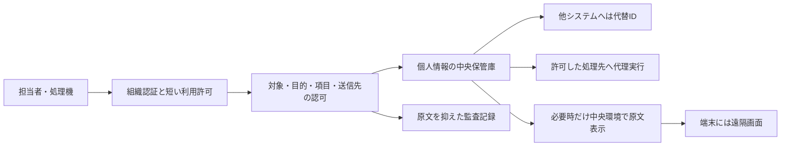

# 個人情報を端末へ配布せずオンラインで集中管理する方法

調査基準日：2026年10月15日。主用途は担当者による個人情報の入力・閲覧・更新と、原文を見せない集計・AI処理。社外文書共有も補助的に扱い、公開公式仕様と2025〜2026年の論文・仕様を比較する。

**個人情報の正本を中央で管理し、利用者の端末へ原本を保存させない方式はある。** 文書の保存を禁止するだけの方式より、中央環境で作業して画面だけを配信する方式、原文の代わりに代替IDを使う方式、原データに計算を持ち込んで結果だけを取り出す方式が要件に近い。

ワンタイムパスワード（OTP）は入口の本人確認の一手段であり、ログイン後の保存・コピー・再配布を止める機能ではない。認証、利用権限、端末への送信、結果の持出し、保存と削除を分けて設計する。[NIST認証標準](https://pages.nist.gov/800-63-4/sp800-63b.html)、[遠隔環境の仕様比較](online_pii_remote_environments_20261015.md)

## 今回の二つの用途に対する構成

**基本は「個人情報保管庫＋権限を絞った業務画面＋原文を返さない分析・実行窓口」。** 人が原文を読む必要がある担当業務だけ、遠隔画面の経路を追加する。文書共有サービスは、個人情報の台帳更新や任意の分析を一元化する中核とは別に評価する。

| 主用途 | 構成案 | 最初に比較する対象 |
|---|---|---|
| 担当者が入力・閲覧・更新 | 入力から保管庫へ分離し、通常の業務DBは代替ID、画面は伏字・担当範囲のみ。必要時の原文参照は理由と短い権限を要求 | Skyflow、VGS。決済・文字列の代理処理を含む比較にBasis Theory |
| 原文の端末送信も制限する担当業務 | 上記画面を中央の仮想デスクトップ/遠隔ブラウザーで操作し、転送と外部送信を制限 | Azure Virtual Desktop/Windows 365、遠隔ブラウザー各方式 |
| 原文を見せず集計・AI処理 | 許可した計算をデータ側で実行し、件数・派生事実・審査済み結果だけ返す。学習済みモデルも出力審査に含める | OpenSAFELY型の設計、SACRO、共同分析にはAWS/Snowflake/Decentriq |

これは公開比較からの構成案であり、候補の標準設定がそのまま全条件を満たす意味ではない。たとえば保管庫の原文復元APIを全担当者やAIに許すと、原文非配布の境界が失われる。[保管庫と代理処理](online_pii_vaults_and_cleanrooms_20261015.md)、[遠隔環境](online_pii_remote_environments_20261015.md)、[研究と出力審査](online_pii_research_20261015.md)

## まず定義する三つの要件

| 要件 | 実現を目指す内容 | 主な方法 |
|---|---|---|
| 原本ファイルを保存させない | 通常のダウンロード、同期、印刷、コピーを許さない | 文書閲覧サービス、共有制限、遠隔環境 |
| 原文の文字列やファイルを端末へ送らない | サーバー側で開き、端末には表示用の画面を送る | 画素転送型の遠隔ブラウザー、仮想デスクトップ |
| 利用者にも原文を見せない | 個人単位の内容の代わりに、伏字・必要な項目・集計だけを返す | 個人情報保管庫、限定した業務API、安全な分析環境 |

閲覧する以上、表示する情報は画像や文字として端末に届く。画素転送は原文ファイルの送信を減らせても、表示情報を無にするものではない。外部カメラ・手書き・記憶まで含め、正規閲覧者による記録をソフトだけで完全に阻止することはできない。厳しい要件では表示する内容自体を減らす。

この意味で「完全オンライン」は、原本を端末へ配らず、保存と処理を管理された環境に限定する運用として定義する。端末メモリに表示情報まで一切存在しないという保証とは分ける。[文書サービスの制限](online_pii_document_access_20261015.md)、[遠隔環境の違い](online_pii_remote_environments_20261015.md)

## 六つの方式の比較

| 方式 | 主な候補 | 中央に置くものと利用方法 | 要件に対する条件 |
|---|---|---|---|
| オンライン文書閲覧・仮想資料室 | SharePoint/OneDrive、Box、DocSend、Digify | 文書を中央に保管し、認証した相手に閲覧権限を与える | 保存禁止の役割・設定、対応形式、外部ゲスト、同期/API、既存権限を確認。ブラウザーの表示データは端末へ届く |
| 遠隔ブラウザー | AWS WorkSpaces Secure Browser/Applications、Cloudflare Browser Isolation | 遠隔でWebを実行し画面や描画命令を返す | 画素転送と描画命令転送は違う。ファイル、コピー、印刷、遠隔からの外部送信を別に制限する |
| 仮想デスクトップ | Azure Virtual Desktop、Windows 365等 | 中央のOSとアプリで入力・閲覧・編集・分析する | 端末へのドライブ、コピー、プリンタ等の転送を制限する。画面保護は対応OS/アプリ条件付き |
| 個人情報保管庫と代替ID | Skyflow、VGS。決済情報中心の比較にBasis Theory | 原文を専用保管庫へ集め、他システムでは代替IDを使う | 原文の復元や表示を許すAPIからは流出し得る。送信先を限定した代理処理や必要項目だけの表示を設計する |
| 安全な分析環境・計算をデータへ送る | ONS Secure Research Service、NHS SDE、OpenSAFELY | 元データを管理環境に置き、コードを実行する。許可した結果だけ外へ出す | 詳細データを画面で見られる環境と、通常の研究者には集計だけ返す方式を区別。成果物審査が必要 |
| 共同分析用の隔離環境 | AWS Clean Rooms、Snowflake Data Clean Rooms、Decentriq | 参加者が互いの原文を自由に取得せずに共同計算する | 出力・問い合わせ・参加者権限によっては個人単位の情報を取得できる。全データが物理的に一箇所へ移るとは限らない |

各候補の公開仕様・適用範囲は[文書閲覧6系統](online_pii_document_access_20261015.md)、[遠隔・安全環境7群](online_pii_remote_environments_20261015.md)、[保管庫と共同分析](online_pii_vaults_and_cleanrooms_20261015.md)を参照。製品名だけで「保存禁止」と判断せず、具体的な設定・契約・出力経路を比較する。

## OTPや一回限定リンクでできること

メールOTPは主に、そのメールボックスを使えることを確認する。認証器で生成するOTP、メールの確認リンク、短命なAPI認証情報、個人データを置き換える代替IDは異なる。

- 認証コードを一度だけ使えることと、ログイン後の閲覧が一回だけで終わることは別。
- 一回の閲覧許可でも、見えた内容を別に記録することまでは取り消せない。
- 期限付きリンクでも、別の役割・古いリンク・アプリ経由の取得権限は別に管理する。
- 手入力のOTPはフィッシング耐性のある認証ではない。職員向けの高保護用途では、正しい接続先に認証を結び付けるFIDO/WebAuthn等を比較する。

DocSendのメール検証済み状態は2週間、Googleの訪問者PINは7日後の再検証がある。これらを毎回OTP・一回限定の閲覧と解釈しない。契約・役割・端末に応じて、許可時間と再認証条件を設定する。[DocSend](https://help.dropbox.com/share/dropbox-docsend-email-authentication)、[Google訪問者](https://support.google.com/drive/answer/9195194?hl=en)、[NIST](https://pages.nist.gov/800-63-4/sp800-63b.html)

## 調査で重要だった現行仕様と例外

| 確認事項 | 導入判断への影響 |
|---|---|
| AWS WorkSpaces Secure Browserは2026-10-29に新規顧客受付を停止予定 | 既存顧客は継続可能。新規導入ではWorkSpaces Applications等の代替と条件を比較する |
| Cloudflareの隔離ブラウザーは保存・コピー・印刷等が既定許可 | 隔離を有効にしただけでは保存禁止にならない。中央のWebから別Webへの再送信も別制御 |
| SharePointのサイト単位保存禁止にはサービス側app-onlyアプリの例外 | 人向けブラウザーの制約とアプリ権限を両方管理する |
| BoxのViewerはダウンロード可。Previewerにはモバイル設定等の条件 | 役割名、重複権限、オフライン利用まで確認する。透かしだけでは保存を止めない |
| DocSendには保存しなければ閲覧できない形式がある | オンライン限定の資料は形式を変換するか、受入れ対象から外す |
| Digifyの画面保護はぼかし等を含むが全撮影を防ぐ保証ではない | 撮影の抑止と原文非配布を分ける。保護付きダウンロードは別機構 |
| FINAL CODEのBrowser Viewは暗号化ファイルを配布する方式 | 原本の取出しを制限できても「端末にファイルを一切持たせない」とは違う |
| 個人情報保管庫にも原文表示・復元・代理送信の経路がある | 「代替IDしか扱わない」範囲と、原文を取得できる担当/処理を明示する |

出典：[AWS受付変更](https://docs.aws.amazon.com/workspaces-web/latest/adminguide/workspaces-secure-browser-maintenance-mode.html)、[Cloudflare転送設定](https://developers.cloudflare.com/cloudflare-one/remote-browser-isolation/isolation-policies/)、[SharePoint方針](https://learn.microsoft.com/en-us/sharepoint/block-download-from-sites)、[Box権限](https://support.box.com/hc/en-us/articles/360044196413-Understanding-Collaborator-Permission-Levels)、[DocSend形式](https://help.dropbox.com/share/dropbox-docsend-download-only-files)、[Digify画面保護](https://help.digify.com/en/articles/2820319-screen-shield-with-screenshot-protection)、[FINAL CODE](https://secure.finalcode.com/manual/finalcode_bv_manual_jp.pdf)。保管庫の根拠は[担当詳細](online_pii_vaults_and_cleanrooms_20261015.md)に記載。

## 用途別の構成案

### 担当者が個人情報を入力し更新する業務

個人情報の正本を保管庫へ集め、他システムに代替IDを渡す。通常の画面は伏字と必要項目だけを表示し、原文の参照は担当範囲・目的・対象レコード・時間で限定する。住所への発送や連絡は、原文を人やAIへ返す代わりに、許可した宛先へ代理実行する方式を検討する。

端末に原文の文字列も持たせたくない担当者は、遠隔ブラウザー/仮想デスクトップ内でその業務画面を操作する。直接APIやストレージへ接続できる入口も制限する。

これは公開比較に基づく設計案であり、図だけで安全性を保証するものではない。保管庫が原文をブラウザーへ返す通常の表示経路を残すなら、その画面の内容は端末へ届く。

### 社外の相手へ文書を見せる

文書閲覧サービスで宛先指定、本人確認、保存・印刷禁止、期限、透かし、失効を組み合わせる。相手が使える端末と対応形式を事前に確定する。原文を端末へ送らないことまで要求する場合は、閲覧サービスに加えて隔離したアクセス経路が必要になる。

共有解除後に、既に保存したコピーまで消えることを前提にしない。個人情報の一覧を丸ごと見せる必要がないなら、案件ごとの最小限の文書や項目へ分ける。

### 集計・AI・研究に使う

個票を配らず、中央で集計・学習・推論を行い、結果を審査する。**中央のAIに原文を読ませる方式と、AIにも原文を見せず集計・照合専用APIの結果だけを返す方式を分ける。** 後者を求める場合は、原文を返す道具をAIへ与えず、必要な計算を承認した処理として実装する。OpenSAFELYのように、模擬データで作ったコードを元データ側へ送り、通常の研究者には集計しか見せない方式が参考になる。汎用の仮想デスクトップで詳細データを見せる方式とは違う。[OpenSAFELY](https://docs.opensafely.org/how-opensafely-works/)

AIへ渡す情報も同じ境界で制御する。検索結果・道具の返答・会話履歴を通じて原文を外部AIへ送れば、中央保管だけではコピーを防げない。原文が不要な道具は、分類結果・件数・代替ID・実行の成否だけを返す。原文が必要なら、承認した処理環境と用途へ限定する。

## 最新の関連研究と読む順序

| 資料 | 年・種別 | この要件で役立つ点 |
|---|---|---|
| [SATRE 2.0.1](https://satre-specification.readthedocs.io/en/main/) | 2026-07-23、設計仕様 | 中央環境の権限・運用・出力・連携をまとめて設計する |
| [PICACHV](https://www.usenix.org/conference/usenixsecurity25/presentation/chen-haobin) | USENIX Security 2025、査読論文 | データを置くだけでなく、計算で許可する用途を強制する |
| [SACRO](https://arxiv.org/abs/2212.02935) | IEEE Transactions on Privacy 2025。先行公開は2022年 | 持ち出す集計・図・結果を審査する作業を補助する |
| [木系モデルの開示危険評価](https://arxiv.org/abs/2502.09396) | Transactions on Data Privacy 2026。先行版は2025年 | 元データを出さなくてもモデルに残る情報を評価する |
| [RELEASE-AI](https://uwe-repository.worktribe.com/output/15864836/release-ai-a-lifecycle-framework-for-artificial-intelligence-development-and-disclosure-control-in-trusted-research-environments) | 2025年先行公開、2026年大学登録 | 学習成果物の公開を最初の設計段階から管理する |
| [TrustDS](https://www.nature.com/articles/s41598-026-48740-8) | Scientific Reports、2026年 | 同意・用途・場所と実行時の許可・記録を結び付ける研究 |
| [猪谷誠一のデータクリーンルーム論文](https://www.jstage.jst.go.jp/article/jicp/9/2/9_63/_html/-char/ja) | 2026年公開、誌面年2025、査読研究ノート | 技術的な原文非開示と、主体ごとの法的評価を区別する |

まずSATREで全体を設計し、次にSACROで出口を管理し、計算への強制が必要ならPICACHV等を読む。論文の仮定・実験範囲・公開版・未取得箇所は[研究詳細](online_pii_research_20261015.md)を参照。これらは、画面撮影を完全禁止する新技術を示す資料ではない。

## 一箇所で集中管理するための要件案

「一箇所」は、権限・正本・保持期限・削除・監査を統一する**論理的な集中管理**とする。障害対策の複製、バックアップ、地域別の保存を必要とする場合は、物理的な複数コピーを管理対象に含める。個人情報の正本を一つの管理系へ集めても、監査録画・検索索引・一時出力・外部連携にコピーを増やせば目的を損なう。

導入時の受入条件は次を基本とする。

1. 保存・閲覧・更新・原文復元・外部送信を別権限にし、全件出力権限を常用しない。
2. 組織認証と利用時間を管理し、異動・退職時に既存の利用許可も取り消す。
3. 端末の保存、コピー、印刷、同期、モバイル、アプリ/API、遠隔環境からの再送信を別に試験する。
4. 不対応形式や古い設定で、保存が許可される側へ切り替わらないかを確認する。
5. 人向け表示、API、AI、外部委託で原文がどこまで届くかを記録する。
6. 集計・自由記述・学習済みモデル・ログを別々に持出し審査する。
7. バックアップと復旧を含めて保管期限・削除と旧版の扱いを決める。
8. 管理者の例外アクセスと全件取得を監査し、中央の障害に対する復旧手段も設ける。

通常の閲覧や処理は、信頼する中央環境が平文を扱う。処理者にも原文を見せない秘密計算や、特定の条件を秘密を開示せず証明するゼロ知識証明は別の技術であり、OTPの置換だけで導入されるものではない。[関連技術](zero_knowledge_sensitive_data_research_20261007.md)

## 保存資料とレビュー

- [文書閲覧と権利管理](online_pii_document_access_20261015.md)・[取得台帳](online_pii_document_sources_20261015.json)
- [遠隔ブラウザー・仮想環境・研究運用](online_pii_remote_environments_20261015.md)・[取得台帳](online_pii_remote_sources_20261015.json)
- [個人情報保管庫と共同分析](online_pii_vaults_and_cleanrooms_20261015.md)・[取得台帳](online_pii_vault_sources_20261015.json)
- [関連論文と仕様](online_pii_research_20261015.md)・[取得台帳](online_pii_research_sources_20261015.json)
- [独立レビューと改善](online_pii_reviews_20261015.md)・[保存資料の検証](online_pii_verification_20261015.json)

公開資料に基づく比較であり、有償環境の操作・端末残存・撮影・通信・性能の実測試験は含まない。原本は `research/disclosures/raw/online_pii_20261015/` に保存し、取得失敗・転送案内・本文取得を区別する。最新版の仕様でも、全契約・全OSに共通の保証とは扱わない。
