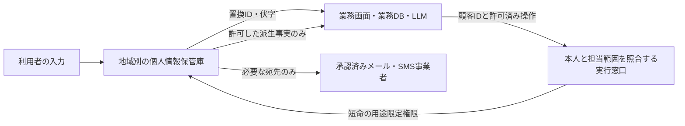

# 個人情報を端末や業務系へ広めない保管庫・代理処理・共同分析基盤

調査日：2026-10-15。公開された公式仕様・操作文書・発表に基づく。実顧客データ、実認証情報、契約画面は使っていない。製品内部のコード監査、端末への保存防止、通信・削除の実機試験は実施していない。[取得台帳](online_pii_vault_sources_20261015.json)には原本・抽出本文・取得時刻・ハッシュ・本文可否を記録した。

## 1. 結論：原文を見せる業務を減らす方式が具体的

「個人情報をオンラインの保管庫へ集約し、業務系は置換した識別子だけを扱う」商用実装はある。特に **Skyflow、VGS、Basis Theory** は、利用者が入力した原文を自社の通常サーバーへ通さずに保管し、担当者には伏字を返し、必要な処理だけ別のサービスへ代理送信する構成を持つ。顧客のメールアドレスを担当者へ表示せずにメールを送る、といった業務に近い。[SK06](https://www.skyflow.com/solutions/by-use-case/solutions-privacy-safe-communication)、[VG01](https://docs.verygoodsecurity.com/vault/http-proxy)、[BT06](https://developers.basistheory.com/docs/concepts/elements.md)

一方、原文を戻す **Reveal／detokenize（置換した識別子から原文を復元して返す操作）** も提供する。端末内の別枠画面で見せても、表示された原文は端末へ届く。実際にVGS Showはクリップボードへコピーする機能を公式に提供する。「ファイルのダウンロードボタンを設けない」と「原文を端末へ送らない」は異なる。原文を見せない要件には、表示の禁止と、代理処理だけを許す権限設計が必要になる。[SK04](https://docs.skyflow.com/docs/tokenization/detokenize.md)、[VG06](https://docs.verygoodsecurity.com/vault/developer-tools/vgs-show/js/configuration)

分析目的なら **AWS Clean Rooms、Snowflake Data Clean Rooms、Decentriq** が別の選択肢になる。共同分析の相手に入力行を渡さず結果を返せるが、許可した結果の書き出し機能も持つ。クリーンルームという名称だけで「個人単位の結果は一切出ない」「端末へ何もダウンロードできない」と判断しない。[AW01](https://docs.aws.amazon.com/clean-rooms/latest/userguide/analysis-rules.html)、[SN02](https://docs.snowflake.com/en/user-guide/cleanrooms/collab-overlap-and-activation)、[DE01](https://www.decentriq.com/solutions/custom-collaborations)

## 2. 7系統の比較

トークンは、ここでは原文の代わりに業務で保持する識別子を指す。ログインに使う認証用トークンとは区別する。原文との対応を保管庫が持つため、置換しただけで復元不能な匿名データになったとは扱わない。

| 製品・系統 | 集中管理の対象 | 業務系へ原文を通さない経路 | 原文・結果が外へ出る境界 | 主な用途 |
|---|---|---|---|---|
| Skyflow | 個人情報・決済情報等の保管庫 | 入力から直接保管、列・行単位の伏字、Connectionsによる代理送信 | 復元API、原文を許した列、接続先サービス、出力の再識別 | 顧客情報の分離、担当顧客だけの閲覧、宛先を見せない連絡 |
| VGS | 多種の機密値を別名へ置換 | Collectの分離入力、受信時置換、外向き中継で原文に戻す | Showの表示・コピー、代理送信先、検査条件漏れ、記録用ログ | サーバーから機密値を除く、決済・本人確認等の外部API連携 |
| Basis Theory | 置換した値・容器別権限・隔離処理 | Elements、代理送信、Reactor内の限定処理 | Reveal、広いproxy権限、利用者が書くコード・ログ、モデルへ渡す値 | 決済、一般の機密文字列、AI代理処理 |
| Privitar→Informatica CDAM | 既存データ資産を横断する利用方針 | データ移動や消費時に方針を適用 | 許可した利用・書き出し先。単一の保管庫という保証ではない | 既存基盤全体のアクセス・プライバシー制御 |
| AWS Clean Rooms | 各社の管理下の表と共同分析規則 | 集計・許可列・許可分析・差分プライバシー | list規則の個別列、結果S3、Copy/Download、鍵がある結果の復号 | 複数社の照合・集計 |
| Snowflake Data Clean Rooms | 各社の表、許可する分析・書出し先 | 結合・列・分析の制限 | 結果表示・取得、activationによるID・属性の書出し | 顧客集合の重なり、共同分析、許可した対象への施策実行 |
| Decentriq | ハードウェアで隔離した共同処理と結果権限 | 提供者も原文を読めない構成、事前承認した処理 | 承認結果・広告向け識別子の送出等。用途別設定が必要 | 外部専門家との共同分析、機密計算・モデルの実行 |

根拠は以下の各節。すべて提供者の公開説明であり、契約機能の有効化や実装の独立検証を済ませた一覧ではない。

## 3. Skyflow：顧客情報を見せずに利用する構成

### 3.1 直接入力・列と行の制御

公式の連絡業務例は、フロントエンドからSkyflowへ連絡先を直接送り、業務用データベースには置換した識別子だけを保持し、メッセージサービスへ必要なときだけ復元して送る流れを説明する。担当者ごとの担当顧客、営業時間、IPアドレス等を条件にする説明もある。これは自社サーバーやLLMへ毎回連絡先を渡す方式を避ける設計候補になる。[SK06](https://www.skyflow.com/solutions/by-use-case/solutions-privacy-safe-communication)

Governanceは列・行単位の利用制御を持つ。公開の操作例は、氏名等の平文、社会保障番号の伏字、メール等の非表示を役割別に指定し、`WHERE persons.state = 'Arizona'`のような行制限も示す。対象者単位の制限は認証に成功しただけでは得られず、アカウントの役割と方針の割当てが必要である。[SK02](https://docs.skyflow.com/docs/governance.md)、[SK09](https://docs.skyflow.com/docs/fundamentals/explore-skyflow.md)

### 3.2 メール・SMS等への代理送信

Connectionsは、受信時に原文を置換して自社サーバーへ渡す経路と、自社側の要求を受けて保管庫から原文を取り出し外部APIへ送る経路を分ける。公開文書では本番の外向き接続URLは地域・環境ごとの審査・許可対象とされる。[SK03](https://docs.skyflow.com/docs/connections.md)

この方式なら「顧客IDとテンプレートIDだけで連絡する」業務にできる。ただし通信サービス自身には宛先が必要である。宛先・文面・配達履歴を保持し得る第三者まで消えるわけではない。任意の宛先や任意の本文に秘密を埋め込める代理送信APIにすると持ち出し経路になるため、業務側では送信先サービス・テンプレート・送信回数・返却項目も制限する。後半は本調査の設計上の分析である。

### 3.3 復元と配置の限界

Detokenize APIは権限のある利用者や処理へ元の値を返す。その応答を自社サーバーで受ける構成なら、サーバーは原文を扱う。LLMの回答を画面に出す直前だけ原文へ戻す場合も、復元後の画面・通信・ログは別の管理対象である。[SK04](https://docs.skyflow.com/docs/tokenization/detokenize.md)

配置は共用環境での論理分離、顧客専用VPC、顧客クラウド内の運用を分ける。PrivateLinkを使っても標準公開接続先は併存し得るため、IP制限等も必要と公式は説明する。顧客クラウド配置もSkyflowが運用するモデルであり、顧客だけが管理者になるという意味ではない。[SK05](https://docs.skyflow.com/docs/fundamentals/deployment-models.md)

## 4. VGS：代理中継と画面分離を明確に分ける

VGS Collectの入力部品は別のオリジンのiframe（埋め込まれた分離画面）で、通常のページの処理から機密入力を分離する。HTTPS Proxyは、サーバーに到達する前に指定した値を別名へ置換し、外部APIへ送るときに別名から原文へ戻す。[VG09](https://docs.verygoodsecurity.com/vault/developer-tools/vgs-collect/js/index)、[VG01](https://docs.verygoodsecurity.com/vault/http-proxy)

外向き中継の公式例は社会保障番号を本人調査サービスへ送る。自社サーバーは置換した値で要求できるが、外部サービスは原文を受け取る。復元中継の認証情報はAPI鍵に相当する重要な権限であり、その漏洩や許可先設定を管理する必要がある。[VG02](https://docs.verygoodsecurity.com/vault/http-proxy/outbound-connection)

**条件漏れ時に原文を通す仕様を確認する。** FAQでは、Hostが一致しなければ400だが、Hostが一致してPathInfo・フィルター条件・操作対象が一致しない場合、要求は変更なしで通ると説明する。値を追加したフォームや形式変更に対して「保管庫を通ったから必ず機密値が除去される」とは言えない。適合しない要求を拒否する追加検査を含め、対象フィールドの網羅性が必要になる。[VG04](https://docs.verygoodsecurity.com/vault/faq)

VGS Showは原文をiframe内に表示し、親ページの処理から分離するが、コピー用ボタンも提供する。画面を受け取る端末からの再配布を禁止する仕組みとは異なる。Access Loggerは記録を有効にして交通を収集し、ヘッダー・本文・要求・応答や置換前の値を確認する仕様を持つ。「原文は業務DBに保存しない」設計でも、調査用の記録設定を別途点検する必要がある。[VG06](https://docs.verygoodsecurity.com/vault/developer-tools/vgs-show/js/configuration)、[VG03](https://docs.verygoodsecurity.com/vault/http-proxy/access-logger)

VGSの管理用機能はAWS us-east-1に集中し、データ処理系は複数地域に分かれる。FAQは日次増分・週次全体バックアップ、第二データセンターへのリアルタイム複製、可用性ゾーン間の複製を説明する。したがって集中保管は**論理的に管理場所を集約する方式**であり、物理的に一個のコピーだけになることを意味しない。地域別の現行提供はEnterprise Platformの表と個別契約を確認する。[VG05](https://docs.verygoodsecurity.com/enterprise-platform)、[VG04](https://docs.verygoodsecurity.com/vault/faq)

## 5. Basis Theory：短命権限とAI処理の境界まで公開

### 5.1 入力・復元・利用者別権限

Elementsは一般文字列用のTextElementを含み、分離された入力から保管庫へ置換して保存できる。同じ仕組みで原文を利用者へ表示する機能もある。自社アプリのコードが直接原文を取得しない設計と、端末に原文が一切届かない設計はここでも異なる。[BT06](https://developers.basistheory.com/docs/concepts/elements.md)

Access Rulesは容器別に対象を限定し、`redact`は値を返さず、`mask`は伏字、`reveal`は平文を返す。該当する規則がなければ403。Sessionは自社サーバーが利用者認証を行ったうえで、特定トークンや容器に操作を限定して許可でき、既定3分で失効する。条件による特定IDの制限は現文書ではSession向けとされる。一方、単純な権限指定は容器別ではなく全トークンに及ぶこと、公開鍵に更新権限を与えれば漏れたIDの値を書き換え得ることにも注意書きがある。[BT05](https://developers.basistheory.com/docs/concepts/access-controls.md)

PII取得の公式例は、サーバーから返す識別子をProxyで復元してクライアントへ平文を返す。また例の`require_auth=false`は認証不要で安全という意味ではなく、利用者の認証・認可を自社サーバーが処理する前提と明記する。サーバー非保有という条件だけでは、端末への原文返却を防げない。[BT01](https://developers.basistheory.com/docs/blueprints/personal-information/query-user-data-from-api)

### 5.2 2026年のUCP連携：短命の用途限定トークン

現行UCPガイドは2026-08-25版のプロトコルを対象とする。外部の購入支援システムへBasis Theoryの広いAPI鍵を渡さず、呼出元ごとの認証、15分の有効期限、購入処理IDとの束縛、処理後の削除、重複課金防止を組み合わせる。入口のProxyは`disable_detokenization=true`で既存値の復元に使えないようにする。これは**公開された実装手順**であり、独立に監査した利用企業の本番実績ではない。[BT02](https://developers.basistheory.com/docs/guides/ucp-payments)

同文書は、`proxy:invoke`を持つ鍵がテナント全体のトークンを任意のHTTPS送信先へ利用できると警告する。任意送信先を許す中継を無効化し、固定の送信先を持つProxyを使う設定も説明する。トークン化はデータを読めなくするだけでなく、「どこへ使えるか」の権限が重要になる。[BT02](https://developers.basistheory.com/docs/guides/ucp-payments)

### 5.3 AIへ原文を渡さない処理と、渡す処理の区別

PCI Agent Runtimesは、カードを使う部分をReactorという隔離した実行機能へ置き、LLMにはブランド・末尾番号・利用可否などの派生した事実だけを渡す設計を示す。一般的な原文復元の道具をLLMへ渡すと、外部ページ等の命令混入によって結果を回答へ繰り返して漏らし得る、と公式自身が説明する。モデルが必要とする事実だけを計算して返す方式は、AIへのPII入力を減らす実装参考になる。[BT04](https://developers.basistheory.com/docs/guides/pci-agent-runtimes/overview)

一方、WebMCPの`enter_card`は分離画面への入力後、結果にはブランド・末尾4桁・入力状態だけを返すが、**呼び出すエージェント自身は全カード番号を扱う**と明記する。画面の親アプリへ漏れない仕組みを、エージェントやモデルへ原文が渡らない保証に読み替えない。WebMCP対応は実験的なブラウザー機能である。[BT08](https://developers.basistheory.com/docs/sdks/web/web-elements/v3/agent-tools.md)

実行ログは既定無効で、認識できた機密値を伏せる処理を持つが、原文や道具の入力をログに書かないよう明記する。ログ取得失敗でも実行は継続する仕様であり、ログ保存成功を取引実行の前提にする監査とは別である。LLM提供者や枠組み独自の記録も点検する必要がある。[BT03](https://developers.basistheory.com/docs/concepts/runtimes/runtime-logs)

### 5.4 地域は接続先まで明示する

地域別APIの文書は、EUとUSの明示した接続先を推奨する。旧共通接続先は障害時に地域振り分けを迂回してUSへ向かう場合があり、その場合EUのデータは提供できず要求が失敗する。これはEUの保管データをUSへ自動移動するという説明ではない。SDKの既定値は後方互換性のため共通接続先のままとされ、地域を明示する必要がある。またAPI地域の変更は画面部品やCDNの配信元まで移動しない。[BT07](https://developers.basistheory.com/docs/api/regional-endpoints.md)

## 6. Privitarの現所有と位置付け

Privitarは独立企業として現在の候補数に数えない。Informaticaの決算原本は**2023-07-12に買収完了**と記録し、その技術を基にCloud Data Access Management（CDAM）をIDMCへ統合したと公式発表が説明する。さらにSalesforceは**2025-11-18にInformatica買収完了**を発表している。[PR01](https://www.informatica.com/about-us/news/news-releases/2023/08/20230802-informatica-reports-second-quarter-2023-financial-results.html)、[PR05](https://www.informatica.com/about-us/news/news-releases/2024/02/20240229-informatica-launches-cloud-data-access-management-industrys-first-ai-powered-solution-for-automating-data-access-policy-enforcement-at-scale.html)、[PR02](https://www.salesforce.com/uk/news/press-releases/2025/11/18/salesforce-completes-acquisition-of-informatica/)

CDAMは分類・属性情報を基に利用方針を管理し、Cloud Data Integrationでデータ移動時、Cloud Data Marketplaceで消費時に制御する。既存環境全体の方針を論理的に集約する候補であり、全原文を一つの保管庫だけに格納し、業務端末へ返さないことを保証する製品とは説明しない。2025年に更新された記事にも初公開は2024-02-29と記載されるため、更新日を新規発売日と混同しない。[PR04](https://www.informatica.com/blogs/ai-powered-data-access-management-where-intelligent-governance-meets-enforcement.html)

## 7. クリーンルーム：共同分析の結果を制限する

### 7.1 AWS Clean Rooms

各データ所有者が表に分析規則を設定する。規則がなければ関連付けはできても問い合わせはできない。aggregationは集計と最小人数、listは重なりに対する許可列の出力、customは許可した分析等を扱う。**listには集計結果のような出力人数制御はない**と文書にあるため、すべての使い方が集計結果だけになるとは言えない。[AW01](https://docs.aws.amazon.com/clean-rooms/latest/userguide/analysis-rules.html)、[AW06](https://docs.aws.amazon.com/clean-rooms/latest/userguide/analysis-rules-list.html)

結果を受け取る権限のある利用者はCopy・Download・S3での閲覧ができる。結果保存先のS3は入力データと同じバケットにはできないとされる。「共同分析を使えば結果も一箇所にしか存在しない」という構成ではない。[AW02](https://docs.aws.amazon.com/clean-rooms/latest/userguide/receive-results.html)

差分プライバシーは、人数の少ない集団や繰り返す問い合わせから個人情報を推定しにくくするため、結果に調整した乱数を加え、利用できる問い合わせの量を予算で管理する。明示的に有効化する機能であり、すべてのClean Roomsの既定保護ではない。現行文書はS3を元にしたGlue表向けで、処理時間から推定する攻撃等は対象外と記載する。[AW03](https://docs.aws.amazon.com/clean-rooms/latest/userguide/differential-privacy.html)、[AW04](https://docs.aws.amazon.com/clean-rooms/latest/userguide/dp-limitations.html)

C3Rは別途使えるクライアント側暗号化機能で、照合列は鍵付き指紋、取得列は暗号化値、平文列は明示した平文として扱う。任意のSQLを暗号文のまま実行できる仕組みではない。表の行数・列名や暗号文長等の付随情報は残り、制限を緩めると同値・頻度・平文との関係からの推定が増え得る。復号できる結果を渡せば、その受領者による原文保有は残る。[AW08](https://docs.aws.amazon.com/clean-rooms/latest/userguide/crypto-computing.html)、[AW09](https://docs.aws.amazon.com/clean-rooms/latest/userguide/crypto-computing-considerations.html)

### 7.2 Snowflake Data Clean Rooms

許可する結合・出力列・分析のひな型・結果の送り先を制御する。公式は結果の表示・ダウンロードや、承認した送り先へのactivation（分析結果を施策実行先へ書き出す処理）を説明する。重なり分析の例は集計と識別列の制限を持つ一方、activationは一致した行のIDと選択した属性を出力できる。**「クリーンルームだから個人単位の識別子は一切出ない」は誤り**である。[SN01](https://docs.snowflake.com/en/user-guide/cleanrooms/getting-started)、[SN02](https://docs.snowflake.com/en/user-guide/cleanrooms/collab-overlap-and-activation)

現行の活動履歴は役割に応じて見える範囲を制限するが、自由記述SQLは履歴に載らず、activationのSUCCESSは分析問い合わせの成功であり、結果書き出しの失敗を表さない場合がある。監査画面の「成功」を処理完了・安全な配布の証明にしない。[SN03](https://docs.snowflake.com/en/user-guide/cleanrooms/activity-history)

### 7.3 Decentriq

機密計算は、TEEというハードウェアで保護した実行領域内で計算し、外側の管理者からも原文を隔離する方式を指す。Decentriqの2023年v3発表はAMD SEV-SNPと利用者による実行環境の検証を説明する。これは同型暗号によって任意計算をする方式やゼロ知識証明とは異なる。データ保有者が合意したコード・計算・結果権限を設定し、承認された相手が結果を表示・書き出す構成である。[DE02](https://www.decentriq.com/article/decentriq-v3-confidential-data-clean-rooms-for-scale)、[DE01](https://www.decentriq.com/solutions/custom-collaborations)

2026-05-08のDatalab v2発表は、照合用とactivation用の識別子を区別し、ハッシュ化したメール・電話、広告識別子、企業独自ID等を組み合わせる現行提供を説明する。したがって、共同分析一般の集計結果だけの説明を全機能へ適用しない。原文を読み取れない管理者保護と、許可した識別子・結果を業務に送出する操作は両立する。[DE05](https://www.decentriq.com/article/introducing-datalab-v2)

2023年発表の「機密データはスイスで保存・処理、補助サービスはEU」はその発表時点の仕様である。2026年の全契約・バックアップ場所・保持期間をそれだけで確定しない。今回それらの詳細を確認できる公開の現行契約資料は取得していない。[DE02](https://www.decentriq.com/article/decentriq-v3-confidential-data-clean-rooms-for-scale)

## 8. OTP等と組み合わせる実装案

以下は公開機能を踏まえた設計案で、特定の提供者の既定構成ではない。

1. **入力時から分離する。** 通常の自社フォームで先に原文を受け、後で保管庫へ移す構成では、初期のサーバー・ログ・解析サービスに残る経路を消せない。分離入力や保管庫への直接送信を使う。
2. **通常業務は原文表示ではなく操作にする。** 「電話番号を取得」ではなく「この顧客へ承認済み通知を送る」「登録済み番号との一致だけ返す」等を定義する。LLMも一般的な復元の道具を持たせない。
3. **OTPは用途に束縛する。** 一回限りの番号は本人の確認や追加認証に使えるが、それ自体は原文の転送・記録・再配布を止めない。対象者、許可操作、送り先、有効期限、使用済み状態をサーバー側で照合し、単なるIDを知っていることを権限にしない。
4. **例外のRevealを別扱いにする。** 原文を表示するなら、対象フィールド・顧客・理由・時間を限定し、実行記録には原文を書かない。端末でのコピー禁止を必要とする場合は管理端末・画面転送等も別途検討する。表示した後の完全な再配布防止を保管庫だけで約束しない。
5. **一箇所は論理的な集中管理と定義する。** 地域別保管庫、災害復旧用複製、バックアップ、第三者送信履歴、ログ、分析結果を資産台帳へ入れる。削除時にどこまで削除されるかは、通常値・バックアップ・書き出し済み結果ごとに確認する。
6. **分析では出力を先に定義する。** 件数だけか、個別IDが必要か、結果をダウンロードできる人、繰返し問い合わせからの再識別まで区別する。入力保護だけでは結果からの漏洩を防げない。

製品選定の最初の分岐は、「人に原文を見せる必要があるか」「原文が必要なのは第三者処理だけか」「必要なのは集計結果だけか」である。最初の業務なら限定表示と端末管理、二番目なら保管庫＋代理処理、三番目なら分析規則を持つクリーンルームが対応する。

## 9. 原本確認と未確認事項

公開本文を取得できなかった箇所も台帳に残した。SkyflowのCollect/Reveal専用ページはMarkdownで403、HTMLはサインイン誘導だけであり、その本文の根拠には採用していない。入力分離の主張は取得できた連絡業務資料を使用する。Informaticaの旧製品URLもHTTP200の404本文だった。VGSの短い章・節のリンク一覧ページ、AWSの誤ったURLも本文の根拠にしない。HTTP成功・保存成功と、説明本文の取得成功は区別した。

原本は取得時点の文書を固定するもので、公開ページの更新が継続することを保証しない。各製品の日本語検出性能、全ログの保持期間、全バックアップの削除時期、契約ごとの運用者権限、全地域への現行提供は未確認。検出精度の比較や本番導入済み企業の独立した性能検証を行った資料ではない。
