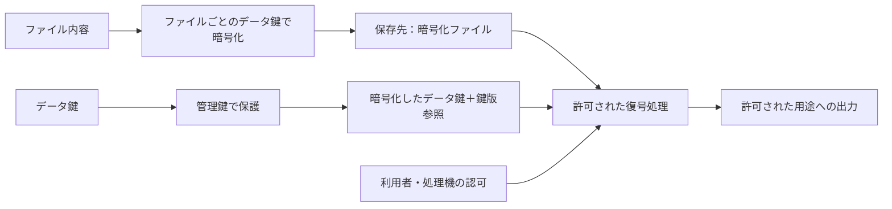

# 保護情報管理における鍵付きファイルと鍵の定期変更

更新日：2026年10月14日。

個人情報・企業秘密を含むファイルと、それを開くパスワードや暗号鍵を組織で管理する。人が文書を開く場合、自動処理が復号する場合、利用者の権限で文書を保護する場合を分け、AIを使う業務基盤での処理境界も整理する。

**人が使う開封パスワードの共有には組織用保管庫、自動処理には秘密管理サービス、自社システムの暗号化には暗号鍵管理サービスが候補となる。** 定期変更では、最新の鍵を保存するだけでは足りない。ファイルの版と鍵の版を対応付け、旧版の復号と変更後の開封確認を管理する。

本資料でいう「保護情報」は管理対象を表す呼称であり、法令上の個人情報の定義とは別である。暗号化だけで、そのデータが個人情報や企業秘密ではなくなるわけではない。[PIIの定義と例](pii_definitions_and_classification_examples_20261008.md)を参照。

## ファイルと鍵を分けて考える

| 管理するもの | 意味 | 例 |
|---|---|---|
| ファイル本体 | 暗号化されている保存内容 | パスワード付きZIP、PDF、Excel、暗号化オブジェクト |
| 開封パスワード | 人が入力する秘密。方式によって暗号鍵の導出等に使う | 文書ごと・配布回ごとのパスワード |
| データ暗号鍵 | ファイル内容の暗号化・復号に使う鍵 | ファイルごとに生成する鍵。DEKという識別名を使う場合がある |
| 鍵を保護する鍵 | データ暗号鍵自体を暗号化して保護する鍵 | KEKという識別名を使う場合がある |
| 利用権限 | 誰がどの操作を実行できるか | 閲覧、復号、更新、共有、管理 |

Bitwarden等の保管庫自身を暗号化する鍵を変更することと、そこに保存したファイル用パスワードを変更することも別である。秘密管理サービス上の値の更新だけでは、既存ZIP・PDF・Excelの開封パスワードは変わらない。

## 管理方法の比較

| 方法 | 具体的な候補と確認できる機能 | 適する使い方 | 定期変更で別途必要なこと |
|---|---|---|---|
| 人向けの組織保管庫 | Bitwarden Password Managerの共有区分・閲覧/編集権限、1Password Businessの共有保管庫 | 人がパスワードを取り出して開く文書 | ファイルと鍵の対応、旧鍵の保存、ファイル側の変更と開封確認 |
| ファイルも保管する組織保管庫 | Keeper Secure File Storageの暗号化ファイル保存・共有 | 少量の機密文書と秘密を管理する | 保管庫の暗号化と、持ち込んだファイルのパスワード変更を区別する |
| 自社管理の共有保管庫 | KeePassの暗号化データベース共有・同期 | 小規模で自社環境に保管したい場合 | 部署ごとに保管庫を分ける等の権限設計、同期と復旧。共有データベース一つを細かな利用者権限の代替にしない |
| 自動処理用の秘密管理 | Bitwarden Secrets Managerの取得/更新、HashiCorp Vault KV v2の版管理 | 処理機が鍵を取得し、ファイルを開く | 対象ファイルの更新処理、鍵の版を指定する取得、切替えと失敗時の復旧 |
| 暗号化操作を提供する基盤 | HashiCorp Vault Transitの暗号化・復号・鍵の版管理 | 独自システムが暗号化操作を呼び出す | 処理境界と再暗号化。通常の暗号化呼出しはVaultへ平文を渡すため、平文非開示の秘密計算とは異なる |
| 暗号鍵管理サービス | AWS KMS、Azure Key Vault、Google Cloud KMS | 大量の保存データを自社システムで暗号化する | 対応する鍵種と更新方式、旧鍵の保持、暗号化したデータ鍵の更新、利用先との連携 |
| 利用者ごとの公開鍵暗号 | ageなど。公開鍵で暗号化し、本人の秘密鍵で復号する | 共通パスワードを配らず、指定受取人へファイルを渡す | 受取人と公開鍵の真正性、秘密鍵の復旧、受取人変更時の再暗号化・再配布 |
| 認証と権限による文書保護 | Microsoft Purviewの機密ラベルと暗号化 | Office文書を部署・利用者・期限等で保護する | 対応アプリと契約、権限変更、利用許可の有効期間とオフライン利用 |
| 暗号化した保存領域 | Cryptomator | クラウド等の保存領域を利用者側で暗号化する | 利用者ごとの組織権限とは別に設計。パスワード変更だけでは内容の暗号鍵や既存ファイルは変わらない |

各行の公式仕様：[Bitwarden共有権限](https://bitwarden.com/help/collection-permissions/)、[1Password共有保管庫](https://support.1password.com/create-share-vaults-teams/)、[Keeperファイル保存](https://www.keepersecurity.com/features/secure-file-storage/)、[KeePass共同利用](https://keepass.info/help/base/multiuser.html)、[Bitwarden Secrets Manager CLI](https://bitwarden.com/help/secrets-manager-cli/)、[Vault KV v2](https://developer.hashicorp.com/vault/docs/secrets/kv/kv-v2)、[Vault Transit](https://developer.hashicorp.com/vault/docs/secrets/transit)、[AWS鍵更新](https://docs.aws.amazon.com/kms/latest/developerguide/rotate-keys.html)、[Azure鍵更新](https://learn.microsoft.com/en-us/azure/key-vault/keys/how-to-configure-key-rotation)、[Google鍵更新](https://docs.cloud.google.com/kms/docs/key-rotation)、[age](https://github.com/FiloSottile/age)、[Purview暗号化](https://learn.microsoft.com/en-us/purview/encryption-sensitivity-labels)、[Cryptomatorのパスワード変更](https://docs.cryptomator.org/desktop/password-and-recovery-key/)。

## 定期変更の種類を区別する

| 変更の種類 | 実施すること | 変わらないものや残る条件 |
|---|---|---|
| 新しい配布ファイルに新しいパスワードを使う | 配布回と鍵の版を対応付けて保管 | 過去のファイルには過去の鍵が必要 |
| 既存ファイルのパスワードを変更する | ファイル形式に応じた変更または再暗号化を行う | 保管庫内の値を更新するだけではファイルは変わらない |
| 内容を暗号化するデータ鍵を変更する | 新しいデータ鍵で内容を再暗号化する | 既に渡した旧ファイルと旧鍵は回収できない |
| データ鍵を保護する管理鍵を変更する | データ鍵を新しい管理鍵で保護し直す | 通常、ファイル内容そのものの再暗号化とは異なる |
| 利用者の権限を取り消す | 保管庫・保存先・復号サービス・文書保護の権限を更新 | 取得済みの平文、鍵、旧ファイル、オフライン利用許可は別問題 |

AWS KMSの鍵更新は既存暗号文を自動で再暗号化する操作ではなく、旧暗号文の復号に必要な旧鍵素材を保持する。Google Cloud KMSも鍵の更新とデータの再暗号化を分ける。Azure Key Vaultでは新しい鍵版の利用と、復号に使う鍵版の対応を保持し、利用先が新しい版へ移行する条件を確認する。[AWS](https://docs.aws.amazon.com/kms/latest/developerguide/rotate-keys.html)、[Google](https://docs.cloud.google.com/kms/docs/key-rotation)、[Azure](https://learn.microsoft.com/en-us/azure/key-vault/keys/how-to-configure-key-rotation)

Cryptomatorのパスワード変更は鍵を保護する仕組みを変更し、既存ファイルを再暗号化しない。古い管理鍵ファイルの版を復元できる保存先では、旧パスワードによる復号が残る条件がある。内容を新しい鍵で保護し直すには、新しい保管領域への移行等を検討する。[公式説明](https://docs.cryptomator.org/desktop/password-and-recovery-key/)

鍵の変更周期は、用途・暗号化量・鍵種・契約上の要件・漏洩時の影響から決める。ファイルの配布周期と管理鍵の更新周期を、理由なく同じ周期にしない。

## パスワード付きファイルの運用案

ファイルを版管理できる保存先へ置き、鍵を組織所有の秘密として保管する。個人の保管庫だけに業務上必要な旧鍵を残すと、異動・退職・アカウント障害で引継ぎが難しくなる。

対応表には秘密値を入れず、次の情報を保持する。対応表自体にも権限と保管期限を設定する。ファイルの所在や案件名も機密になり得る。

| 項目 | 記録する内容 |
|---|---|
| ファイルIDと版 | 名前変更で対応が壊れない識別子、配布版、保存先の版識別子 |
| 鍵の参照先と版 | 保管庫の項目ID、秘密管理の版番号等。パスワードそのものは含めない |
| 保護方式 | ファイル形式、暗号化方式、開封に必要なソフト |
| 管理責任 | 管理担当、利用できる部署/処理機、引継ぎ先 |
| 変更と確認 | 作成日時、適用日時、開封確認の結果、確認担当 |
| 保持と廃止 | ファイル/バックアップの保持期限、旧鍵を廃止できる条件 |

変更手順は次を基本とする。

1. 新しい鍵を生成または受領し、旧鍵を上書きせず別の版として登録する。
2. 新しい鍵でファイルを作成、または形式に応じて変更する。処理中の平文と一時ファイルの扱いを限定する。
3. 新しいファイルと鍵の組合せで開封し、内容の完全性と必要な利用環境を確認する。
4. ファイルと鍵の参照を一組として切り替える。切替え途中の失敗を完了扱いにしない。
5. 旧版は通常の配布経路から外し、保持の必要がある場合は利用権限を絞る。
6. 保存ファイル、バックアップ、復旧手順が旧鍵を必要としなくなったことを確認して廃止する。

変更時の失敗は「鍵が違う」「鍵が取得できない」「形式が未対応」「ファイルが壊れている」「権限がない」を分けて記録する。開封できないファイルを「機密情報なし」と判定しない。

### Bitwardenを使う場合の注意

Password Managerの履歴はログイン項目ごとに直近5件で、非表示の追加項目の過去値も同じ枠を使う。長期保管するファイルの旧鍵を、この履歴だけに依存させない。鍵の版ごとに組織所有の項目を作る等、保持要件を満たす対応を設計する。[履歴の仕様](https://bitwarden.com/help/password-and-generator-history/)

閲覧者と更新担当を分ける。非表示パスワードの権限は、値へのアクセスを完全に防ぐ仕組みではない。利用者に渡った共有秘密として扱う。[共有権限の仕様](https://bitwarden.com/help/collection-permissions/)

## 自社システムで暗号化を設計する場合

次は、鍵を二段階で保護する封筒暗号化の構成案。ファイル内容はデータ鍵で暗号化し、そのデータ鍵を暗号鍵管理サービスで保護する。アプリがファイルを復号する場合、許可された処理機が管理サービスを利用してデータ鍵を得る。

ファイルへの読み取り権限と復号の許可を分け、必要な処理機だけに両方を与える。データ鍵や復号後の内容を、一般のログや検索用目録へ出さない。管理鍵の更新だけで内容のデータ鍵まで変わるとは考えず、目的に応じて保護し直す対象を決める。

Vault KVは秘密値の保存と版管理、Transitは暗号化・復号操作を提供する。名前が似ていても、鍵の保管と暗号化操作は別の用途である。データ鍵をアプリへ取り出す方式ではその処理機が鍵と平文を扱い、Transitへ本文を渡す方式ではVault側が平文を扱う。[KV v2](https://developer.hashicorp.com/vault/docs/secrets/kv/kv-v2)、[Transit](https://developer.hashicorp.com/vault/docs/secrets/transit)

## AIを使う業務基盤への組込み案

**AIに復号鍵を渡さずに処理を呼び出せても、返した復号内容をAIが読めば平文はAIへ渡っている。** 鍵の非開示と内容の非開示を別に設計する。

| 境界 | 基本とする制御 |
|---|---|
| AIが参照するファイル一覧 | 鍵の値を含めず、対象ID、保護区分、許可された操作だけを返す |
| 復号処理の呼出し | 利用者と処理機の権限を検査し、AIの指示だけで全保管庫へアクセスさせない |
| 機密性の検査 | 信頼する処理環境で復号・検査し、必要なら種別・件数・位置・違反理由だけを返す |
| 内容を使うAI処理 | 内容が必要な場合に限り、認可した局所モデルまたは承認済み処理先へ限定する |
| 監査 | 利用者、目的、対象ID、鍵の版、許可/拒否、処理結果を記録する。鍵・原文・機密なファイル名を無条件に保存しない |
| 変更後の再確認 | ファイル版と鍵版の一致、復号成功、検査範囲を確認する。確認不能と安全判定を区別する |

局所モデルは処理場所を限定する方法であり、本文を読まない秘密計算とは異なる。一般の生成AIへ鍵とファイルをまとめて渡すことを、保護情報管理の標準経路にしない。[AIハーネスの保護機構](ai_harness_privacy_security_master_20261008.md)、[機密データの検出と問題管理](telescreen_related_systems_20261009.md)、[平文を開示しない分類](confidentiality_classification_without_plaintext_20261007.md)を参照。

## 利用者の権限で保護する文書とMicrosoft Purview

共有パスワードでは、取得済みの鍵と旧ファイルによる閲覧を後から取り消すことはできない。開ける利用者を組織の認証で制御したい場合、Microsoft Purviewの機密ラベルと暗号化が候補となる。

管理者が設定する権限の変更は、利用者が暗号化サービスへ認証する際に反映される。既に文書を開いた利用者には、利用許可の有効期限まで旧条件が残る場合がある。オフライン利用の設定や、保護を設定した本人の権限も確認する。取得済みの平文を消去する仕組みとは異なる。[暗号化と権限変更](https://learn.microsoft.com/en-us/purview/encryption-sensitivity-labels)

### 発表時期

- **2020年12月3日**：前身のAzure Purviewを公開試験版として発表。[Microsoft公式発表](https://news.microsoft.com/source/features/innovation/new-data-analytics-tools-aim-to-help-deliver-speedier-packages-better-patient-care-and-more/)
- **2022年4月19日**：Microsoft Purviewという統合ブランドを発表。Azure PurviewとMicrosoft 365のコンプライアンス製品群をまとめた。[Microsoft公式発表](https://www.microsoft.com/security/blog/2022/04/19/the-future-of-compliance-and-data-governance-is-here-introducing-microsoft-purview/)

2022年は統合名称の発表時点であり、暗号化・文書保護・DLPの全機能がその日に新規提供されたという意味ではない。DLPは機密情報の持ち出し・共有等を検査し、規則違反を通知または制御する機構を指す。

## Googleで対応する保護機能

Googleにも対応する機能がある。ただし、文書の共有と暗号化、機密情報の検査、秘密の保存、暗号鍵の操作を別の製品・機構で扱う。Microsoft Purviewという製品群との一対一の置換ではなく、必要な用途で比較する。

| 用途 | Googleの候補 | できることと境界 |
|---|---|---|
| Driveの機密情報検査と共有制限 | Google Workspace Drive DLPと分類ラベル | 対応形式の本文を検査し、外部共有の禁止/警告、ダウンロード等の制限、ラベル付与を規則で実行。パスワード保護ファイルの本文は検査対象外 |
| Google側に本文を復号させない追加暗号化 | Google Workspace Client-side encryption（CSE） | 利用者側で暗号化する仕組み。対応するDrive/Docsやメール等の本文を保護。標準設定では外部の鍵サービスと認証を構成する。タイトル、所有者等の属性まで全て隠れるわけではない |
| Google Cloud等にある機密データの分類 | Sensitive Data Protection | データの発見・分類・個人識別情報の削除/置換等。Drive DLPとは別サービスで、内容を読まずに意味分類するものではない |
| 自動処理用パスワードや鍵の版管理 | Google Cloud Secret Manager | 秘密の版と権限を管理。通常の変更予定はPub/Subという通知配信基盤へ通知し、受信する処理が更新を実行する |
| 暗号鍵の管理と定期更新 | Google Cloud KMS | 対応する鍵種の更新と暗号化操作。更新だけでは既存データは再暗号化されない |

[Drive DLP](https://knowledge.workspace.google.com/admin/security/about-dlp-for-drive)、[CSE概要](https://knowledge.workspace.google.com/admin/security/about-client-side-encryption)、[CSEの保護範囲](https://knowledge.workspace.google.com/admin/security/protect-your-organizations-data-with-cse)、[標準設定](https://knowledge.workspace.google.com/admin/security/client-side-encryption-setup-overview)、[Sensitive Data Protection](https://docs.cloud.google.com/sensitive-data-protection/docs/concepts)、[Secret Managerの変更通知](https://docs.cloud.google.com/secret-manager/docs/secret-rotation)、[Cloud KMS](https://docs.cloud.google.com/kms/docs/key-rotation)

**定期的に鍵が変わるZIP/PDF等を処理するなら、Secret Managerとファイル/鍵の対応表がGoogle側の候補となる。** 通知を受け取るだけではファイルの鍵は変更されない。新鍵の登録、ファイル変更、開封確認、利用先の切替えは前述の運用に組み込む。

共有の漏洩防止が目的ならDrive DLP、Google側に本文を復号させないことが目的ならCSEを比較する。CSEが保護する本文を、通常のサーバ側の本文検査で読めると前提にしない。鍵を持つ信頼された環境で分類し、許可された分類結果やラベルだけを連携する方式を検討する。ラベル・ファイル名・所有者等の属性にも機密が含まれ得る。

DLPとCSEにはそれぞれ対応する契約とアプリの条件がある。CSEの標準設定と、追加契約を伴う簡略設定も区別する。通常のDrive共有を、どこへ持ち出しても同じ権限制限が効く文書保護と同一視しない。

## 選択と導入確認

| 条件 | 最初に比較する方式 |
|---|---|
| 人が少数のパスワード付きファイルを扱う | Bitwarden、1Password、Keeperの組織保管庫 |
| 鍵が変わるファイルを処理機が継続的に開く | 版管理できる秘密管理と、ファイル/鍵の対応表 |
| 大量の保存ファイルを独自システムで保護する | 暗号鍵管理サービスと封筒暗号化 |
| 人の入退社・部署変更に応じて閲覧を管理する | 利用者認証による文書保護 |
| 社外受取人へ共通パスワードなしで配布する | 公開鍵暗号と受取人鍵の管理 |

導入時は、鍵変更後の新旧ファイルの開封、旧鍵の復旧、処理停止中の切替え、利用者の退職、鍵取得の拒否、バックアップからの復元、検査不能の表示を確認する。鍵の値がAI入力・通知・運用ログへ残らないことも、処理経路ごとに確認する。

製品の対応形式、契約、旧版の保持、認証方式、変更の自動化対象は導入条件として確定する。「秘密管理に自動更新がある」ことから「任意ZIP/PDF/Excelのパスワードが自動で変わる」と推測しない。

## 関連資料と出典記録

- [取得URLと原本ハッシュ](protected_information_key_management_sources_20261014.json)
- [原本の保存先](../disclosures/raw/protected_information_20261014/)
- [保存された機密データの監視と問題管理](telescreen_related_systems_20261009.md)
- [個人情報を扱うAIハーネスの保護機構](ai_harness_privacy_security_master_20261008.md)

- [企業LLMの国内保存と処理地域](enterprise_llm_japan_residency_20261014.md)
