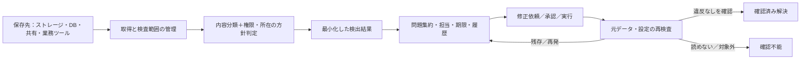

# ストレージ等を監視し、機密データをSentryのように警告するシステムの比較

調査基準日：2026-10-09。公開公式資料・操作文書・公開実装・論文を並行調査し、担当を入れ替えてレビューした。利用者の構想を「保存先を横断して機密データと不適切な保存状態を検出し、警告を集約し、人への修正依頼・解決確認・再発まで追う」として比較する。特定の非公開リポジトリの実装事実は記載していない。

## 結論：同じ分野の製品はある。中心は保存データの安全管理

**Slack・Drive・GitHubだけでなく、S3等のストレージ、ファイル共有、データベースを検査し、機密情報や公開範囲の問題を警告する既存製品はある。** 最も近いのはDSPM（Data Security Posture Management：データの所在・機密性・アクセス権・危険な保存状態の管理）と、保存データを対象にしたDLP（Data Loss Prevention：機密情報の持ち出し・共有・保存の規則違反を検査・制御する仕組み）。「機密データ版Sentry」という方向性は既存市場と重なる。

直接比較を優先するなら **Teleskope、Sentra、Datadog Sensitive Data ScannerのS3機能、IBM Guardium Exposure Manager、Rubrik DSPM、BigID、Cyera、Varonis**。意味による企業秘密分類にはConcentric AI、顧客環境内処理にはSymmetry DataGuardも重要。機密な値そのものを見つけるだけではなく、置き場所・権限・公開状態を合わせて問題にするものが近い。

[Teleskope問題管理](https://docs.teleskope.ai/the-platform/policy-maker)、[Sentra AWS](https://sentra.io/platforms/aws)、[Datadog S3](https://docs.datadoghq.com/security/sensitive_data_scanner/setup/cloud_storage/)、[IBM問題管理](https://www.ibm.com/docs/en/exposure-manager?topic=managing-issues)、[Rubrik方針評価](https://docs.rubrik.com/en-us/saas/dspm/dsp_policies.html)、[BigID問題API](https://developer.bigid.com/api/data-posture-api-tutorial/)、[Cyera修正](https://www.cyera.com/solutions/remediation)、[Varonis対応先](https://www.varonis.com/coverage)

同じ目的に近いことと、全機能が同一なことは別である。どれか一つが「全保存先・全形式・日本語の任意企業秘密・原文非保持・重複/再発・期限・修正後の再検査」をすべて保証すると、今回の公開資料だけからは判断できない。

## 優先して調べる比較対象

順位は実測精度や購入推奨ではなく、構想への機能上の近さと公開仕様の具体性から選んだ調査優先度。

| 比較対象 | 近い理由 | Sentry型の運用で確認できた部分 | 境界・要確認 |
|---|---|---|---|
| **Teleskope** | S3・複数クラウド・DB・SMB共有・業務クラウドを横断 | 問題状態、所有者通知、Jira、待機、修正手順 | 状態変更と再検査保証は別。標準Outpostは抽出平文を遠隔処理へ送る。顧客内GPU分類は別条件 |
| **Sentra** | 複数保存先の機密分類と危険な所在/権限 | 警告状態・コメント・履歴、再検査要求、変更分検査、検査範囲表示 | 全量/標本の設定を区別。手動終了と修正確認の条件は未確定 |
| **Datadog Sensitive Data Scanner** | 顧客AWS内でS3内容を検査する監視製品 | 保存先/ファイル/所有者。関連設定不備に担当・状態・Jira・修正手順・履歴 | 現行確認範囲はS3。ログ側の集約・代表ログ保存をS3へ一般化しない |
| **IBM Guardium Exposure Manager** | 保存先等の方針違反を問題として管理 | 担当・履歴・外部依頼。保存先側は完了→再検査待ち→違反残存なら未解決 | 端末側は別遷移。例外承認でも解消する。Guardium DSPMと名称/機構を区別 |
| **Rubrik DSPM** | 危険な保存・過剰公開・残存・保護不足 | 方針を継続評価し、新規違反と既存違反の解消を判定 | 方針停止でも閉じる。ライブ保存先検査とバックアップ検査を区別 |
| **BigID** | DB・ファイル・業務クラウドの統合分類 | case・担当・方針・状態の公開API、外部問題管理 | 公式例は外部への書出し後にもresolvedを設定でき、再検査と同義ではない |
| **Cyera** | 複数クラウド・業務クラウドの機密分類と公開検出 | 所有者依頼、上申、修正前確認、権限制限・削除・ラベル・監査 | 機能/配置ごとの本文取得、検出値、再発/期限の具体仕様は要確認 |
| **Varonis** | クラウド・NAS・業務クラウドの保存内容と有効権限 | 公開リンク撤回・権限修正、継続監視 | 顧客内Collectorと原文取得するクラウド処理を区別。機能別の保持例外にも注意 |
| **Concentric AI** | 文書の意味と似た文書の通常権限から企業秘密の危険を検出 | 同種文書の集約・危険の優先化・修正 | 自社SaaSのモデルが本文を読む。氏名・メールは伏字保存の例外。汎用の再発状態契約は未確認 |
| **Symmetry DataGuard** | 保存データと人/機械のアクセスを横断把握 | 危険の可視化と修正、自社環境内配置の公開例 | 再発・重複・期限・検査失敗時の詳細運用契約は未確認 |

詳細な出典・取得条件・原文処理の比較は[ストレージ中心の11機構](telescreen_related_storage_monitoring_20261009.md)、[企業基盤・国内製品](telescreen_related_enterprise_20261009.md)、[業務クラウドを含む10系統](telescreen_related_saas_dlp_20261009.md)に記載。

## 全体をどう分けるか

| 系統 | 今回比較した対象 | 構想への位置付け |
|---|---|---|
| 保存データ・権限・危険の管理 | Sentra、Teleskope、Concentric AI、Symmetry、Securiti、Rubrik、IBM、Cortex Cloud、Wiz、BigID、Cyera、Varonis、Cyberhaven、Netwrix各系統 | 最も直接近い。内容分類とアクセス/所在の方針を組み合わせる |
| クラウド提供者の保存検査 | Amazon Macie、Google Sensitive Data Protection、Microsoft PurviewのData Map/DSPM/DLP | 同じ目的の構成要素または統合製品。検査器・通知・問題台帳の境界を確認する |
| 業務クラウド中心の保存DLP | Nightfall、Strac、elba、Metomic、MIND、Polymer | 直接近い部分がある。S3/DB/自社ファイルへの対応は製品・接続先別 |
| 認証情報の漏洩問題管理 | GitGuardian、TruffleHog Enterprise | 出現箇所の集約・修正・再発の比較に有用。PIIや企業秘密一般を同じ検出器で扱うと推測しない |
| 自社実行の検出器・結果管理 | TruffleHog、Gitleaks、detect-secrets、Presidio、DefectDojo、OpenMetadata、DataHub | 組合せて構築する候補。検出器と完成した警告運用製品は別 |
| 国内の保存ファイル検査 | P-Pointer File Security、InterSafe PIS、すみずみ君、Log360 | 日本の識別子とPC/ファイル共有の巡回。重複/再発/期限の仕様は要確認 |
| 通信・端末・メールを含む統合DLP | Netskope、Forcepoint、Proofpoint、Harmonic、Candor | 保存検査を含む製品もあるが、通信遮断や人物の行動調査と目的を区別する |
| 監視・ログ内の機密情報 | Datadog Sensitive Data Scanner、Datadog Observability Pipelines、CloudWatch Logs data protection | Datadog S3は直接候補。ログのみの処理は隣接。Sentryは問題運用の参考 |
| 歴史的/関連参考 | OpenDLP、MyDLP、Gamma.AI、Cloud Custodian、Prowler | 保守・買収・対象の違いを明示。公開設定検査だけでは本文分類を意味しない |

表は製品・機構・部品・参考を含む探索範囲であり、独立企業数でも購入候補数でもない。PISとすみずみ君は検出機構が共通。Gamma.AIはPalo Alto Networksへ統合済み。DataHubでは旧標準PII分類器が現行固定版で削除されており、古い資料の機能を現行搭載として扱わない。Metomicの現行サイトはAIへの通信制御に重点を移し、CyberhavenとDatadogは保存検査を確認できたため、以前の分類をそのまま使わなかった。

[公開実装・研究の比較](telescreen_related_oss_and_research_20261009.md)、[企業製品の現行対応](telescreen_related_enterprise_20261009.md)、[業務クラウド製品の変更](telescreen_related_saas_dlp_20261009.md)

## 「Sentryのように」を分解すると、差が見える

図は公開比較に基づく設計案であり、特定製品の内部構成ではない。

| 比較軸 | 確認すべきこと | 公開資料から得た例 |
|---|---|---|
| 何を危険とするか | 機密データの存在か、場所/権限/公開との不一致か | DSPMは後者を扱う。許可された個人情報DBにPIIがあるだけで事故とは限らない |
| 同一問題の集約 | 規則、資産、同じ値の別コピー、再配送、版変更をどう分けるか | Nightfallはイベント重複管理。GitGuardianは秘密の出現を集約。Macieの機密findingは検出ごとに新規 |
| 再発 | 終了後に同じ問題へ戻るか、新しい問題になるか | Sentry・GitGuardian・DefectDojoが参考。製品ごとに同一性の定義は違う |
| 担当と期限 | 所有者不明時の責任者、期限超過、通知漏れをどう扱うか | elbaの利用者作業追跡、Teleskopeの所有者通知と待機、IBMの担当/履歴 |
| 修正の証明 | 画面を閉じる操作と原本再検査を区別できるか | IBM保存先側のPending scan、Rubrikの継続評価。BigIDの外部書出し後resolvedは別の意味 |
| 検査の網羅性 | 全件/標本、読取り深度、暗号化・画像・巨大ファイル、失敗を表示するか | Sentraの検査範囲、Macieの標本、国内検出器の未対応形式 |
| 証拠をどこへ残すか | 一致値、周辺本文、ファイル名、通知、ログ、退避、バックアップ | Workspace DLP snippetは元内容削除後も残る。DefectDojoのGitleaks取込みも原秘密を保存し得る |
| 通知の信頼性 | 検出の再取得、再配送の重複排除、停止検知、未検査を安全としないこと | Macie→EventBridgeは最善努力配送。イベント通知のみで網羅性を保証しない |

根拠と条件は各詳細稿を参照。[Sentryの状態](https://docs.sentry.io/product/issues/states-triage/)、[Macie結果の違い](https://docs.aws.amazon.com/macie/latest/user/findings-publish-event-schemas.html)、[Workspace証拠保持](https://knowledge.workspace.google.com/admin/security/view-content-that-triggers-dlp-rules)

## 原文をAIに送らない設計について

**局所検査で結果だけを外に出す既存例もある。これだけでは独自性にならない。** Datadog S3、Sentraの公開説明、Symmetryの顧客AWS配置、CyeraのOutpost方式は比較対象。ただし原文非送信は、元データを暗号文のまま分類する意味ではない。信頼する検査器は本文を読み、外へ渡す結果を小さくする方式である。

対照的にTeleskope標準Outpostは抽出平文を遠隔分類へ送る。Concentricは第三者AIサービスを使わなくても自社SaaSで本文を読む。Varonisも配置・機能で処理経路が異なる。原文を保存しないこと、原文を外へ送らないこと、AIの学習に使わないこと、検査器も平文を読まないことは別条件。

[Datadog処理境界](https://docs.datadoghq.com/security/sensitive_data_scanner/setup/cloud_storage/)、[Symmetry AWS](https://aws.amazon.com/blogs/apn/cloud-native-data-security-posture-management-deployments-on-aws-with-symmetry-systems/)、[Teleskope Outpost](https://docs.teleskope.ai/setup/deployment/outpost)、[Concentric FAQ](https://concentric.ai/wp-content/uploads/2025/06/AI_FAQs_June2025-Mary-B.pdf)、[Varonis security](https://www.varonis.com/trust/security)

LLMは必須ではない。PIIの既知形式や認証情報は正規表現・辞書・チェックサム・統計・専用分類器で検出し、企業秘密の意味や宛先/保存先との整合性に文脈分類を追加できる。局所LLMが常に高精度とはいえず、日本語と自社の文書で適合率（警告のうち本当の違反の割合）・再現率（本当の違反を検出した割合）・処理費用・見逃しを評価する必要がある。

ゼロ知識証明は、決めた処理や条件を秘密を明かさず証明する技術。機密性の定義、対象の全件性、実際に削除されたことまで自動的に保証するものではない。今回の直接製品群で暗号文だけによる任意企業秘密の意味分類を標準機能として確認できなかった。[平文非開示分類](confidentiality_classification_without_plaintext_20261007.md)、[ゼロ知識証明等](zero_knowledge_sensitive_data_research_20261007.md)、[軽量分類モデル](bert_jev_local_decision_models_20261007.md)

## 公開実装と関連研究から構築するなら

構成の候補は、**保存先別の取得処理＋TruffleHog/Gitleaks等の認証情報検出＋Presidioや専用分類器＋安全な結果への変換＋DefectDojo等の問題管理＋修正後検査**。完成品と同じ範囲になるには、変更の追跡、アクセス方針、所有者、検査失敗、再発の同一性を追加する必要がある。

公開コードの確認では、局所実行でも原秘密を出力・保存・認証先へ送信する経路があった。TruffleHog公開版の標準出力、Gitleaksの伏字の既定値、detect-secretsの外部有効性確認、DefectDojoの取込み、IssueGuardのログ等である。「ローカル」「ハッシュ」「伏字」という名称だけで、全経路の原文不保持を保証しない。

研究では、IssueGuardがGitHub issuesの秘密検出、RiskHarvesterが漏れた秘密の危険度、AssetHarvesterが秘密と資産の関連を扱う。検出候補を選ぶ精度と秘密の分類精度、最新コードと過去履歴の評価範囲を分ける。自社の多種保存先に対する汎用DSPMの実証ではない。[固定コード・論文全文の分析](telescreen_related_oss_and_research_20261009.md)

## 開発上の差別化仮説

以下は公開比較からの提案。市場にない機能だという断定でも、特定の非公開実装の仕様でもない。

1. **小規模な自社配置と接続の追加を容易にする。** 大規模な統合DLP契約に依存せず、オブジェクト保存・ファイル・DB・業務ツールの結果を共通の問題形式へ集める。
2. **原文非保持を経路単位で確かめる。** 管理画面だけでなく、検査器出力・一時展開・通知・モデル呼出し・ログ・問題台帳まで、機密な値を残さないことを試験する。ファイル名や所有者情報も対象にする。
3. **終了理由を明示する。** 確認済み修正、危険受容、誤検出、規則停止、権限切れ、検査不能を別状態/理由にし、再検査の証拠を残す。
4. **警告疲れと未検査を同時に扱う。** 同じ問題の再検出をまとめつつ、標本未選択・処理停止・読取り失敗を「安全」にしない。再発とコピーの増加を分けて表示する。
5. **日本語の企業秘密を評価する。** マイナンバー等の既知形式と、未公開財務・顧客契約・設計文書等の意味分類を分け、自社の方針違反として評価する。

比較試験では、公開/合成データで「同じ検出の再配送」「別コピー」「修正後再発」「方針の例外追加」「検査権限を失う」「暗号化ファイル」「日本語の同じ意味で異なる表現」「通知失敗」「問題台帳に原秘密が残る」を試すと、単純なデモでは見えない違いが分かる。

## 保存物と調査の限界

- [ストレージ中心の比較](telescreen_related_storage_monitoring_20261009.md)と[取得台帳](telescreen_related_storage_sources_20261009.json)
- [企業基盤・国内製品](telescreen_related_enterprise_20261009.md)と[取得台帳](telescreen_related_enterprise_sources_20261009.json)
- [業務クラウドの10系統](telescreen_related_saas_dlp_20261009.md)と[取得台帳](telescreen_related_saas_sources_20261009.json)
- [公開実装と研究](telescreen_related_oss_and_research_20261009.md)と[取得台帳](telescreen_related_oss_sources_20261009.json)
- [比較表CSV](telescreen_related_systems_comparison_20261009.csv)・[JSON](telescreen_related_systems_comparison_20261009.json)
- [レビュー記録](telescreen_related_review_summary_20261009.md)・[保存資料の検証](telescreen_related_verification_20261009.json)

原本は `research/disclosures/raw/telescreen_related_20261009/` に保存。原本をGitで管理するかどうかは既存の除外設定に従い、台帳と日本語の調査結果を共有可能な成果物とする。HTTP成功でもログイン画面や本文なしを区別し、未取得の全文を取得済みと数えない。

公開説明・公開コード・論文の評価を調べたものであり、有償環境の実操作、秘密を使った有効性確認、非公開顧客情報、実機の負荷・精度・通信監査は行っていない。独立レビューはこれらの実証に代わるものではない。機能の不在や各製品の精度順位を断定せず、導入・実装時の確認事項を示した。
